# OBD1 Honda ECU Hardware for Boost-by-Gear Control

## Overview

Integrating boost-by-gear control into an OBD1 Honda ECU requires specific hardware modifications to the circuit board. These modifications enable the ECU's programmable logic to control an external boost control solenoid, allowing for precise, gear-dependent boost pressure management. This article details the necessary components and their typical installation points on common OBD1 ECUs, such as the P28.

```carousel
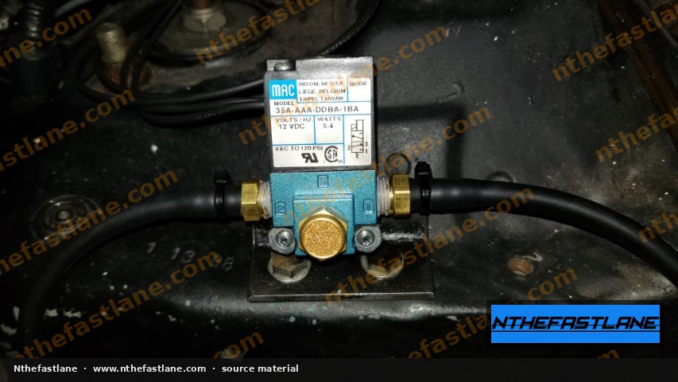
<!-- slide -->
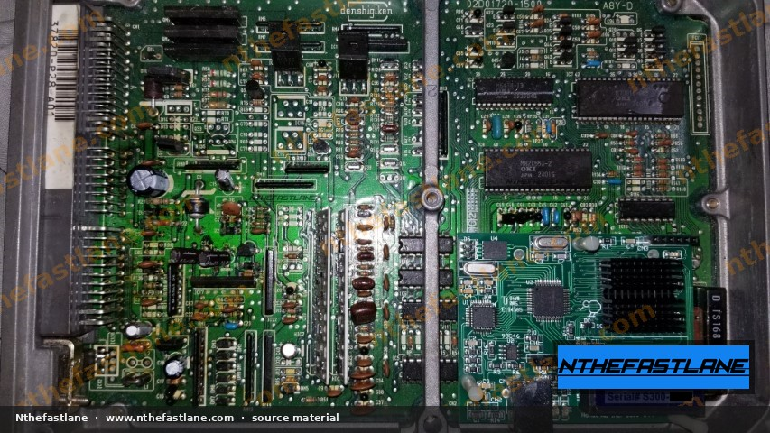
<!-- slide -->
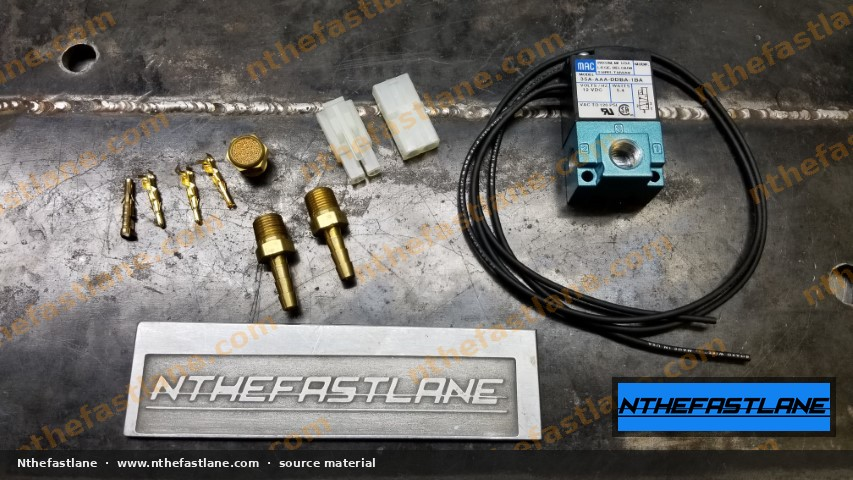
<!-- slide -->
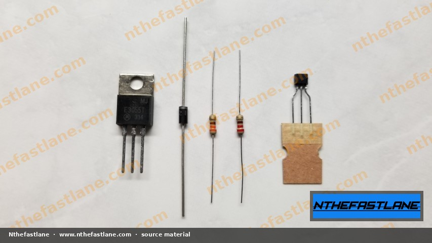
<!-- slide -->
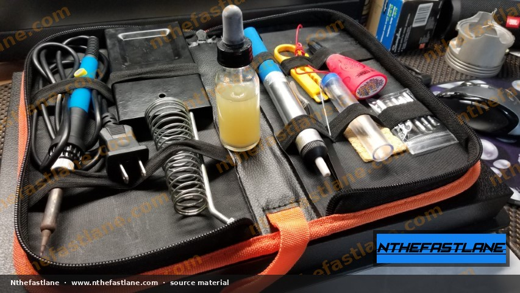
<!-- slide -->
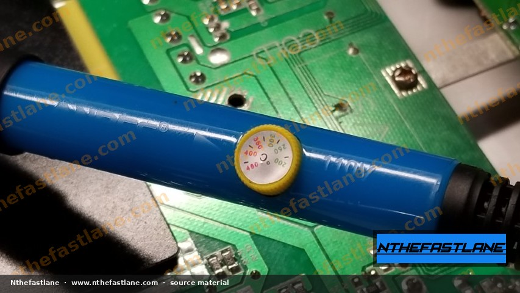
<!-- slide -->
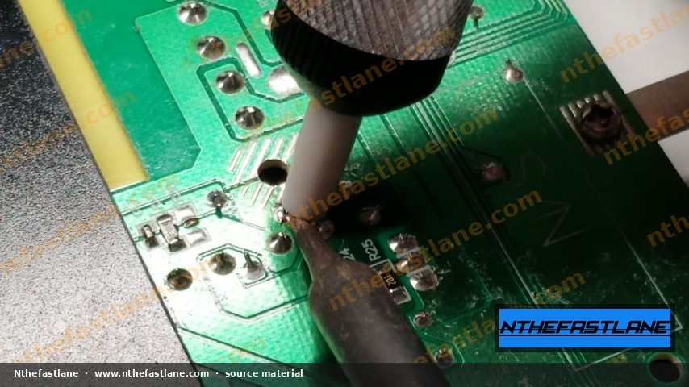
<!-- slide -->
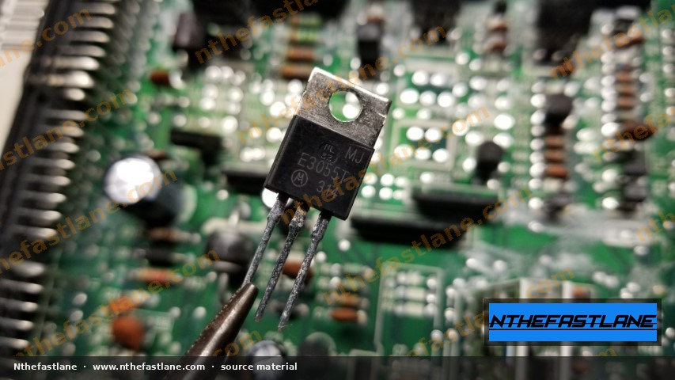

```

```carousel
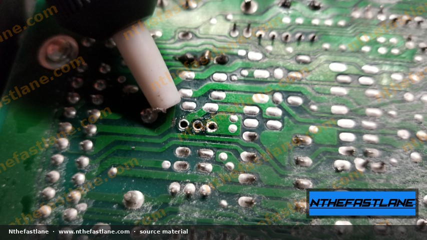
<!-- slide -->
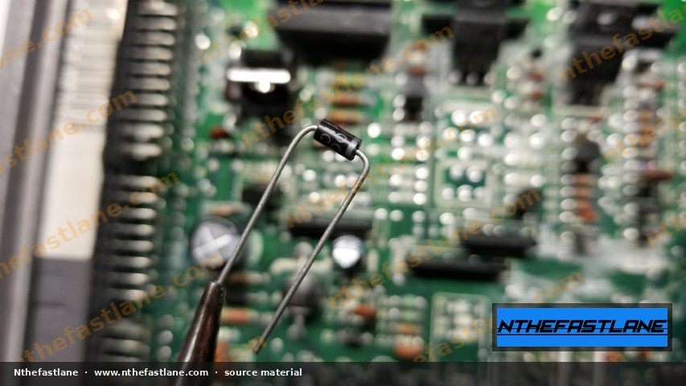
<!-- slide -->
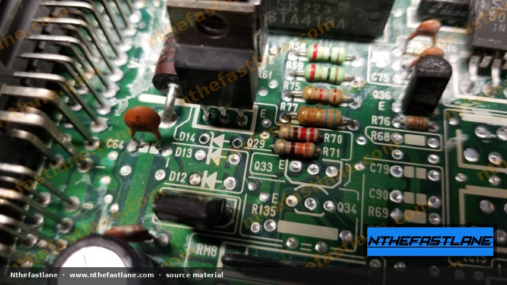
<!-- slide -->
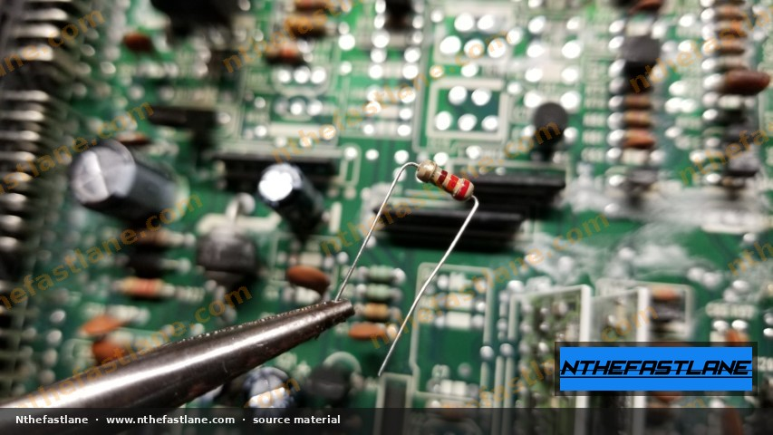
<!-- slide -->
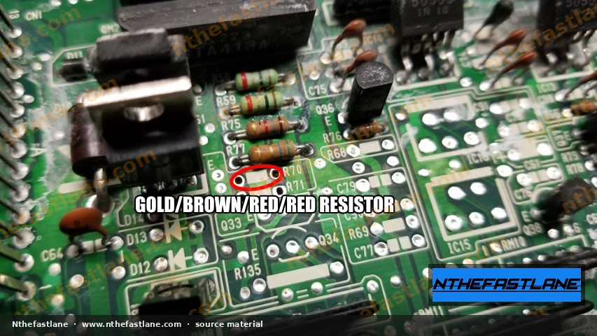
<!-- slide -->
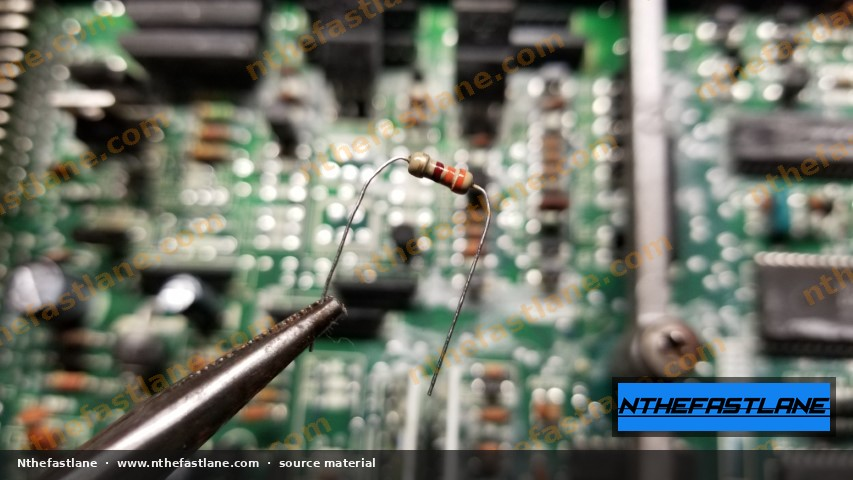
<!-- slide -->
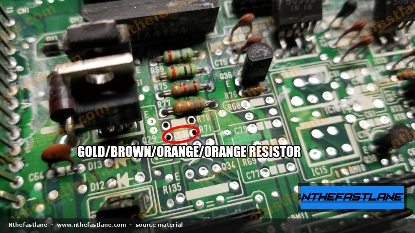
<!-- slide -->
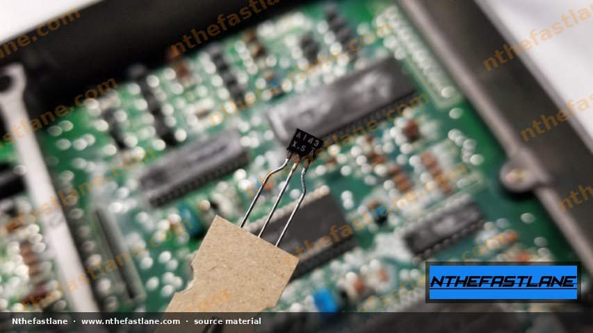

```

```carousel
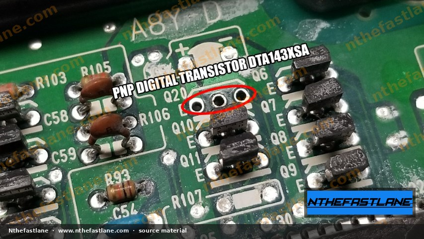
<!-- slide -->
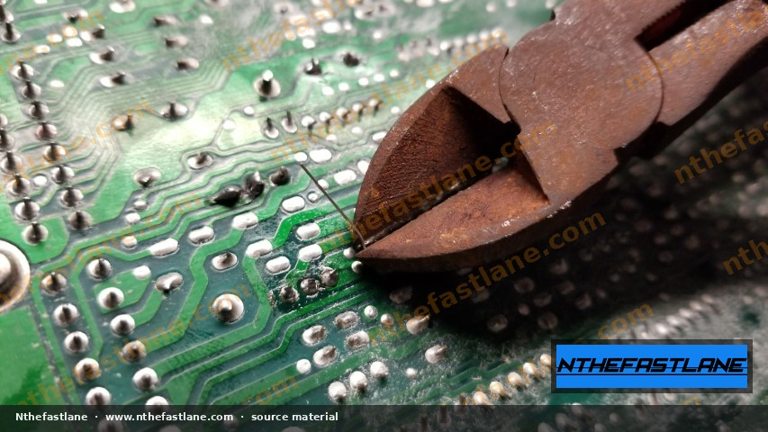
<!-- slide -->
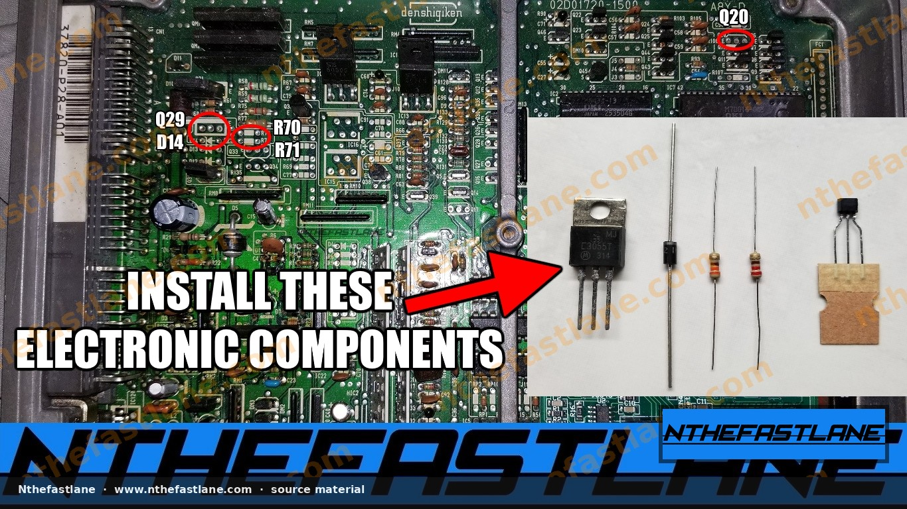
<!-- slide -->
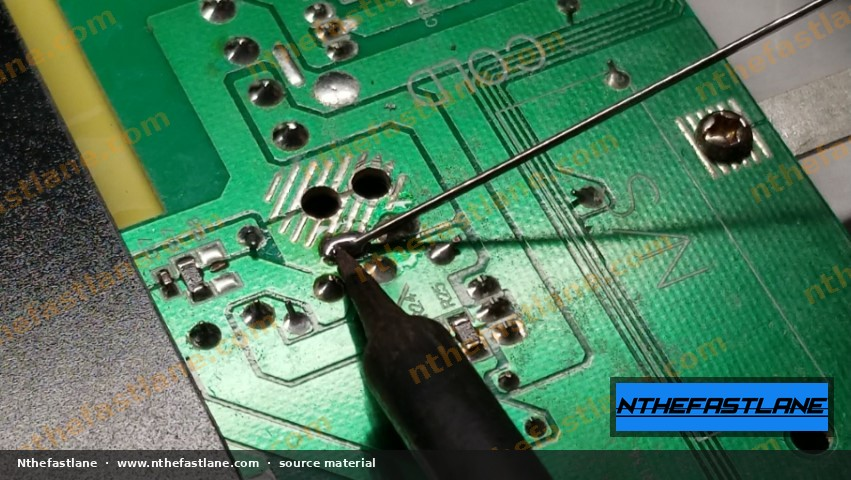

```

## Required Hardware Modifications

To enable boost-by-gear functionality, several electronic components must be added to the ECU's printed circuit board (PCB) to create a driver circuit for the external boost control solenoid.

The primary components typically include:

*   A high-current switching transistor (power transistor)
*   A flyback diode for solenoid protection
*   Current-limiting and/or pull-up resistors
*   A pre-driver or logic-level transistor (digital transistor)

## Component Identification and Placement

Modifications are generally performed in specific unpopulated areas of the ECU PCB designed for optional features or alternative component configurations. The `37820-P28-A01` ECU is a common platform for these modifications.

> [!IMPORTANT]
> Always confirm component locations, values, and orientations against the specific ECU's factory service manual or a verified reference before proceeding with any modifications. Component layouts can vary slightly between ECU revisions.

### Boost Control Solenoid Driver Circuit

The core of the boost control hardware involves a power transistor and its supporting components, which switch the 12V supply to the external solenoid based on signals from the ECU's main processor.

*   **Power Transistor (Q29):** This is typically a TO-220 package NPN power transistor, such as an **MJ C3055T** or **E3055T**. It is responsible for switching the high current required by the boost control solenoid.
*   **Flyback Diode (D14):** A diode, often with a black band indicating cathode, is installed in parallel with the solenoid driver to protect the transistor from voltage spikes when the solenoid de-energizes.
*   **Resistors (R70, R71):** These are commonly **220 Ohm, 5%** resistors, identifiable by their **Red, Red, Brown, Gold** color bands. They typically serve as base resistors for the power transistor, controlling the current flow to its base.
*   **Pre-Driver Transistor (Q20):** A smaller transistor, such as a **PNP Digital Transistor DTA143XSA**, may be used as a pre-driver or logic-level shifter, interfacing the ECU's microcontroller output with the base of the power transistor (Q29).
*   **Other Resistors:** A **1.2 kOhm, 5%** resistor (Brown, Red, Red, Gold) may be present in related circuits (e.g., **R25**). Its exact function should be confirmed with the ECU's schematic.

```wirelist
{
  "title": "Typical Boost Control Circuit Components (P28 ECU)",
  "variants": [
    {
      "id": "p28-boost",
      "label": "P28 ECU",
      "groups": [
        {
          "label": "Solenoid Driver",
          "rows": [
            { "pin": "Q29", "signal": "Solenoid Driver", "path": "NPN Power Transistor (e.g., MJ C3055T)", "note": "Switches 12V to external solenoid" },
            { "pin": "D14", "signal": "Flyback Diode", "path": "Diode (e.g., 1N400x series)", "note": "Protects Q29 from inductive kickback" },
            { "pin": "R70, R71", "signal": "Base Resistors", "path": "220 Ohm, 5% (Red, Red, Brown, Gold)", "note": "Limits current to Q29 base" },
            { "pin": "Q20", "signal": "Pre-Driver", "path": "PNP Digital Transistor (e.g., DTA143XSA)", "note": "Interfaces MCU with Q29" }
          ]
        },
        {
          "label": "Auxiliary Components",
          "rows": [
            { "pin": "R25", "signal": "Input/Pull-up", "path": "1.2 kOhm, 5% (Brown, Red, Red, Gold)", "note": "Function requires FSM confirmation" }
          ]
        }
      ]
    }
  ]
}
```

## External Boost Control Solenoid

An external 3-port boost control solenoid is required to regulate turbocharger wastegate pressure. A common choice is the **MAC Valve Model 35A-AAA-DDBA-1BA**.

### Solenoid Specifications

*   **Type:** 3-port, typically normally closed (NC) in boost control applications.
*   **Voltage:** 12 VDC
*   **Power Consumption:** Approximately 5.4 to 5.8 Watts
*   **Pressure Range:** Operates up to 120 PSI (VAC to 120 PSI)

### Solenoid Plumbing

The solenoid typically connects as follows:

*   **Port 1:** Connects to the pressure source (e.g., turbocharger compressor outlet).
*   **Port 2:** Connects to the wastegate actuator.
*   **Port 3:** Vented to atmosphere (or routed to the turbocharger inlet for closed-loop systems).

## Installation Considerations

> [!CAUTION]
> Soldering involves working with lead-containing solder (e.g., Sn60/Pb40). Ensure adequate ventilation and wash hands thoroughly after handling.

*   **ESD Protection:** Always use proper electrostatic discharge (ESD) precautions when handling ECU PCBs to prevent damage to sensitive components.
*   **Soldering:** Use a fine-tip soldering iron and appropriate rosin core solder. Ensure clean, strong solder joints without bridging adjacent pads.
*   **Component Orientation:** Pay close attention to the polarity of diodes and transistors. Incorrect orientation will prevent the circuit from functioning and may cause damage.
*   **Wiring:** The external solenoid connects to the ECU's modified output. Confirm the correct pin on the ECU connector for the solenoid signal by consulting the factory service manual.

## Verification and Tuning

After hardware installation, the ECU requires custom firmware to utilize the new boost control circuit.

*   **Chipped ECU:** The ECU must be chipped to accept custom tuning software (e.g., Hondata S300, which is often installed on these ECUs).
*   **Software Calibration:** The tuning software allows for setting boost targets per gear, adjusting solenoid duty cycles, and configuring safety parameters.
*   **Monitoring:** Use a wideband oxygen sensor for accurate air-fuel ratio (AFR) monitoring during tuning.
*   **Professional Tuning:** Dyno tuning by an experienced professional is highly recommended to ensure safe and optimal performance.
