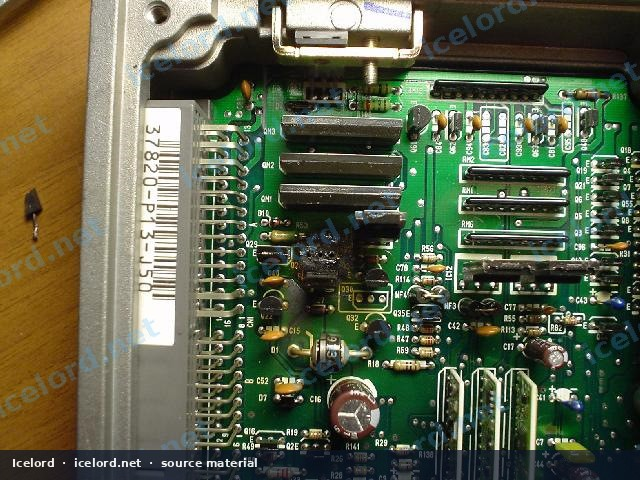
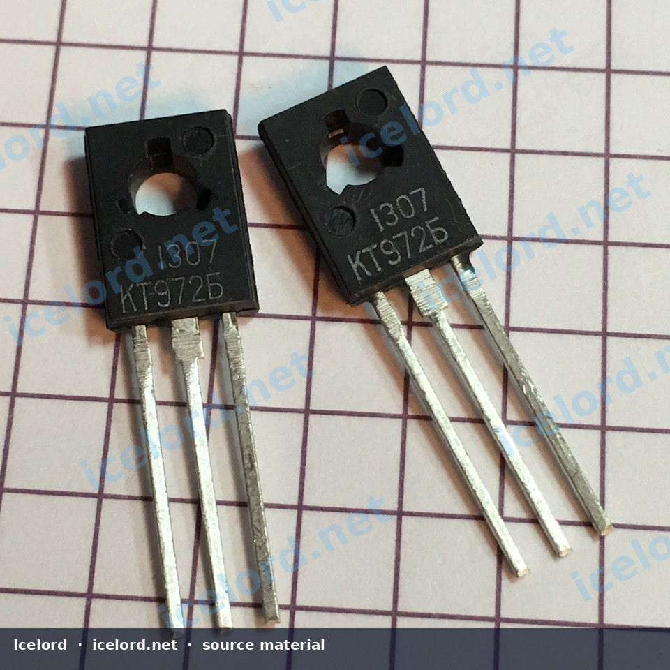
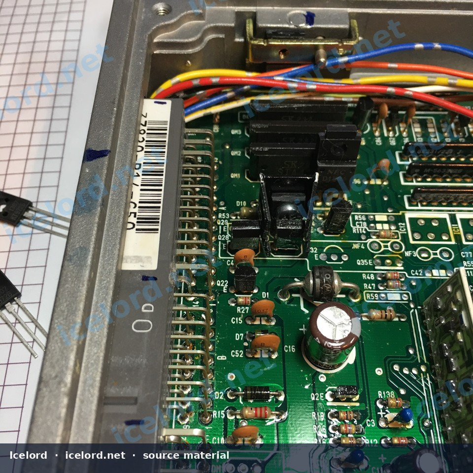
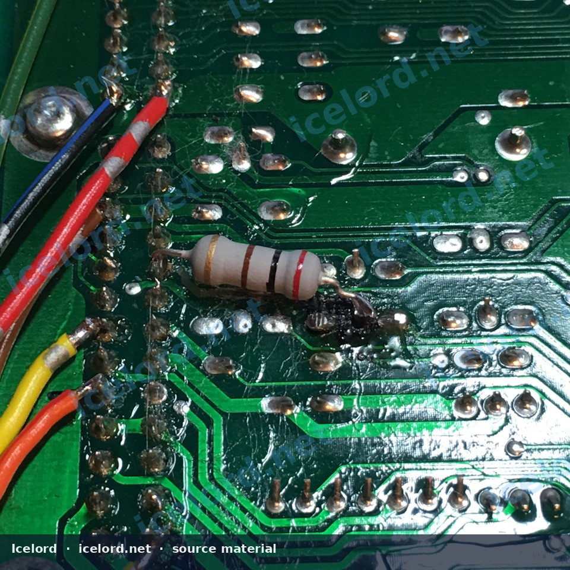

# Honda OBD1 ECU Solenoid Driver Transistor Diagnosis and Repair

Many Honda OBD1 Engine Control Units (ECUs) are susceptible to failure of the solenoid driver transistor, a common issue that can lead to various engine performance problems. This article outlines the diagnosis and repair procedure for this specific component failure.

```carousel

<!-- slide -->

<!-- slide -->

<!-- slide -->


```

## Understanding the Solenoid Driver Transistor

The solenoid driver transistor, commonly identified as a D1780 or 2SD1780, is a compound (Darlington) transistor responsible for controlling high-current components such as the VTEC solenoid or Intake Air Bypass (IAB) electro-vacuum solenoids. Its function is to switch 12-volt power to these solenoids based on signals from the ECU's main processor. When this transistor fails, the controlled solenoid will cease to operate correctly.

## Symptoms of a Failed Solenoid Driver

Failure of the solenoid driver transistor typically manifests as:

*   **VTEC System Malfunction:** No VTEC engagement, leading to reduced high-RPM power, or a Check Engine Light (CEL) for VTEC-related codes (e.g., P1259).
*   **IAB System Malfunction:** Incorrect operation of intake manifold runner control, potentially affecting engine torque at specific RPMs.
*   **Check Engine Light (CEL):** Activation of the CEL with codes related to the affected solenoid circuit.
*   **Visible Damage:** In severe cases, a burnt smell or visible charring on the ECU circuit board around the transistor.

## Diagnosis

### Visual Inspection

Often, a failed solenoid driver transistor will show clear signs of damage. Carefully inspect the ECU circuit board, particularly around the D1780/2SD1780 transistor, for:

*   **Discoloration:** Burnt or darkened areas on the PCB.
*   **Component Damage:** A visibly scorched, cracked, or melted transistor body.
*   **Solder Joint Issues:** Overheated or damaged solder pads.

> [!CAUTION]
> Always disconnect the ECU from the vehicle's power supply before performing any inspection or repair to prevent electrical shock or further damage.

### Identifying the Component

The problematic transistor is typically labeled D1780 or 2SD1780. It is a three-pin component often located near the edge of the ECU board, close to the main connectors. The primary cause of its failure is excessive current flow through the solenoid circuit, which can be due to a short in the solenoid itself or its wiring.

## Repair Procedure

Replacing the failed transistor requires basic soldering skills and appropriate tools.

### Required Tools and Materials

*   Soldering iron (fine tip recommended)
*   Desoldering pump or desoldering braid
*   Flux
*   Solder (rosin core, leaded or lead-free compatible with existing solder)
*   Multimeter (for continuity and resistance checks)
*   Replacement transistor (KT972B or equivalent)
*   Optional: Small heat sink for the new transistor
*   Optional: 10-20 Ohm current-limiting resistor (for added protection)
*   Isopropyl alcohol and cotton swabs (for cleaning)

### Replacement Transistor Selection

The original D1780 (2SD1780) transistor typically has a current rating of 2 Amperes (A) and a voltage rating of 45 Volts (V).

A suitable replacement is the **KT972B** transistor. This component offers improved specifications, typically rated for 3A and 45-60V, providing a higher safety margin against future failures. The KT972B is pin-compatible with the original D1780, simplifying the replacement process.

> [!IMPORTANT]
> While the KT972B is a widely accepted replacement, always confirm its specifications and pinout against the factory service manual or component datasheets to ensure compatibility and safe operation.

### Installation Steps

1.  **Preparation:** Ensure the ECU is completely disconnected from power. Place the ECU on a clean, static-safe work surface.
2.  **Locate and Document:** Identify the damaged D1780/2SD1780 transistor. Take a clear photograph of its orientation and surrounding components for reference.
3.  **Desolder the Old Transistor:** Apply flux to the pins of the old transistor. Using a desoldering pump or braid, carefully remove the solder from each of the three pins. Gently pry the transistor free once all solder is removed.
4.  **Clean the Area:** Use isopropyl alcohol and a cotton swab to thoroughly clean any residual flux or burnt material from the PCB pads and surrounding area.
5.  **Prepare the New Transistor:** If using an optional heat sink, attach it to the KT972B transistor now. If adding an optional 10-20 Ohm current-limiting resistor, solder it in series with the transistor's collector pin (the middle pin) before installing the transistor onto the board. Confirm the resistor's value against the factory service manual for the specific solenoid circuit if exact specifications are available.
6.  **Install the New Transistor:** Carefully align the KT972B transistor with the PCB pads, ensuring correct orientation (refer to your photograph or markings on the PCB). Insert the pins through the holes.
7.  **Solder the New Transistor:** Solder each pin securely to the PCB pads. Use a small amount of flux and ensure strong, shiny solder joints. Avoid excessive heat to prevent damage to the transistor or PCB traces.
8.  **Final Inspection:** Visually inspect all solder joints for bridges, cold joints, or other imperfections. Clean any remaining flux residue with isopropyl alcohol.

> [!TIP]
> Consider inspecting the solenoid (VTEC or IAB) itself for shorts or excessive resistance, as a faulty solenoid can cause the driver transistor to fail again. Consult the factory service manual for correct solenoid resistance specifications.

## Verification

After completing the repair:

1.  **Bench Test (Optional):** If you have the equipment, perform a basic continuity test on the repaired circuit to ensure no shorts or open circuits.
2.  **Vehicle Test:** Reinstall the ECU into the vehicle. Start the engine and check for proper operation of the VTEC or IAB system. Monitor for any Check Engine Lights and clear any stored fault codes.
3.  **Extended Monitoring:** Drive the vehicle under conditions that would normally trigger the VTEC or IAB system to confirm consistent and correct operation.

> [!WARNING]
> If the issue persists or the new transistor fails, immediately disconnect the ECU and investigate potential external causes, such as wiring shorts or a faulty solenoid, to prevent repeated component damage.
