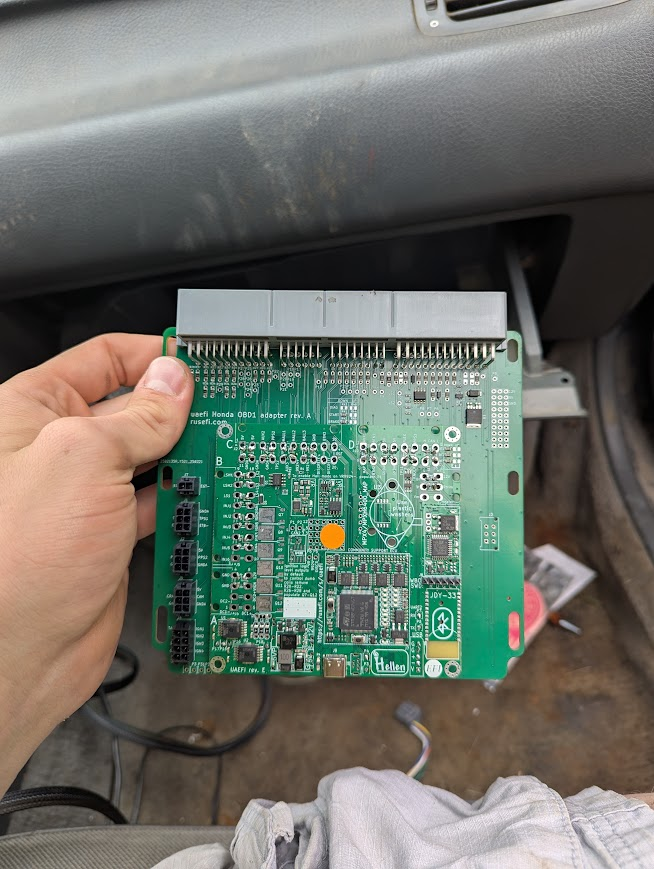
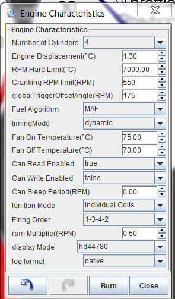

# Honda Distributor to Coil-on-Plug (COP) Ignition Conversion Guide

## Overview

Factory Honda distributor internal ignition coils and igniters (ICMs) are prone to heat breakdown under high RPM and boost. Converting to **Coil-on-Plug (COP)** using modern 4-wire K20/K24 smart coils improves spark energy, eliminates distributor cap wear, and allows full sequential ignition timing control.

---

## 1. Recommended Coils & Pinouts

### Honda K20A / K24A Smart Coils (Denso 30520-RRA-007)

| Coil Pin | Wire Purpose | Connection Site |
| --- | --- | --- |
| Pin 1 | Ignition Switched Power (+12V) | +12V Switched Fuse / Main Relay |
| Pin 2 | Logic Ground | Cylinder Head Ground Stud |
| Pin 3 | ECU Signal Trigger | Standalone ECU Ignition Output (Ign 1-4) |
| Pin 4 | Power Ground | Engine Block / Main Ground |

---

## 2. Distributor Modification & Igniter Bypass

1. Remove the factory internal ignition coil and igniter module from inside the distributor housing.
2. Retain the internal VR sensors (CKP, TDC, CYP) and distributor shaft to serve purely as the engine position trigger.
3. Route 4 individual 5V logic signal wires from your ECU's ignition outputs (`Ign 1`, `Ign 2`, `Ign 3`, `Ign 4`) to each corresponding cylinder's coil plug.

> \[!IMPORTANT\] Configure ignition outputs for **5V Logic Level Output** (Active High / Falling Edge trigger depending on ECU hardware). Incorrect polarity will cause thermal overload of the coil internal igniter.

---

## 3. Recommended Dwell Settings

| Battery Voltage | Recommended Dwell Time |
| --- | --- |
| 12.0 V | 3.2 ms |
| 13.5 V | 2.5 ms |
| 14.5 V | 2.2 ms |

---

## 4. Hardware Installation & Coil Mounting

*D-series coil-on-plug conversion plate and Denso smart coil mounting setup.*

---

## 4. Hardware Installation & Wiring Schematics

*D-series coil-on-plug conversion plate and Denso smart coil mounting setup.*

### Sequential Coil & VTEC Wiring Schematic

*Coil-on-plug 5V logic signal wiring and VTEC output trigger schematic.*

### Harness Connector Detail

*Factory harness plug reference for ignition signal tap.*
