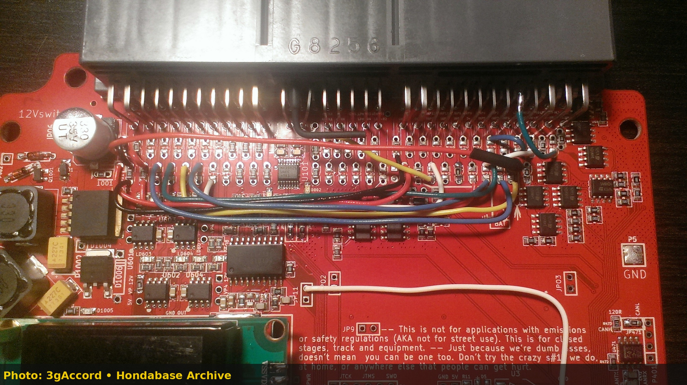
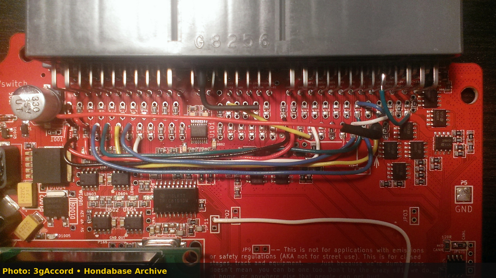

# Honda OBD1 (1992-1995) Standalone ECU Wiring & Plug-and-Play Adapter Pinouts

## Overview

1992-1995 Honda OBD1 vehicles (EG Civic, DC2 Integra, CB7 Accord) use a 3-plug ECU interface (Connectors A, B, and D). This reference covers wiring standalone ECUs directly to factory OBD1 Honda harness plugs.

---

## 1. Primary Connector Pinouts (Plugs A, B, D)

### Connector A (26-Pin Main Connector)

| Pin | Function | Sensor / Actuator |
| --- | --- | --- |
| A1 | Fuel Pump Relay Ground | Main Relay Pin 7 |
| A7 | FLR Output | Fuel Injector #1 |
| A8 | FLR Output | Fuel Injector #2 |
| A3 | FLR Output | Fuel Injector #3 |
| A5 | FLR Output | Fuel Injector #4 |
| A25 | Power Ground | Engine Ground Stud |

---

## 2. Plug-and-Play ECU Board Assembly

```carousel

*Frankenso 0.4 Honda OBD1 plug-and-play adapter board header assembly.*
<!-- slide -->

*Frankenso 0.4 Honda OBD1 adapter board overview showing header pin soldering.*
```
