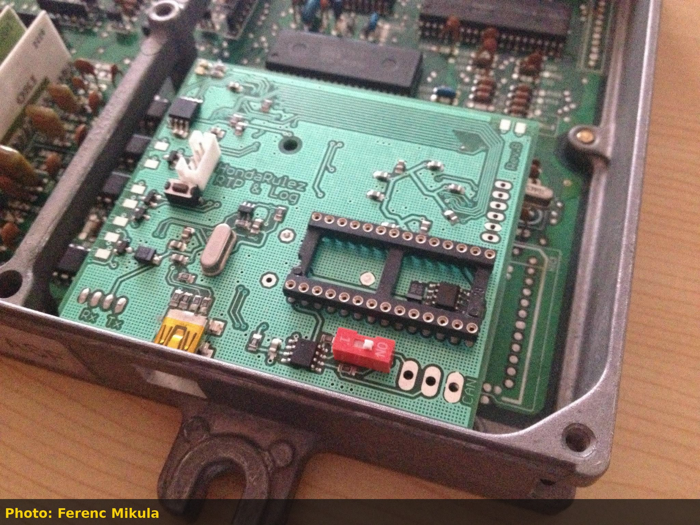
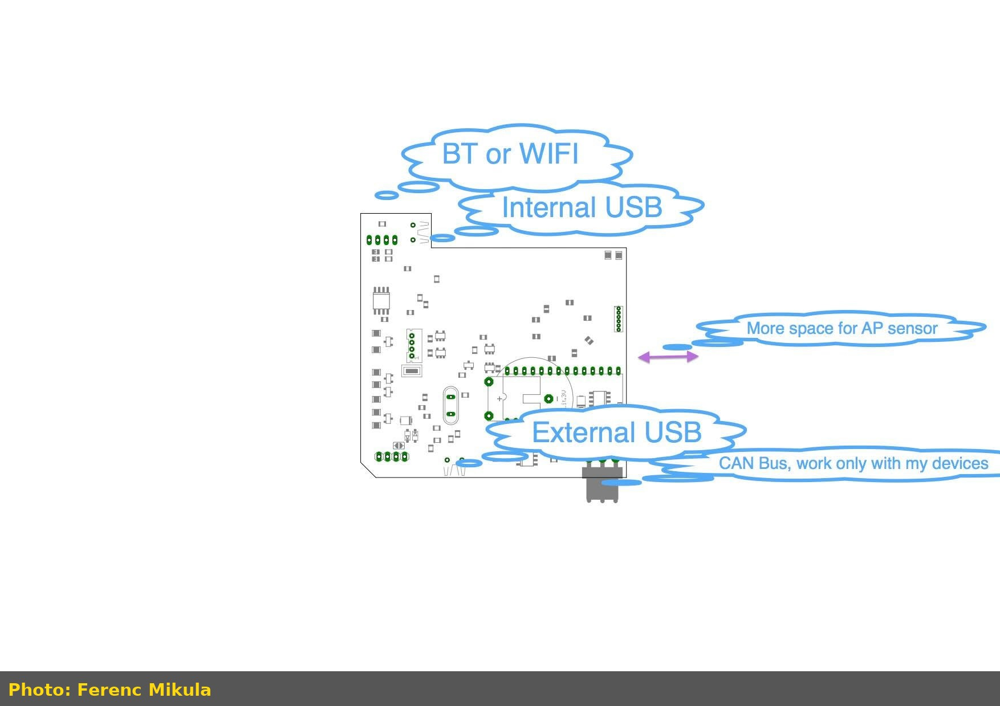
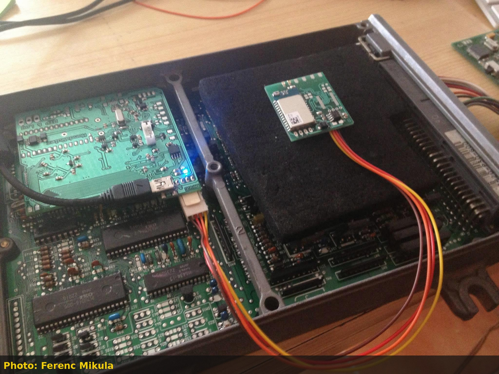

# HondaRulez COP/RCM Standalone Coil-On-Plug Driver: History, Pinouts, and Install

Honda's factory distributor bundles three jobs into one housing: crank/cam position sensing, coil energy storage, and igniter switching. Deleting the distributor for coil-on-plug (COP) ignition normally means either running dumb coils off a standalone ECU's own logic-level outputs, or fitting smart coils that carry their own igniter. The **COP Controller** and its successor, the **RCM II**, take a third approach: a dedicated driver board sits between the ECU's single ignition trigger (or its own decoded crank/cam signal) and up to 8 coil outputs, handling cylinder sequencing and coil switching itself. It was designed by Hungarian hobbyist Ferenc Mikula (posting under the handle "HondaRulez") and documented through his own site and, later, his Facebook group.

> [!NOTE]
> This covers the standalone driver-board approach. For wiring 4-wire K-series smart coils directly to a standalone ECU's ignition outputs instead, see the [Honda distributor to coil-on-plug conversion guide](/cars/electronics/honda-distributor-to-coil-on-plug-cop-conversion).

## Origins: the RTP wireless tuning board (2013)

Before the COP driver existed, Mikula built the **RTP** ("Realtime Programming") board: a plug-in module that fits inside a Honda ECU housing alongside the factory board, adding wireless tuning and datalogging to an otherwise stock OBD0/OBD1 ECU.

*RTP & Log Rev.B board installed next to the factory ECU PCB, ribbon-connected into the OBD0 housing (photo: Ferenc Mikula).*

The board exposed two USB virtual COM ports (one for realtime reflashing at up to 920 kbaud, one for datalogging at 38400 baud), a Bluetooth option for mobile logging, and a CAN connector for future expansion boards. An onboard jumper let it run standalone for preloading software without an ECU attached, and a status LED reported errors using the same blink codes as the factory Check Engine Light.

*Early planning sketch of the RTP board's connectivity options: onboard USB, an external USB header, Bluetooth or WiFi, and a CAN bus for accessories (photo: Ferenc Mikula).*

Later revisions added an onboard wireless module wired directly to the RTP board, letting the datalogger talk to an Android app over Bluetooth while the tuning port stayed connected by USB.

*A newer RTP revision under test, with a wireless logging module wired in via a 3-pin header and connected through the ECU's internal USB port (photo: Ferenc Mikula).*

This wireless-first design language, and the CAN bus laid down for "extra HW extension," carried directly into the COP Controller that followed a few months later.

## COP Controller (2014)

The first COP driver board replaced the distributor's ignition module and coil, and it drove up to 4 individual coils directly from a 15-pin connector.

> [!IMPORTANT]
> The distributor's internal ignition module and coil must be physically removed. The COP Controller replaces both.

### COP Controller pinout

| Pin | Signal | Pin | Signal |
| --- | --- | --- | --- |
| 1 | +12V (Blk/Yel) | 9 | GND (-) |
| 2 | Cylinder 4 | 10 | Tach output (Blue) |
| 3 | Cylinder 3 | 11 | Ignition input (Grn/Yel) |
| 4 | Cylinder 2 | 12 | CAN L |
| 5 | Cylinder 1 | 13 | CAN H |
| 6 | Shield for sensor cable | 14 | CYL signal - (White) |
| 7 | CYL signal + (Orange) | 15 | Crank signal - (Blu/Yel) |
| 8 | Crank signal + (Blu/Grn) | | |

All wire color references are to the factory distributor connector; the power feed taps the distributor's Black/Yellow wire.

> [!WARNING]
> Use shielded cable rated for at least 100V on the CYL and Crank sensor lines. The distributor's VR sensor signal can swing up to 50V, well above typical signal-wire insulation ratings.

The recommended mounting location is next to the ECU rather than at the distributor, keeping the shielded sensor runs as short as practical.

### Status LEDs and error codes

- **Red LED**: flashes on every cylinder selection (a visual tachometer of sorts).
- **Green LED**: flashes on Bluetooth communication, or blinks out an error code the same way the factory ECU flashes a Check Engine Light code.

| Code | Meaning |
| --- | --- |
| 1 | No CYL signal |
| 2 | No Crank signal |
| 10-13 | System errors (stack, watchdog, brown-out, config) |

A Bluetooth connector (paired with HondaRulez's own BT module) allows parameter configuration and ignition monitoring from a mobile app.

## Board 0002: a general-purpose control platform

In parallel, Mikula published **Board 0002**, a general-purpose automotive control board built around a Freescale/NXP MC9S12G 16-bit MCU. It wasn't COP-specific, but it established the hardware baseline (CAN bus, TTL serial, overvoltage/reverse-battery protection, early power-fail detection) that the second-generation COP board would build on.

| Spec | Value |
| --- | --- |
| MCU | MC9S12G series, 16-bit, automotive grade, internal oscillator (1%) |
| Flash / RAM / EEPROM | 48KB / 4KB / 1.5KB (expandable to 64KB / 2KB EEPROM) |
| Max bus frequency | 25 MHz |
| CAN | CAN 2.0 A/B, up to 1 Mbps, switchable termination |
| Inputs | 4x digital (ground-active), 1x power-input comparator |
| Outputs | 6x |
| Supply | Up to 18V, onboard automotive regulator, separated power/logic ground |
| Programming | BDM connector, with serial bootloader support |

## RCM II / Board 0006: coil-on-plug controller V2

The RCM II ("Board 0006-COPII") is the direct successor to the original COP Controller, moving to 8 coil outputs and adding I2C/SPI expansion for accessory modules like knock detection or traction control.

### Hardware features

- MC9S12G series 16-bit MCU, 128KB Flash / 16KB RAM / 3KB EEPROM
- CAN 2.0 A/B (up to 1 Mbps), I2C, and SPI, all TTL (5V) level
- 2x analog inputs (10-bit, 0-5V, overvoltage protected)
- 2x digital inputs (VSS and brake/clutch by default)
- 2x knock sensor or ABS sensor inputs, depending on expansion module fitted
- 1x ICM input, biased to avoid triggering a Honda CEL 15 (no ignition signal) fault
- 8x coil outputs (TTL level)
- 1x tach output (low-side drive, pullable to 5V or 12V, synced to virtual TDC)
- 1x TDC output for VR-based inputs, to help eliminate the distributor entirely

### Connector pinouts

**Serial**

| Pin | Signal |
| --- | --- |
| 1 | Rx |
| 2 | Tx |
| 3 | +5V |
| 4 | Ground |

**I2C**

| Pin | Signal |
| --- | --- |
| 1 | SCL |
| 2 | SDA |
| 3 | +5V |
| 4 | Ground |

**SPI**

| Pin | Signal |
| --- | --- |
| 1 | Ground |
| 2 | +5V |
| 3 | MOSI |
| 4 | MISO |
| 5 | SCK |
| 6 | CSn |

**CN21 (expansion, order-configurable)**

| Pin | Signal |
| --- | --- |
| 1 | KS1 or front sensor |
| 2 | Sensor ground 1 |
| 3 | Out 5 |
| 4 | Out 6 |
| 5 | KS2 or rear sensor |
| 6 | Sensor ground 2 |
| 7 | Out 7 |
| 8 | Out 8 |

**CN22 (main harness)**

| Pin | Signal | Pin | Signal |
| --- | --- | --- | --- |
| 1 | VBatt (+12V) | 7 | Ground |
| 2 | CAN L | 8 | CAN H |
| 3 | Analog input 1, TPS (default) | 9 | Analog input 2, O2 (default) |
| 4 | Digital input 1, VSS (default) | 10 | Digital input 2, handbrake (default) |
| 5 | ICM input | 11 | TDC output (order-configurable) |
| 6 | CKP input (default) | 12 | CYP input (default) |

**CN20**

| Pin | Signal |
| --- | --- |
| 1 | Power ground |
| 2 | Out 1 |
| 3 | Out 2 |
| 4 | Out Tacho |
| 5 | Out 3 |
| 6 | Out 4 |

> [!NOTE]
> Pins marked as order-configurable on CN21/CN22 are not populated by default; they need to be requested at time of order.

## From COP/RCM to wireless tuning

The COP/RCM boards and the original RTP prototype share a common thread: both were built around the same MC9S12G platform and the same CAN-bus-for-expansion philosophy that Mikula used across his projects. The RTP's wireless-logging daughterboard, in particular, foreshadows the wireless ECU-tuning modules (marketed later as ET-Link and ECU-Tamer) that the same community group eventually built around this hardware family, replacing the USB tether entirely for tuning and datalogging.

> [!TIP]
> If you're troubleshooting a chipped OBD1 ECU rather than building a COP conversion, watch for solder bridges under the main CPU on hand-chipped boards. Hot-air rework used for ECU chipping is a common cause of hard-to-find shorts on the CPU's ground plane.
