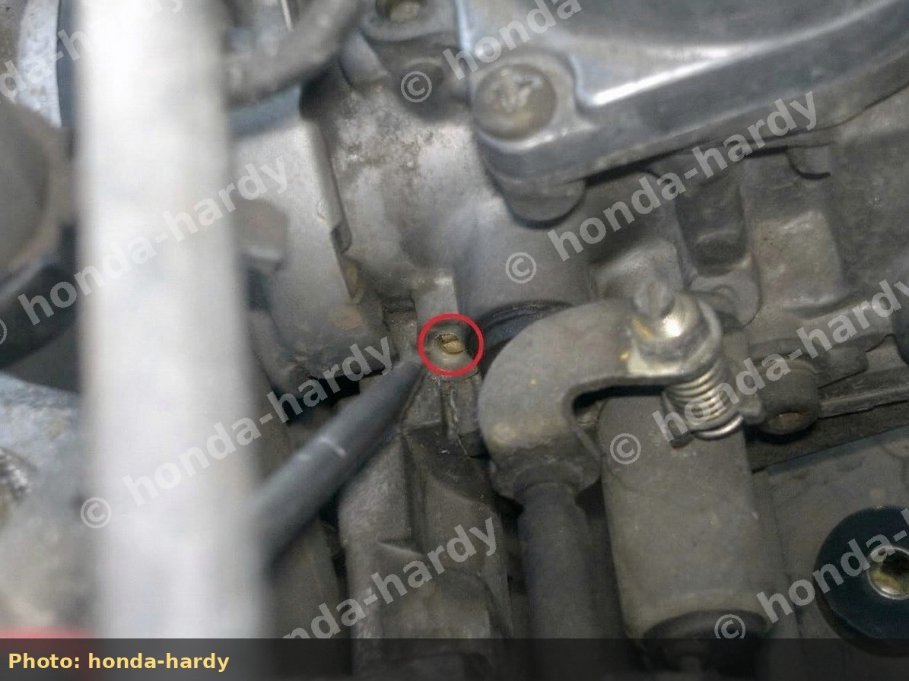
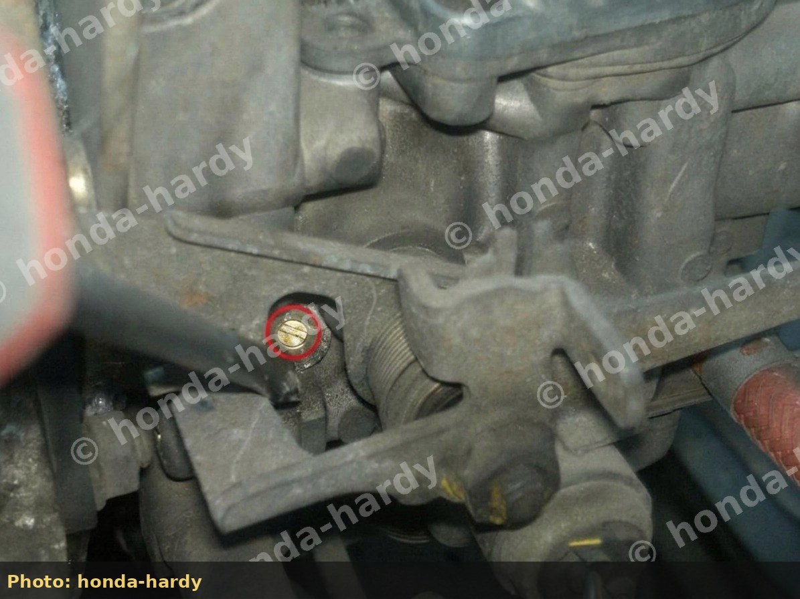
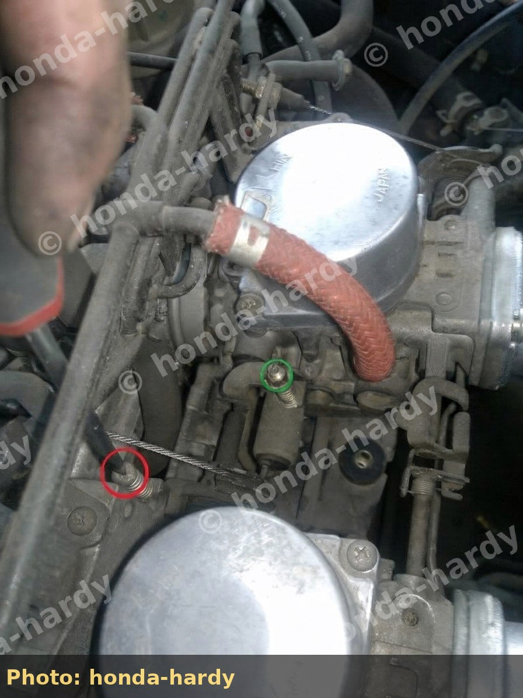
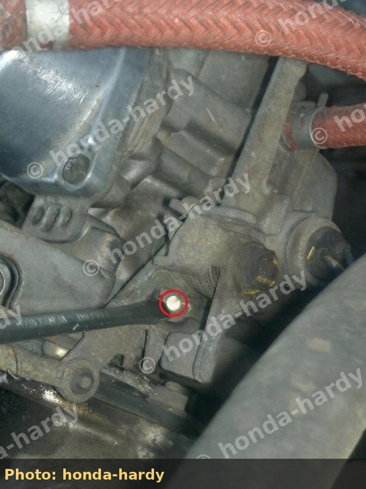
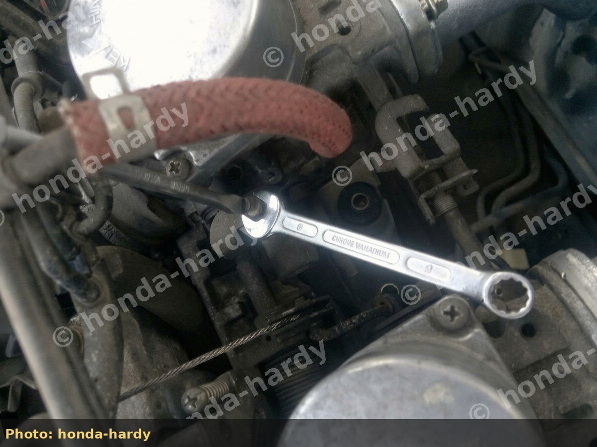
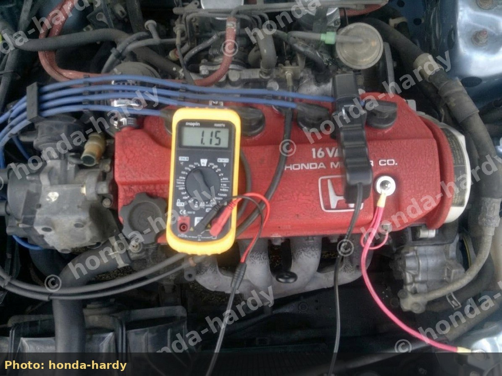
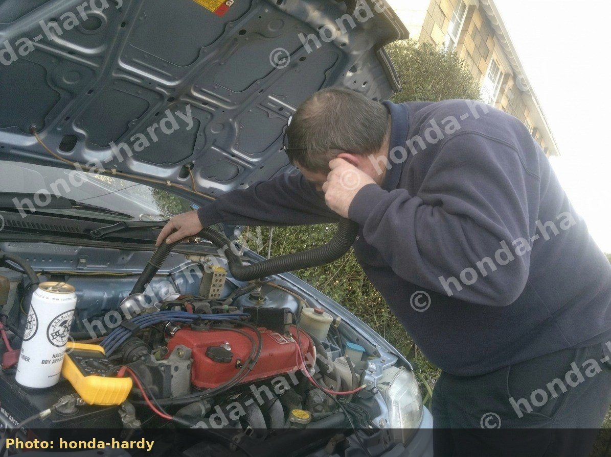
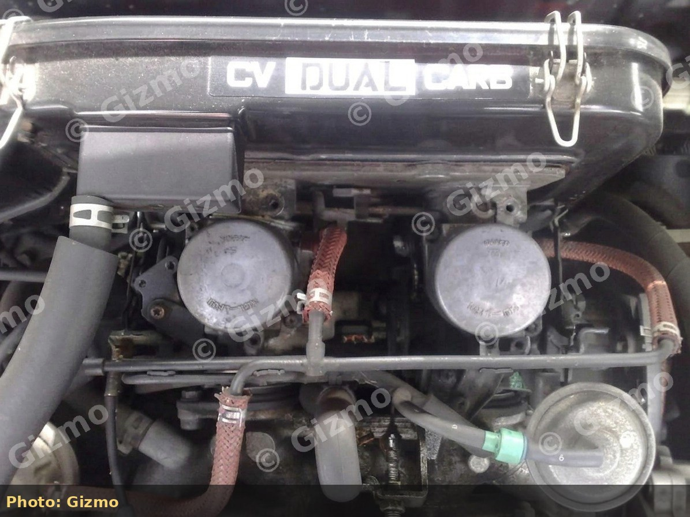
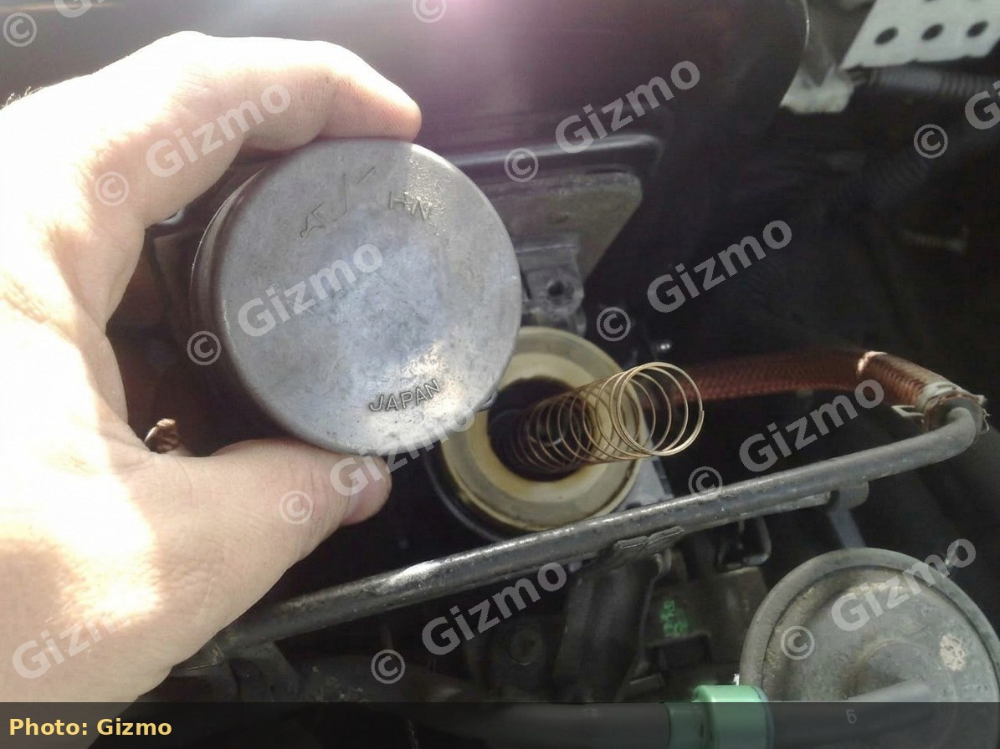
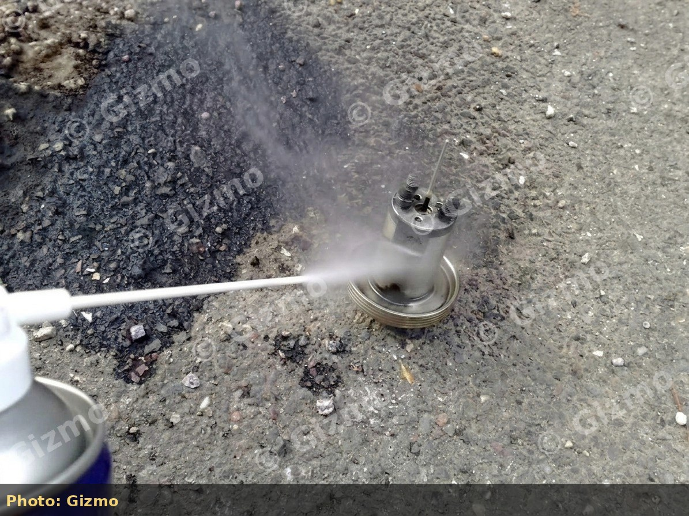

# Setting Idle Mixture and Balancing Dual Carbs on a D14A1

Procedure for warm idle mixture, tick-over, and dual-carb balance on a **Honda D14A1** dual Keihin CV setup (fourth-generation Civic GL and related dual-carb cars). Use after a carb rebuild or when the engine is luggish, uneven, or fails exhaust emissions.

> [!TIP]
> Ideal workflow: set rough idle → set mixture (CO or wideband) → balance airflow between bodies → re-check idle and mixture. Expect to iterate two or three times.

## Tools

- Exhaust gas analyser (**CO%** and, where tested, **HC ppm**) **or** wideband AFR with a safe sample point
- Tachometer or multi-function engine analyser (idle rpm / dwell)
- Small flat screwdriver for mixture screws
- Phillips screwdriver for idle speed screw
- **8 mm** spanner + screwdriver for balance locknut / screw
- Length of hose for the field “ear” balance method if no manometer / Carbtune is available

## Locate the adjusters

### Idle mixture screws

On many D14A1 dual-carb sets, each idle mixture screw sits under a **white plastic blanking disc**. Pry carefully and adjust **both sides equally** in small increments (left and right bodies each have a screw).

*Idle mixture screw location (honda-hardy).*

*Opposite-body mixture screw (honda-hardy).*

### Idle speed screw

Follow the throttle cable to the carb linkage. The **idle speed (tick-over) screw** is the Phillips adjuster at the linkage - turn clockwise to raise idle on most layouts. Mixture changes often raise idle; re-set after every mixture pass.

*Idle speed screw at throttle linkage (honda-hardy).*

*Another linkage/adjuster location circled for identification (honda-hardy).*

### Balance (synchronisation)

> [!IMPORTANT]
> On typical dual Keihin layouts used here, the **right-hand carb is the fixed reference**; the **left-hand carb is adjustable** relative to it (locknut + centre screw). Confirm on your linkage before turning the wrong screw.

An **8 mm** spanner commonly fits the balance locknut: hold the centre screw, loosen the nut, adjust, re-lock.

*Balance locknut and adjuster (honda-hardy).*

## Target values (street baseline)

| Parameter | Community street target | Notes |
| --- | --- | --- |
| Warm idle CO | \~0.9-1.0% | Example: **0.2% CO** was too lean and cost large dyno power; final setup **\~0.87% CO** reported “good” |
| Hydrocarbons (MOT-style) | e.g. **\~400 ppm** vs a **1200 ppm** limit in one UK test | Always use **your** local limits |
| Warm idle speed | \~750-800 rpm | Example set point: **775 rpm** |
| Cruise AFR | near \~14.7:1 | After idle is sorted |
| WOT AFR | not lean of \~12.8-13.0:1 without data | Log under load |

*Warm idle set near 775 rpm (honda-hardy).*

## Step-by-step

1. **Warm the engine** fully; chock wheels; handbrake on; load electrical accessories as you will for the emissions test if that is the goal.
2. **Baseline idle** near the service-manual value.
3. **Mixture**: turn each mixture screw a fraction of a turn **equally** until CO ≈ 1% or idle AFR is stable (not lean-misfire, not sooty rich).
4. **Re-set idle speed** if rpm rose or fell.
5. **Balance airflow:**
   - With trumpets fitted, or with the airbox lid and filter removed so both throats are open.
   - Hose-to-ear: hold one end to your ear, the other to the **right (fixed)** throat, then the **left** throat; match pitch/strength.
   - Adjust only the left balance screw; lock the 8 mm nut.
 - Prefer a manometer / Carbtune when available - hose-to-ear is a field method.
6. **Re-check idle speed and mixture** after balance (balance often changes both).
7. **Road test**: hesitation often means balance or needle transition; surge at cruise often means mixture; flat WOT often means main jet / spring / restrictor.

*Field balancing with a hose (honda-hardy).*

## Dyno lesson (open stacks + lean idle)

A dual-carb D14 on trumpets/filters with cut springs and **\~0.2% CO** struggled around **\~75 bhp**. Pulling the choke as a crude enrichment test recovered about **86.4 bhp**. That does **not** mean “run on choke”; it means **fuel must match airflow**.

After correcting idle mixture toward \~1% CO, balancing, and re-setting idle, the same car was reported driveable again on trumpets - still subject to proper WOT jetting.

> [!WARNING]
> Do not leave the choke partially open as a tune. Fix jets, needles, mixture screws, vacuum leaks, and balance.

## What the idle screws cannot fix

On dual Keihin CV carbs:

- **Idle / light-load** mixture screws mainly affect the **slow circuit**.
- **WOT** is dominated by the **main jet** (and needle taper when the slide is high). Turning idle screws will not fix a 10:1 full-load log.
- After a thorough carb clean, warm idle often rises (cleaner passages, better balance). Re-set tick-over; do not assume you must cut springs because idle climbed after cleaning.

## Carb cleanup before tuning

A dirty dual-carb set often feels flat or hesitant at WOT even when the rest of the car is healthy. Community how-tos start by lifting the **CV Dual Carb** airbox lid, removing the **piston lids** (stubborn screws often free with a light hammer tap on the screwdriver), and cleaning the slides/needles with carb cleaner - then re-fitting carefully so the slide keyway lines up.

*Stock dual Keihin lids under the factory airbox lid (Gizmo).*

*Slide/piston out for cleaning (Gizmo).*

*Piston/needle clean with aerosol carb cleaner (Gizmo).*

Re-balance and re-set mixture after any full clean. Expect idle rpm to change once passages flow again.

### Wideband reality check (dual-carb D15B4)

Logged cruise around **12.5-13.5:1** and WOT around **9.8-10.5:1** is common on lightly modified dual-carb cars before main-jet work. Cutting springs without a gauge is not a substitute for jetting. See [Street Tuning Dual-Carburetor Honda D-Series Engines](/cars/tuning/dual-carb-d-series-street-tuning) for the full AFR table from that log.

## Spring mod interaction

If you also cut or stiffen slide springs (see [Street Tuning Dual-Carburetor Honda D-Series Engines](/cars/tuning/dual-carb-d-series-street-tuning)):

- Cut-and-stretch can feel sharper but may **lean** high rpm if mains/needles are unchanged - **or** richen part throttle by restricting slide rise (both outcomes appear in owner force and wideband tests).
- Force testing has shown cut-and-stretched springs can be **stiffer at full compression** than stock.
- Some owners run **two springs** (progressive) instead of a cut spring so the slide rises more softly early and resists full rise at WOT.
- After any spring change, **repeat mixture, balance, and WOT AFR**.

## Aftercare

- Refit airbox or filters securely.
- Cap mixture screw ports if required for emissions legality.
- Log cruise and WOT AFR before changing main jets or removing slide restrictors.
- For springs, jets, and overall build order, see [Street Tuning Dual-Carburetor Honda D-Series Engines](/cars/tuning/dual-carb-d-series-street-tuning).
