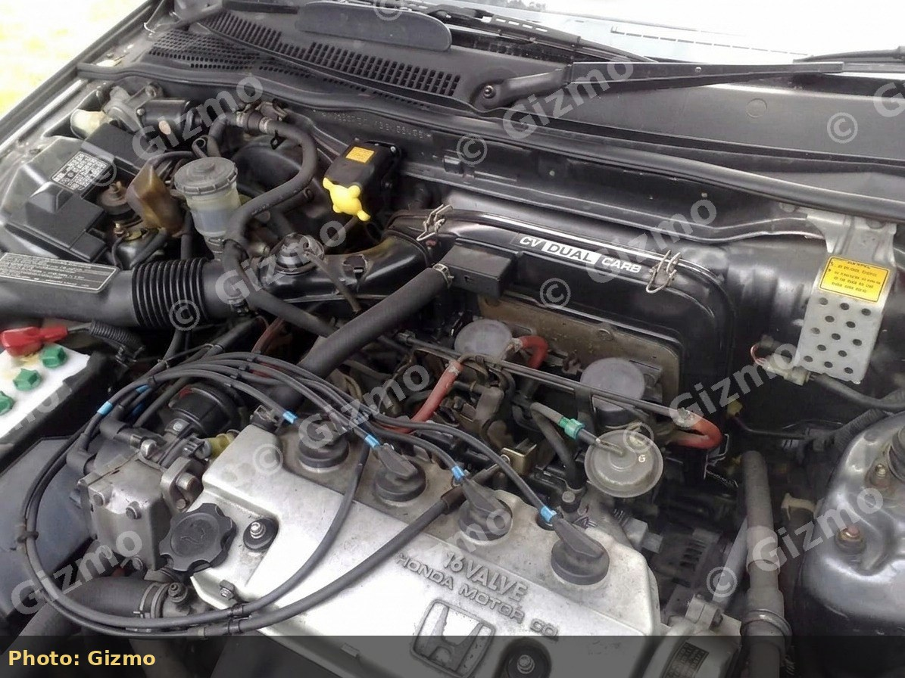
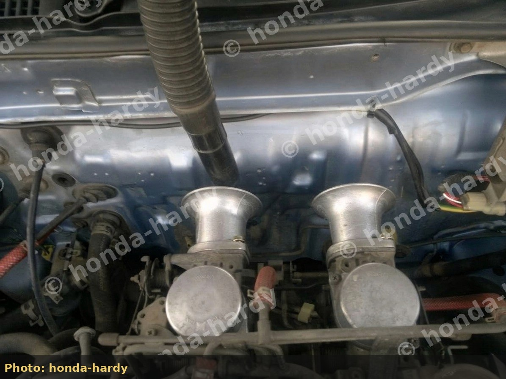
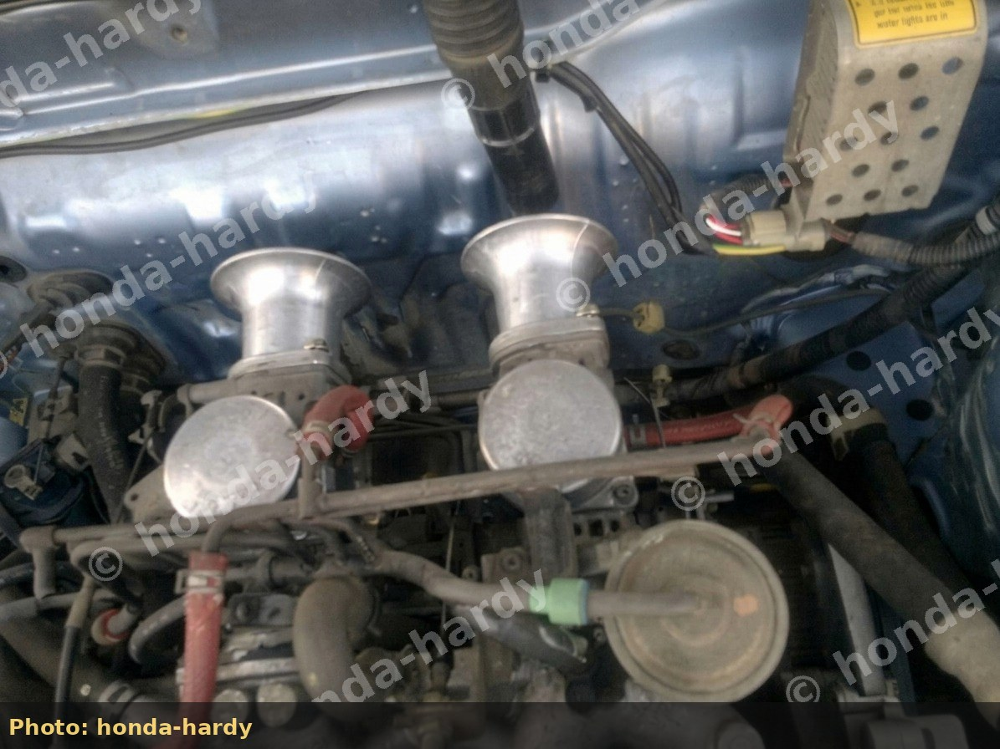
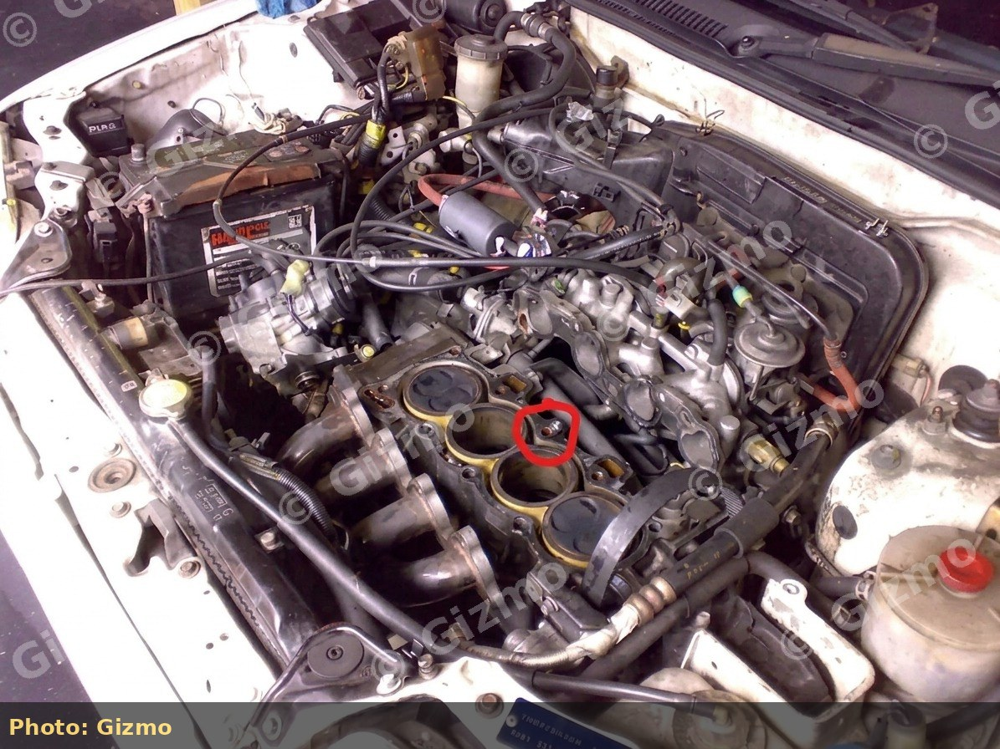
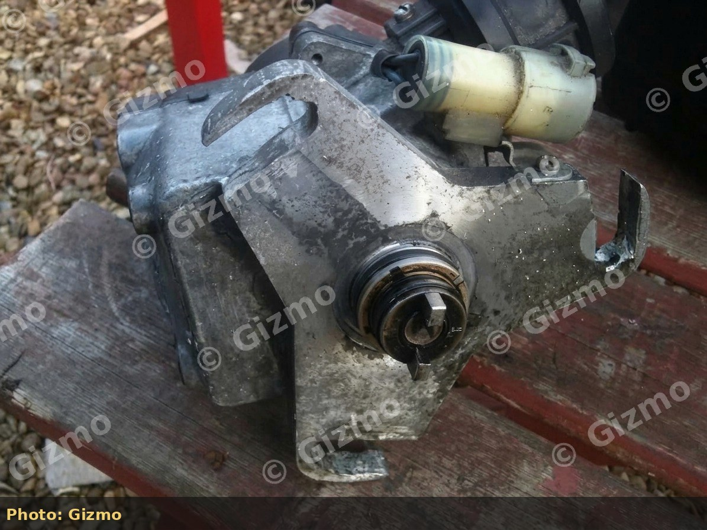

# Dual-Carb Intake Options: Stock Airbox versus Velocity Stacks

Choosing an intake path for Honda dual Keihin CV carburetors (D14A1 and related dual-carb D-series) is about **airflow control, filtration, heat, and fuel calibration**: not only induction noise.

## Option A: modified stock airbox (preferred street baseline)

**Do:**

- Delete the **exhaust-heat feed** into the box after warm-up
- Remove the **internal restrictor flap**
- Install a quality **panel filter** (confirm dual-carb box fitment; K&N E-series panels are often cited)
- Optionally **drill** extra box inlets once the above are done
- Route cooler air from the grille / wing when fabricating ducts
- Keep the factory mesh out of the way of a good panel element - do not stack mesh + tights as a “filter”

**Avoid:**

- A single cone only on the factory snorkel (little benefit; can add restriction)
- Mesh or fabric stretched tightly over open carb mouths - more restriction than it looks

This path keeps debris protection and makes cold-air ducting easier. Many stronger street dual-carb cars stay on a drilled box plus panel filter rather than open stacks.

*Stock dual-carb layout with factory airbox still fitted (Gizmo).*

**Winter:** several owners put the **airbox back on** for wet/cold months even if they run open filters in summer.

## Option B: velocity stacks (trumpets) with foam or ram socks

Stacks sit on the carb mouths. They smooth the entry, raise air speed at part load (venturi effect), and can use **standing-wave / length** effects to move the torque band. They only make power if the **fuel system matches** the new airflow.

*D14 dual carb velocity stacks (honda-hardy).*

*Trumpets from above (honda-hardy).*

*Airbox off, carb mouths open for stacks or filters (Gizmo).*

*Open dual Keihin throats after airbox removal (Gizmo).*

### Plumbing when the airbox comes off

| Hose / item | Action |
| --- | --- |
| Rocker / cam-cover breather into the airbox | Fit a **small breather filter** or catch-can - do not leave open into the bay without filtration |
| Heat-wrapped pipe to the manifold heat shield | Often **dumped / deleted** with the heat circuit |
| Tiny vacuum/breather lines | Trace and cap or re-route correctly - do not tape at random |
| Throttle and choke cables | Usually stay on the linkage; not on the airbox mouth plate on most hatches |
| Auto **kick-down** cable (third cable to gearbox) | May use a plate near the carb mouths - relocate or remove only if you accept kick-down behaviour changes |

### Filters on stacks

- **Foam socks / ram socks** stretch over the trumpet mouth (Pipercross-style and similar).
- Trumpets sized for other sidedrafts (e.g. some **45 mm** Weber/Dellorto trumpets) are sometimes adapted - verify mouth OD and sealing.
- Open OEM mesh alone is not adequate long-term filtration.

### Stack diameter (community street notes)

On dual-carb GLs running open stacks long-term (with and without socks):

| Stack ID (approx.) | Reported feel |
| --- | --- |
| **\~45 mm** | Noticeable midrange gain; modest top-end; low-end mostly intact |
| **\~50 mm** | Stronger mid and top; **low-end can soften**; pairs better with a short custom box or careful cold-air feed |

Those are seat-of-pants reports on dual-carb D14/D15 cars, not controlled dyno deltas. Length still matters: short **\~50 mm** stacks accentuate top-end character; longer runners trade that for midrange. Always re-jet and re-balance after changing trumpet size.

### Fueling requirements with stacks

- Re-set **idle mixture** and **balance** after fitting.
- Expect to revisit **needles** (D15B / CRX needles often add fuel at part throttle) and **main jets**.
- Cold-air ducting matters: open stacks with the bonnet down mainly ingest **hot** bay air unless you feed them.
- Optional **stiffer** slide springs if the engine goes rich as soon as the slides hit the stops (opposite of blind spring-cutting).

## Open stacks without jetting: what goes wrong

Community dyno on a dual-carb 1.4 with stacks, spring cuts, and **lean idle CO (\~0.2%)** showed roughly **\~75 bhp**, recovering to **\~86 bhp** when fuel was added. High-power dual-carb D-series street cars on the same forums often run **drilled stock boxes + K&N**, not trumpets - because mixture control is easier.

### Relative intake comparison (built dual-carb D15, not stock D14)

On a sorted dual-carb CRX with ported head/manifold work, controlled dyno fan, \~7600 rpm limit:

| Setup | Approx. peak |
| --- | --- |
| Modified stock airbox | \~129 bhp (stronger low torque) |
| Bike-style filters | \~137 bhp |
| Large oval foam | \~138 bhp |

Use this only as a **relative** lesson: open area can free top end when the engine and fueling already support it; a stock D14A1 will not jump into that power band from socks alone.

## Decision guide

| Goal | Better starting choice |
| --- | --- |
| Daily reliability, emissions, weather | Modified stock airbox + panel filter |
| Maximum induction sound | Stacks + socks (budget AFR and jetting time) |
| First power package with header/exhaust | Airbox path, then reassess with wideband |
| Track / short runs with sorted fueling | Stacks possible with real filtration and cold air |

## Related work order

1. Rebuild and balance carbs on the stock box
2. Exhaust / header
3. Decide airbox vs stacks **with AFR data**
4. Only then change springs, needles, or jets for the new airflow
