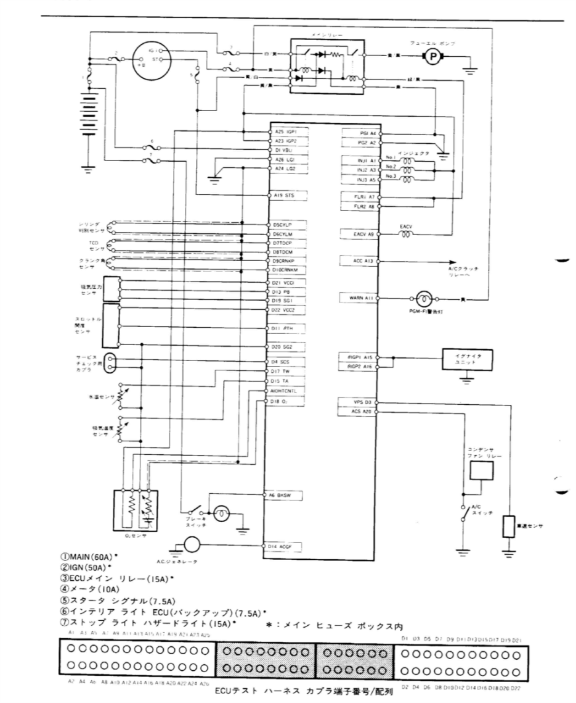

# Honda Beat & Acty (E07A 3-Cylinder) Carburetor to EFI Conversion

## Overview

The 656cc 3-cylinder E07A engine powers iconic Honda Kei vehicles including the **Honda Acty** mini truck (HA3/HA4) and the **Honda Beat** mid-engine roadster (PP1). Converting carbureted Acty trucks or factory PGM-FI Beat models to modern standalone EFI unlocks improved cold starts, smoother throttle response, and boost capability.

---

## 1. Engine & Sensor Hardware Overview

- **Cylinder Count:** 3-Cylinder SOHC (12 Valves).
- **Firing Order:** 1 - 2 - 3 (120-degree firing interval).
- **Intake Layout:** Single throttle body (Acty) or Individual Throttle Bodies / MTREC (Beat PP1).

---

## 2. Fuel Strategy: Alpha-N vs Speed-Density

On ITB-equipped E07A engines (Honda Beat), manifold pressure signal pulses violently at low RPM.

> \[!TIP\] Use **Alpha-N (TPS vs RPM)** as the primary fuel matrix for ITB setups, with MAP sensor used purely for barometric pressure compensation. On single-throttle Acty trucks, standard Speed-Density (MAP vs RPM) functions perfectly.

---

## 3. Trigger Wheel & Ignition Wiring

1. **Trigger Setup:** 36-1 or 24-2 custom trigger wheel mounted to crank pulley, monitored by a 2-wire VR or 3-wire Hall sensor.
2. **Ignition System:** Convert from original distributor cap to 3 individual smart coils (e.g. CBR600RR or K20 coils) firing in sequential 1-2-3 order.

---

## 4. ITB Assembly & Custom ECU Adapter

*E07A 3-cylinder ITB throttle body and standalone ECU harness adapter.*

---

## 4. ITB Assembly & Custom ECU Adapter

*E07A 3-cylinder ITB throttle body and standalone ECU harness adapter.*

### Throttle Linkage Mechanism

*Honda Beat MTREC individual throttle body linkage movement.*
