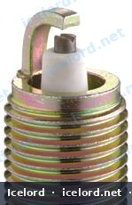
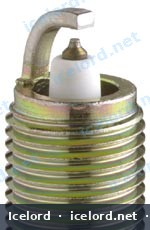
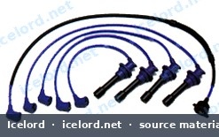

# Honda NGK Spark Plug Application and Gap Guide

Maintaining your Honda's ignition system with the correct spark plugs is crucial for optimal engine performance, fuel efficiency, and emissions. This guide provides a reference for recommended NGK spark plug types and their corresponding gap specifications for a range of Honda and Acura models.

> [!IMPORTANT]
> Always confirm the specific spark plug type and gap with your vehicle's factory service manual (FSM) or a reputable parts catalog for your exact year, make, model, and engine code. Specifications can vary by region and specific engine sub-variants.

```carousel

<!-- slide -->

<!-- slide -->


```

## Understanding NGK Spark Plug Codes

NGK spark plug codes provide detailed information about the plug's design, including thread size, heat range, and special features. While a full breakdown is beyond this guide's scope, understanding that different codes signify different characteristics is important for proper selection.

## Spark Plug Application Tables

The following tables list common NGK spark plug recommendations. The "Gap" column indicates the recommended electrode gap in millimeters (mm).

### Accord Models

| Model | Engine | Eng. Size | Years | NGK Plug Type | Gap (mm) |
|---|---|---|---|---|---|
| Accord 1,6 | EL, EG | 1.6 | 78-82 | BPR6ES, BR6EB, BPR6EY | 0.8 |
| Accord 1,6 2D | EZ | 1.6 | 84- | BPR6ES-11 | 1.1 |
| Accord 1,6 4D | EZ | 1.6 | 84- | BPR6ES | 0.8 |
| Accord 1,6 L CA | A16A1 | 1.6 | 86- | BPR6EY-11 | 1.1 |
| Accord 1,8 2D/4D | ET1 | 1.8 | 84- | BPR6EY-11 | 1.1 |
| Accord 1,8i/iLS CE7 | F18A3 | 1.8 | 96- | ZFR6F-11 | 1.1 |
| Accord 2,0 CB3 | F20A2, F20A6 | 2.0 | 90- | ZFR6F-11 | 1.1 |
| Accord 2,0 EX CA | A20A1, A20A2 | 2.0 | 86- | BPR6EY-11 | 1.1 |
| Accord 2,0 EXi CA | A20A4 | 2.0 | 86- | BPR6EY-11 | 1.1 |
| Accord 2,0 S,LS,ES CC7 | F20Z1 | 2.0 | 93- | ZFR6F-11 | 1.1 |
| Accord 2,0i CC7 | F30Z2 | 2.0 | 93- | ZFR6F-11 | 1.1 |
| Accord 2,0i CB3 | F20A4, F20A8 | 2.0 | 90- | ZFR6F-11 | 1.1 |
| Accord 2,0i 16V CA5 | B20A8 | 2.0 | 88- | BCPR6E-11 | 1.1 |
| Accord 2,0i 16V EX CA | B20A2 | 2.0 | 87- | BCPR6EYN-11 | 1.1 |
| Accord 2,0i EX CA | A20A3 | 2.0 | 87- | BPR6EY-11 | 1.1 |
| Accord 2,0i LS/ES CE8 | F20Z1 | 2.0 | 95-96 | ZFR6F-11 | 1.1 |
| Accord 2,2i (4WS) CB7 | F22A3 | 2.2 | 90- | ZFR6F-11 | 1.1 |
| Accord 2,2i 16V CE9 | F22Z2 | 2.2 | 95- | ZFR6F-11 | 1.1 |
| Accord 2,3 SR CC7 | H23A3 | 2.3 | 93- | ZFR6F-11 | 1.1 |
| Accord Aero 2,0 EX CA | A20A1, A20A2 | 2.0 | 86-87 | BPR6EY-11 | 1.1 |
| Accord Aero 2,0 EXi CA | A20A4 | 2.0 | 86- | BPR6EY-11 | 1.1 |
| Accord Aero 2,0i CC9 | F20Z3 | 2.0 | 93- | ZFR6F-11 | 1.1 |
| Accord Aero 2,0i EX CA | A20A3 | 2.0 | 87- | BPR6EY-11 | 1.1 |
| Accord Aero 2,0i LS,ES CE2 | F20B3 | 2.0 | 94- | ZFR6F-11 | 1.1 |
| Accord Aero 2,2i CB8 | F22A7-F22A8 | 2.2 | 91 | ZFR6F-11 | 1.1 |
| Accord Aero 2,2i LS,ES CE1 | F22B5 | 2.2 | 94- | ZFR6F-11 | 1.1 |
| Accord Coupe CC1 | F20A7 | 2.0 | 92- | ZFR6F-11 | 1.1 |
| Accord Coupe 2,0i ES / iLS (CG4) | F20B5 | 2.0 | 98- | ZFR6F-11 | 1.1 |
| Accord Coupe 2,2i CD7 | F22B5 | 2.2 | 94- | ZFR6F-11 | 1.1 |
| Accord Coupe 3,0i V6 (CG2) | J30A1 | 3.0 | 98- | ZFR5FN-11 | 1.1 |

### Civic Models

| Model | Engine | Eng. Size | Years | NGK Plug Type | Gap (mm) |
|---|---|---|---|---|---|
| Civic 1,2 | ZA2, EB1, EB2, EB3 | 1.2 | 76-84 | BPR6EY-11, BPR6ES | 0.8, 1.1 |
| Civic 1,3 | D13B1, D16B2, D13B2, EV2, EN1, EN2, EN4 | 1.3 | 80-92 | BCPR6E-11, BKR6E-11, BPR6EY-11, BPR5ES, BPR6ES | 0.8, 1.1 |
| Civic 1,4 | D14A1, D14A7, D14A8, D14A3, D14A5, D14A2, D14A4 | 1.4 | 88-97 | BCPR6E-11, ZFR5F-11, BKR6E-11 | 1.1 |
| Civic 1,5 | D15Z8, D15Z3, D15B2, EW3, EW4, D15Z6, EW2, D15Z1, EC | 1.5 | 77-97 | ZFR5F-11, ZFR6F-11, BKR6E-11, BCPR6E-11, BPR6EY-11, ZFR6J-11, BR6ES | 0.8, 1.1 |
| Civic 1,6 | D16A6, D16Z2, D16B2, D16Z6, D16Y5, D16Y3, D16Y2, B16A2, B16A1 | 1.6 | 88-97 | BCPR6E-11, ZFR5F-11, BKR6E-11, ZFR6J-11, BKR7EN-11, BKR6EN-11 | 1.1 |
| Civic 1,8 VTI 5T | B18C4 | 1.8 | 97- | BKR6EN-11 | 1.1 |
| Civic Coupe 1,5i/LSi EJ2 | D15B7 | 1.5 | 94- | ZFR6F-11 | 1.1 |
| Civic Coupe 1,6 ESi EJ1 | D16Z9 | 1.6 | 94- | BKR6E-11 | 1.1 |
| Civic Coupe 1,6 LS EJ6 | D16Y7 | 1.6 | 96- | BKR6E-11 | 1.1 |
| Civic Coupe 1,6i SR EJ8 | D16Y8 | 1.6 | 96- | BKR6E-11 | 1.1 |

### CRX / Del Sol Models

| Model | Engine | Eng. Size | Years | NGK Plug Type | Gap (mm) |
|---|---|---|---|---|---|
| CRX | EW3 | 1.5 | 84- | BPR6EY-11 | 1.1 |
| CRX 1,6 EG2 (Del Sol VTEC) | B16A2 | 1.6 | 92- | BKR6EN-11 | 1.1 |
| CRX 1,6 EH6 (Del Sol Si) | D16Z6 | 1.6 | 92- | BKR6E-11 | 1.1 |
| CRX 1,6i-16 ED9 | D16A9, D16Z5 | 1.6 | 88-89 | BCPR6E-11 | 1.1 |
| CRX 16V AS | ZC1 | 1.6 | 86- | BCPR6EY-11 | 1.1 |
| CRX VTEC EE8 | B16A1 | 1.6 | 90- | BKR6EN-11 | 1.1 |

### Integra Models

| Model | Engine | Eng. Size | Years | NGK Plug Type | Gap (mm) |
|---|---|---|---|---|---|
| Integra | | 1.6 | 88- | BCPR6E-11 | 1.1 |
| Integra R DC2 | B18C6 | 1.8 | 98- | PFR7G-11 | 1.1 |

### Prelude Models

| Model | Engine | Eng. Size | Years | NGK Plug Type | Gap (mm) |
|---|---|---|---|---|---|
| Prelude 1,6 | EL | 1.6 | 79-81 | BPR6ES | 0.8 |
| Prelude 1,8 | ET, ET2 | 1.8 | 83-85 | BPR6EY, BPR6EY-11 | 0.8, 1.1 |
| Prelude 2,0 | | 2.0 | 97- | ZFR6F-11 | 1.1 |
| Prelude 2,0 BA4 | B20A4, B20A3, B20A9, B20A5 | 2.0 | 88-90 | BCPR6EYN-11 | 1.1 |
| Prelude 2,0 BB3 | F20A4 | 2.0 | 92- | ZFR6F-11 | 1.1 |
| Prelude 2,0i 16V BA2 | BA20A1 | 2.0 | 86- | BCPR6E-11 | 1.1 |
| Prelude 2,2 VTEC BB1 | H22A2 | 2.2 | 93- | PZFR6F-11 | 1.1 |
| Prelude 2,2i | | 2.2 | 97- | PZFR6F-11 | 1.1 |
| Prelude 2,3 BB2 | H23A2 | 2.3 | 92- | ZFR6F-11, PZFR6F-11 | 1.1 |

## Checking and Adjusting Spark Plug Gap

The spark plug gap is the distance between the center and ground electrodes. An incorrect gap can lead to misfires, reduced power, and poor fuel economy.

### Procedure

1.  **Obtain a Feeler Gauge:** Use a wire-type feeler gauge for accurate measurement. Blade-type gauges can be less accurate for spark plugs.
2.  **Measure the Gap:** Carefully slide the correct size wire gauge between the electrodes. It should have a slight drag.
3.  **Adjust if Necessary:**
    *   **To increase gap:** Gently pry the ground electrode away from the center electrode using the adjustment tool on the feeler gauge.
    *   **To decrease gap:** Gently tap the ground electrode on a hard, flat surface.
    *   > [!CAUTION]
        > Never bend or apply force to the center electrode, especially on iridium or platinum plugs, as this can damage the fine tip. Only adjust the ground electrode.
4.  **Re-measure:** Always re-measure the gap after adjustment to ensure it is within specification.

> [!TIP]
> While many new spark plugs are "pre-gapped," it is always best practice to verify the gap before installation, as shipping and handling can sometimes alter it.

## Spark Plug Installation

Proper installation is key to preventing damage to the spark plug or cylinder head.

### Key Steps

*   **Clean Threads:** Ensure the spark plug threads in the cylinder head are clean and free of debris.
*   **Anti-Seize (Optional):** Apply a very small amount of anti-seize compound to the spark plug threads, if desired. If using anti-seize, reduce the specified torque value by approximately 10-20% as recommended by the anti-seize manufacturer.
    *   > [!WARNING]
        > Excessive anti-seize can act as an insulator, affecting electrical grounding, or lead to over-tightening and thread damage.
*   **Hand-Thread First:** Always start threading the new spark plug by hand to prevent cross-threading. It should turn smoothly.
*   **Torque Specification:** Tighten the spark plug to the manufacturer's specified torque. **Refer to your vehicle's factory service manual for the exact torque value.** Over-tightening can strip threads or damage the spark plug, while under-tightening can lead to blow-by and overheating.

## When to Replace Spark Plugs

Refer to your vehicle's maintenance schedule for recommended spark plug replacement intervals. Factors such as driving conditions, fuel quality, and engine modifications can influence the lifespan of spark plugs. Regular inspection for wear, fouling, or damage is always recommended.
