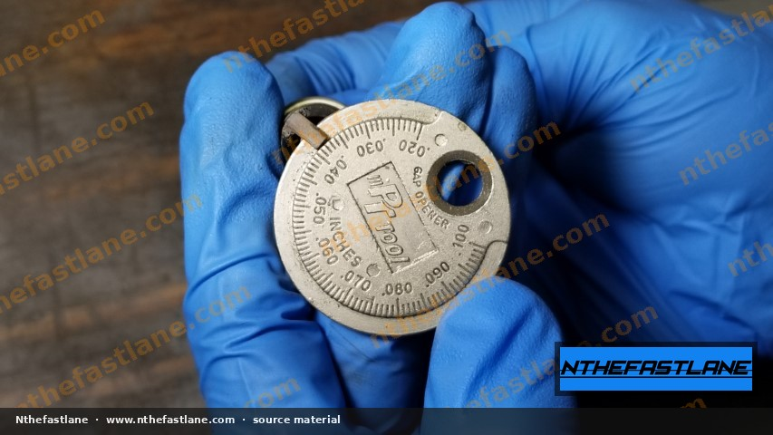
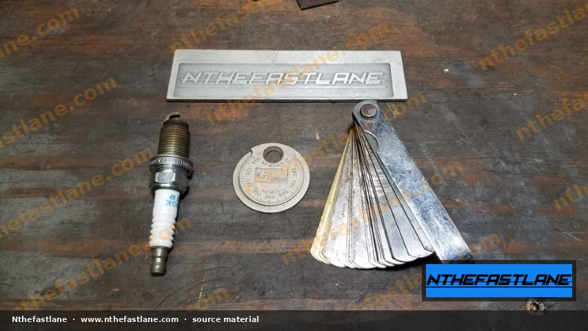
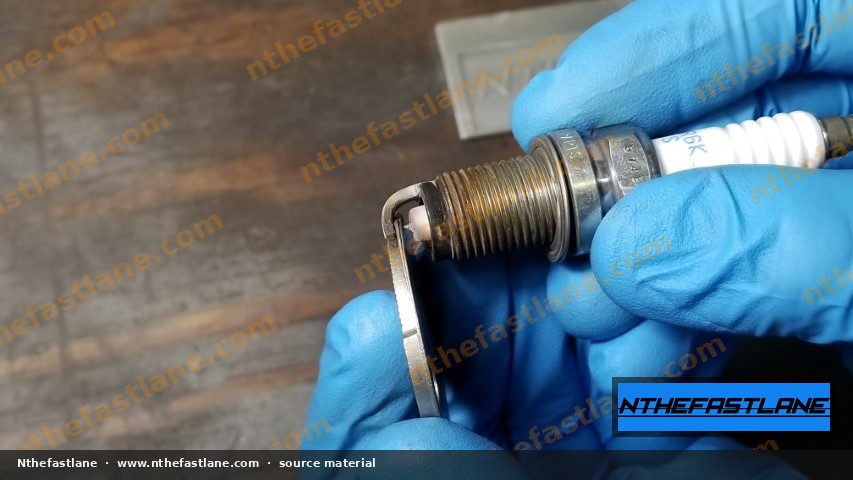
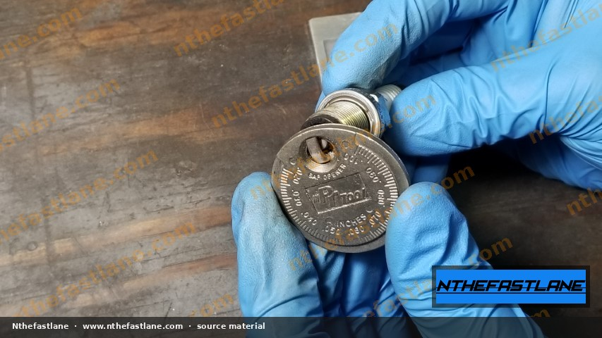
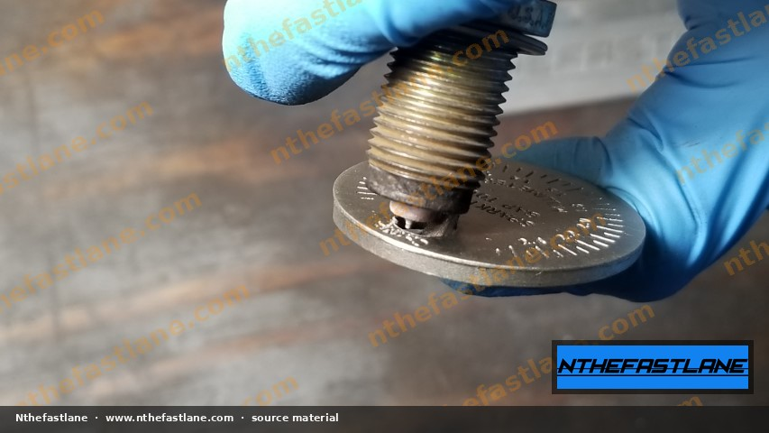
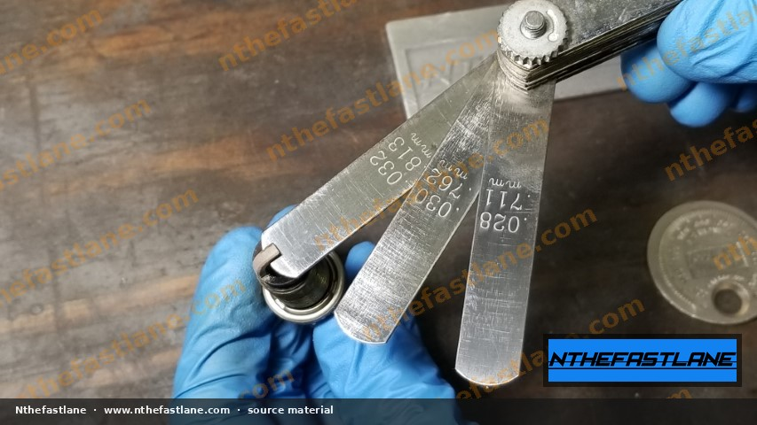
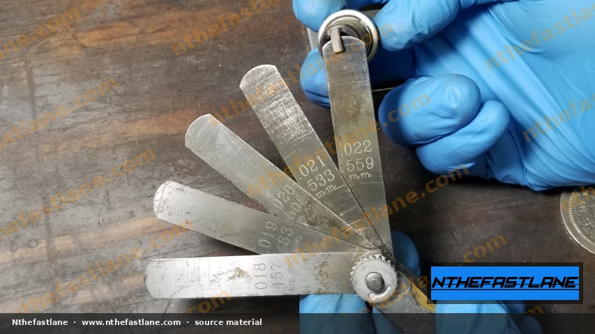
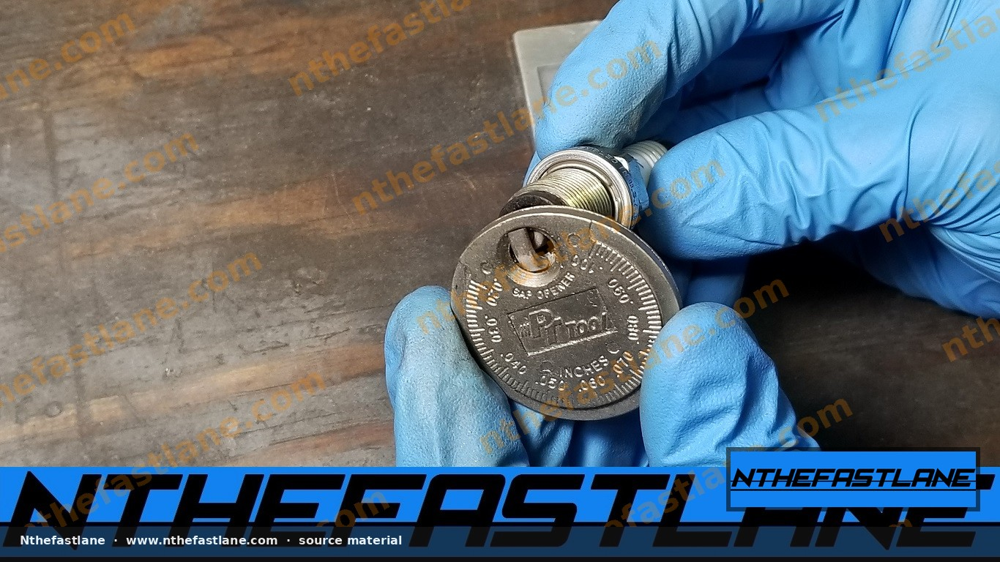

# Optimizing Spark Plug Gap for Forced Induction Honda Engines

Spark plug gap is a critical factor in the ignition system's ability to reliably ignite the air-fuel mixture, especially in forced induction applications where cylinder pressures are significantly higher. Proper gapping ensures consistent spark delivery, preventing misfires and promoting efficient combustion under boost.

```carousel

<!-- slide -->

<!-- slide -->

<!-- slide -->

<!-- slide -->

<!-- slide -->

<!-- slide -->

<!-- slide -->


```

## Understanding Spark Plug Gap and Forced Induction

In a naturally aspirated engine, the spark plug gap is typically set to a wider specification to expose more of the spark to the air-fuel mixture, promoting better combustion. However, forced induction (turbocharging or supercharging) dramatically increases the pressure within the combustion chamber.

### Why Boost Requires a Different Gap

*   **Increased Voltage Demand:** Higher cylinder pressure requires a greater voltage potential from the ignition coil to force the spark across the gap. If the gap is too wide, the ignition system may not be able to generate enough voltage, leading to a misfire.
*   **Misfire Prevention:** Misfires under boost can cause power loss, engine damage (due to unburnt fuel igniting in the exhaust), and can be particularly detrimental in high-performance applications.
*   **Optimized Spark Energy:** While a smaller gap reduces the voltage demand, a gap that is too small can restrict the spark's exposure to the air-fuel mixture, potentially reducing combustion efficiency. The goal is to find the optimal balance for the specific engine and boost level.

## General Principles for Gapping Boosted Engines

For most forced induction Honda engines, the spark plug gap is generally reduced compared to naturally aspirated specifications. This reduction helps the ignition system overcome the increased cylinder pressure and deliver a consistent spark.

> [!IMPORTANT]
> The precise optimal spark plug gap for a boosted engine is highly dependent on several factors, including:
> *   The specific engine build and components (e.g., piston compression ratio).
> *   The amount of boost pressure being run.
> *   The type and strength of the ignition system (e.g., coil-on-plug, aftermarket coils).
> *   The fuel type used.
> *   The overall engine tune.
> Always consult your engine builder, tuner, or the factory service manual (FSM) for specific recommendations tailored to your application. Generic recommendations may not be suitable for all setups.

While specific values must be confirmed, common gap ranges observed on tools for performance and forced induction applications often fall within the following approximate ranges:

*   **Typical Naturally Aspirated Honda:** .040" - .044" (confirm with FSM)
*   **General Forced Induction Range:** .018" - .035" (highly application-dependent)

Some examples of gap measurements found on specialized tools include:

*   0.018" (0.457 mm)
*   0.019" (0.483 mm)
*   0.020" (0.508 mm)
*   0.021" (0.533 mm)
*   0.022" (0.559 mm)
*   0.028" (0.711 mm)
*   0.030" (0.762 mm)
*   0.032" (0.813 mm)

## Tools for Measuring and Adjusting Spark Plug Gap

Accurate measurement and adjustment are crucial. Use the correct tools to avoid damaging the spark plug.

*   **Feeler Gauges:** These are flat blades of specific thicknesses, ideal for precise measurement. Ensure the gauge slides through with slight drag.
*   **Wire-Type Gap Gauges:** Often circular, these gauges have wires of varying diameters. They are useful for quick checks but may not be as precise for adjustment as feeler gauges.
*   **Spark Plug Gapping Tool:** A specialized tool designed to gently bend the ground electrode for adjustment without stressing the ceramic insulator or center electrode.

## Spark Plug Gapping Procedure

Follow these steps to correctly check and adjust your spark plug gap:

1.  **Select the Correct Plug:** Ensure you are using the appropriate spark plug type and heat range for your boosted application, as recommended by your engine builder or tuner.
2.  **Measure Current Gap:** Using a feeler gauge or wire-type gauge, carefully measure the existing gap of the new spark plug. Start with a gauge slightly smaller than your target gap and work your way up until you find the largest gauge that slides through with light drag.
3.  **Adjust if Necessary:**
    *   **To Widen the Gap:** Use a spark plug gapping tool or a very small, flat-bladed tool to gently pry the ground electrode away from the center electrode. Apply minimal force.
    *   **To Narrow the Gap:** Gently tap the ground electrode against a clean, hard surface. Be extremely careful not to deform the electrode or damage the ceramic insulator.

> [!CAUTION]
> Never pry against the center electrode or the ceramic insulator when adjusting the gap. This can damage the spark plug, leading to misfires or premature failure.

4.  **Re-measure and Verify:** After each adjustment, re-measure the gap to ensure it matches your target specification. Repeat the adjustment process in small increments until the desired gap is achieved.
5.  **Install Spark Plugs:** Once gapped, install the spark plugs into the cylinder head. Refer to your factory service manual for the correct tightening torque specification. Over-tightening can damage the spark plug or cylinder head threads, while under-tightening can lead to poor heat transfer and potential misfires.

> [!TIP]
> Always check the gap of new spark plugs, even if they are pre-gapped. Shipping and handling can sometimes alter the gap from the factory setting.
