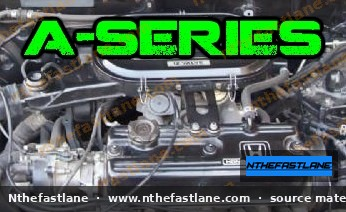

# Honda A-Series Engine Specifications and Identification

The Honda A-series engines are a family of inline-four cylinder powerplants primarily used in the Honda Accord and Prelude models during the 1980s. These engines are recognized for their robust design and straightforward mechanics, often featuring a 12-valve SOHC (Single OverHead Camshaft) configuration.

*Image placeholder - replace with a publication-cleared photo (d7f001_fe70f35b91034d36b92993f8e6636a3f~mv2.jpg).*

## Engine Identification

Identifying a specific A-series engine is crucial for maintenance, parts ordering, and understanding its characteristics. The engine code provides key information about its displacement and specific variant.

### Locating the Engine Code

The engine code is typically stamped directly onto the engine block. Common locations include:

* On a flat surface near the transmission bell housing, on the front side of the block.
* On the front of the block, below the cylinder head, often near the exhaust manifold.

> [!TIP]
> Cleaning the area with a wire brush and degreaser may be necessary to clearly read the stamped code, especially on older engines.

### Decoding A-Series Designations

Honda A-series engine codes generally follow a pattern where the first two digits indicate the approximate displacement:

* **A16**: Denotes an engine with approximately 1.6 liters of displacement.
* **A18**: Denotes an engine with approximately 1.8 liters of displacement.
* **A20**: Denotes an engine with approximately 2.0 liters of displacement.

Further alphanumeric characters (e.g., A1, A3) after the initial designation often specify regional variations, fuel system types (carbureted vs. PGM-FI), or minor internal differences.

## General Specifications

The A-series engines share several fundamental design characteristics, making them distinct from later Honda engine families.

### Engine Architecture

* **Configuration**: Inline 4-cylinder.
* **Camshaft Layout**: SOHC (Single OverHead Camshaft).
* **Block Material**: Cast iron, known for its durability.
* **Cylinder Head Material**: Aluminum alloy.

### Valvetrain

* **Valve Count**: 12 valves total (three valves per cylinder: two intake, one exhaust). This 3-valve-per-cylinder design was common in Honda engines of this era.
* **Valve Adjustment**: Mechanical, typically utilizing a screw-and-locknut adjustment system. Regular valve lash inspection and adjustment are part of routine maintenance.

### Fuel and Ignition Systems

* **Fuel Delivery**: Varies by market and specific model year. Early A-series engines often employed carbureted fuel systems, while later versions (particularly in North America) transitioned to PGM-FI (Programmed Fuel Injection).
* **Ignition System**: Distributor-based, utilizing a single ignition coil and distributor to send high voltage to the spark plugs.

### Displacement Variants

While sharing a common architecture, the A-series came in several displacement sizes:

* **A16**: Approximately 1.6 liters.
* **A18**: Approximately 1.8 liters.
* **A20**: Approximately 2.0 liters.

These variations primarily involved changes in bore and stroke to achieve the desired displacement, often accompanied by different intake manifold designs and ECU programming.

## Maintenance Considerations

Maintaining an A-series engine involves standard procedures common to most internal combustion engines, with a few specific points to note:

* **Timing Belt**: The A-series engines are interference engines, meaning valve-to-piston contact can occur if the timing belt breaks. Adhere strictly to the factory-recommended timing belt replacement interval.
* **Valve Adjustment**: Due to the mechanical valvetrain, periodic valve lash adjustment is necessary to maintain optimal engine performance and prevent excessive wear. Consult the factory service manual for specific clearance specifications.
* **Fluid Capacities**: Engine oil capacity, coolant capacity, and other fluid specifications should always be confirmed against the factory service manual for the specific model and year.

> [!CAUTION]
> Always ensure the engine is cool before performing valve adjustments to obtain accurate clearances.

## Important Notes

> [!IMPORTANT]
> For all specific technical data, such as torque specifications, precise fluid capacities, sensor resistance values, and detailed repair procedures, **always consult the official Honda Factory Service Manual (FSM)** relevant to your specific vehicle's model year and engine code. Information provided here is for general reference and identification purposes.
