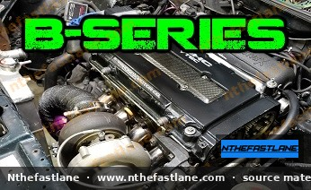

# Honda B-Series Engine Specifications and Identification

The Honda B-series covers a wide set of 1.6–2.0 L fours used in Civic, Integra, Del Sol, CR-V, and related platforms. Correct identification prevents wrong gaskets, pistons, ECUs, and transmissions.

*Image placeholder - replace with a publication-cleared photo (d7f001_0bee8fc7d80d4bc7bf5d00345bae7e7a~mv2.jpg).*

## Primary Identifiers

1. **Engine code stamp** on the block (full code such as B18C1, B16A2, B20B).
2. **Cylinder head castings** (examples: PR3, P72, P61) for VTEC vs non-VTEC and port family.
3. **OBD generation** of the wiring and ECU (OBD0 / OBD1 / OBD2).
4. **Transmission** that left the factory with the engine (cable vs hydraulic clutch, LSD, final drive).

Do not rely on valve-cover stickers alone - they are swapped constantly.

## Family Map

| Group | Displacement (nominal) | Hallmarks |
| :--- | :--- | :--- |
| **B16** | 1.6 L | High-rev DOHC VTEC in most variants |
| **B17** | 1.7 L | Early Integra GSR; unique bottom-end geometry |
| **B18** | 1.8 L | Non-VTEC B18A/B and VTEC B18C variants |
| **B20** | 2.0 L | CR-V / larger bottom ends; popular hybrid base |

Exact bore, stroke, compression, and power ratings are year- and market-specific. Pull the FSM line for the stamped code.

## What to Capture Before Ordering Parts

- Full code + serial
- Manual or automatic origin
- Intake manifold type
- Distributor vs later ignition arrangements by market
- Whether the oil pump is early/late and whether a windage tray or different pan is used

## Swap and Hybrid Cautions

B20VTEC-style hybrids change compression and piston-to-valve clearance. Treat them as custom:

- Measure deck height and chamber volume
- Confirm oil feed to VTEC
- Match ECU, injectors, and MAP/vacuum routing

## Related Articles

- B-series torque specifications
- Head gasket and timing belt procedures
- Transmission identification when mating gearboxes
