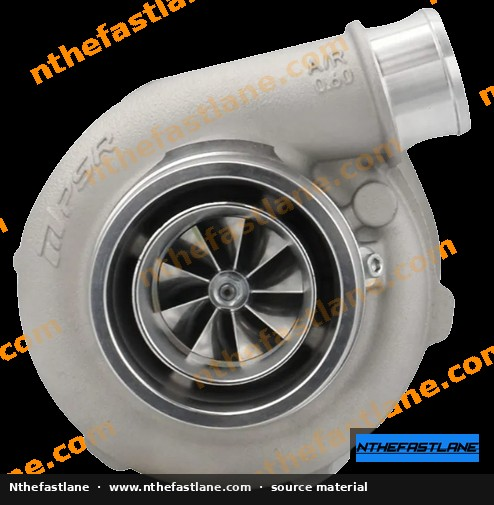
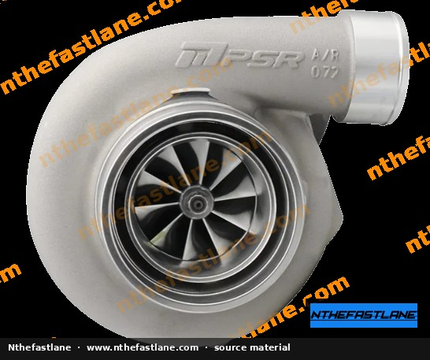
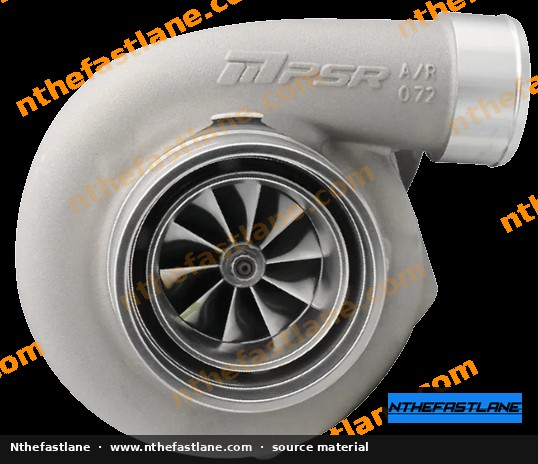
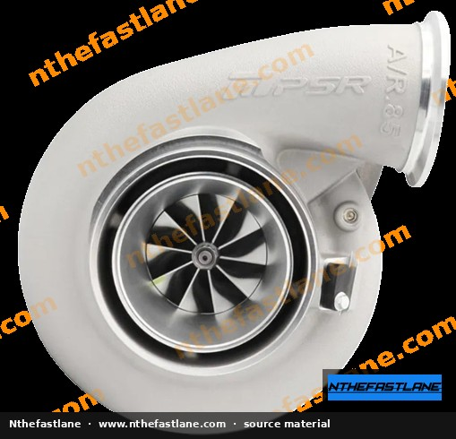

# Honda B-Series Torque Specifications and Tightening Sequences

This reference consolidates the critical fastener torque ranges and sequences used when assembling Honda **B-series** engines (B16, B17, B18, B20 families). Values vary by year, market, and whether OEM bolts or aftermarket studs are used.

> [!IMPORTANT]
> Confirm every value against the factory service manual (FSM) for the exact engine code and production year. Aftermarket head studs (for example ARP) use **their own** multi-stage torque-plus-angle or torque-only procedures - never apply OEM head-bolt specs to studs.

```carousel

<!-- slide -->

<!-- slide -->

<!-- slide -->

<!-- slide -->

<!-- slide -->


```

## Scope and Applicability

| Family | Common codes | Typical applications |
| :--- | :--- | :--- |
| B16 | B16A, B16A2, B16B | Civic, Del Sol, Integra (market-dependent) |
| B17 | B17A | Integra GSR (early) |
| B18 | B18A/B/C | Integra LS/GS/GSR/Type R, some Civics |
| B20 | B20B, B20Z | CR-V, some swap bases |

Always identify the engine from the block stamp and head casting before selecting a torque table.

## Preparation

- Clean and chase all threaded holes; damaged threads invalidate torque.
- Lightly oil under bolt heads and on threads **only when the FSM specifies lubricated torque**. Dry vs lubricated changes clamp load dramatically.
- Replace one-time-use fasteners (many OEM head bolts are TTY).
- Use a calibrated torque wrench; critical fasteners benefit from a second check after a heat cycle.

## Cylinder Head Fasteners

Honda B-series aluminum heads use a multi-pass sequence from the center outward.

1. Install a new head gasket oriented to the block dowels.
2. Finger-start all head bolts or stud nuts.
3. Follow the FSM sequence diagram (center-out spiral).
4. Apply the published multi-stage torque (and angle, if specified).

> [!WARNING]
> Do not reuse torque-to-yield head bolts. Under-torqued heads leak coolant/oil; over-torqued heads crack or pull threads.

**Aftermarket studs:** Follow the stud manufacturer’s procedure exactly (often a specific lubricant + multi-stage torque). Clamp load is not interchangeable with OEM bolt tables.

## Main Cap and Connecting-Rod Fasteners

| Joint | Notes |
| :--- | :--- |
| Main cap bolts | Sequence matters on girdled blocks; torque in stages per FSM |
| Rod bolts | Many B-series rod bolts are stretch-critical; measure stretch when the FSM or aftermarket kit requires it |
| Bridge / girdle bolts (where equipped) | Install after mains are final-torqued unless FSM says otherwise |

## Camshaft, Timing, and Valvetrain

| Fastener | Practice |
| :--- | :--- |
| Camshaft holder bolts | Even multi-pass pattern; avoid warping the holders |
| Cam sprocket bolts | Hold cam when torquing; confirm key/pin engagement |
| Timing belt tensioner | Set tension per FSM method (deflection or auto-tensioner procedure), then torque lock fastener |
| Valve cover bolts | Low torque; overtightening cracks covers and crushes gaskets |

## Front Cover, Oil Pump, and Seals

- Oil pump housing bolts: low–moderate torque; warped covers cause low oil pressure.
- Crank pulley / balancer bolt: very high torque; use a proper holding tool - do not rely on the starter.
- Water pump bolts: even pattern; replace the O-ring/gasket and verify weep-hole orientation.

## Intake, Exhaust, and Accessories

| Joint | Practice |
| :--- | :--- |
| Intake manifold | Center-out pattern; replace gaskets |
| Exhaust manifold / header | Hot-side fasteners often need anti-seize rated for exhaust temps; recheck after heat cycles |
| Starter, alternator, brackets | Snug to published values; elongated holes need alignment before final torque |
| Motor mount through-bolts | Torque with the powertrain weight supported in the design position |

## Representative Categories (verify in FSM)

These are **category reminders**, not substitutes for the manual:

- **Head bolts / studs:** multi-stage, sequence critical
- **Main caps:** multi-stage, sequence critical
- **Rod bolts:** torque or stretch method
- **Crank pulley bolt:** high torque + holding tool
- **Spark plugs:** moderate; use correct reach and anti-seize policy per plug maker
- **Oil drain plug:** crush washer replacement + moderate torque

## Verification Checklist

- [ ] Engine code confirmed; correct FSM table selected
- [ ] Fastener type confirmed (OEM TTY vs reusable vs stud kit)
- [ ] Thread repair (Heli-Coil/Time-Sert) accounted for if present
- [ ] Final torque recorded for critical joints
- [ ] Re-check exhaust and valve-cover fasteners after first heat cycle

## Related Work

When torque work is part of a larger job, pair this reference with head-gasket, timing-belt, and oil-pump procedures rather than treating fasteners as an isolated step.
