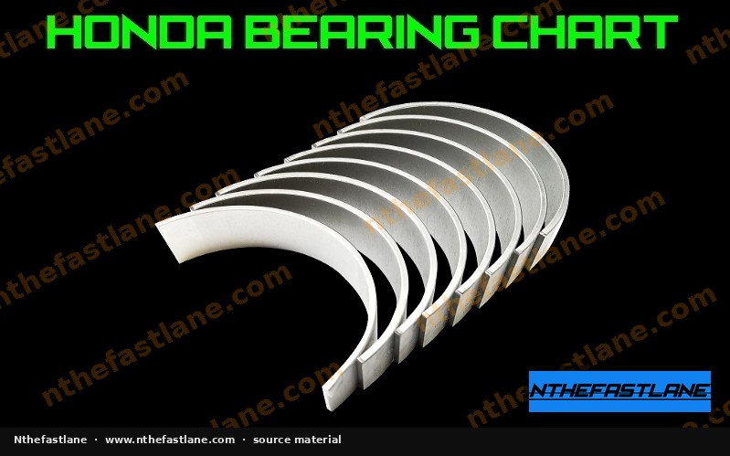

# Honda Main and Connecting-Rod Bearing Color Thickness Chart

## Understanding Honda Bearing Color Codes
Honda engines employ a selective assembly process for crankshaft main and connecting rod bearings. This system uses color codes to denote specific bearing thicknesses, ensuring precise oil clearance for optimal engine lubrication and longevity.

Correct bearing selection is critical during any engine rebuild or repair involving crankshaft or connecting rod replacement.

*Image placeholder - replace with a publication-cleared photo (d7f001_0f1eff48aa7c4d788825e690cafc8684~mv2.jpg).*

## The Bearing Selection Process
The selection of the appropriate bearing color (and thus thickness) depends on a combination of factors:

* **Crankshaft Journal Diameter:** Measured precisely.
* **Main Bearing Bore Diameter (Block):** Measured precisely.
* **Connecting Rod Big End Bore Diameter:** Measured precisely.
* **Crankshaft and Block/Rod Identification Marks:** Honda often stamps codes on the crankshaft, engine block, and connecting rods that, when cross-referenced with the factory service manual (FSM), indicate the required bearing size.

> [!IMPORTANT]
> Always consult the specific Honda factory service manual for your engine model to obtain the exact measurement procedures, identification mark locations, and the corresponding bearing color charts and thickness specifications. These values are crucial for accurate bearing selection.

## Common Bearing Color Designations
Honda bearings are typically identified by a paint mark or stamp, indicating their specific thickness. Common colors include:

* **Blue**
* **Black**
* **Brown**
* **Green**
* **Yellow**
* **Pink**

Each color corresponds to a specific thickness range. The thinnest bearings might be one color, and the thickest another, with intermediate colors filling the range.

> [!CAUTION]
> Do not assume bearing thickness based solely on color without consulting the FSM. The exact thickness values associated with each color can vary between engine families and models.

## Importance of Correct Bearing Clearance
Maintaining the factory-specified oil clearance is paramount for engine health.

* **Insufficient Clearance:** Can lead to metal-to-metal contact, excessive heat generation, oil film breakdown, and rapid bearing wear or seizure. This often results in a "spun bearing."
* **Excessive Clearance:** Can cause low oil pressure, reduced lubrication, increased noise (knocking), and premature wear of bearings and other engine components.

> [!TIP]
> After selecting and installing bearings, it is highly recommended to verify the oil clearance using a precision measurement tool like Plastigage. This confirms that the chosen bearings provide the correct clearance before final assembly.

## Measurement Tools and Techniques
Accurate measurement is fundamental to proper bearing selection. Essential tools include:

* **Micrometers:** For measuring crankshaft journal diameters.
* **Bore Gauges:** For measuring main bearing bores in the block and connecting rod big end bores.
* **Plastigage:** A crushable plastic thread used to measure actual oil clearance after bearing installation.

Ensure all measurements are taken at multiple points and angles to account for any taper or out-of-round conditions.

## Conclusion
The Honda bearing color thickness chart, found within the factory service manual, is an indispensable resource for achieving proper engine clearances. Diligent measurement and adherence to FSM specifications are key to a successful and durable engine rebuild.
