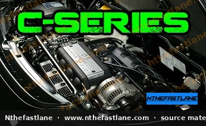

# Honda C-Series Engine Specifications and Identification

## Introduction
The Honda C-series engine family comprises a range of V6 powerplants primarily utilized in premium Honda and Acura vehicles, most notably the Acura Legend and the iconic Acura NSX. These engines are recognized for their smooth operation, robust design, and, in later iterations, the integration of Honda's VTEC (Variable Valve Timing and Lift Electronic Control) system.

*Image placeholder - replace with a publication-cleared photo (d7f001_0755daf2f06f49f28724c7e0c85c7e9c~mv2.jpg).*

## Engine Identification
Identifying a specific C-series engine variant typically involves locating the engine code stamped on the engine block. This code provides crucial information regarding the engine's displacement and specific configuration.

> [!IMPORTANT]
> Always verify the engine code directly on the engine block to ensure accurate identification, as vehicle documentation or previous modifications may not reflect the current engine.

## Key Characteristics
Honda C-series engines share several fundamental design elements:

* **V6 Configuration:** All C-series engines are V6 designs, offering a balance of power and refinement.
* **Aluminum Construction:** Featuring aluminum blocks and cylinder heads for reduced weight.
* **Overhead Camshafts:** Variants include both Single Overhead Camshaft (SOHC) and Dual Overhead Camshaft (DOHC) designs.
* **VTEC Technology:** Later and higher-performance C-series engines, such as the C30A and C32B found in the NSX, incorporate VTEC for enhanced power delivery across the RPM range.

## Common C-Series Variants and Applications
The C-series family includes several displacements, each tailored for specific vehicle applications. Detailed specifications, such as bore, stroke, compression ratio, and power output, vary significantly between these variants and should always be confirmed with the factory service manual.

| Engine Code | Displacement (Approx.) | Valvetrain | Notable Applications |
| :---------- | :--------------------- | :--------- | :------------------- |
| C20A | 2.0L | SOHC | Honda Legend (JDM) |
| C25A | 2.5L | SOHC | Acura Legend (early) |
| C27A | 2.7L | SOHC | Acura Legend |
| C30A | 3.0L | DOHC VTEC | Acura NSX |
| C32A | 3.2L | SOHC | Acura Legend |
| C32B | 3.2L | DOHC VTEC | Acura NSX (later) |
| C35A | 3.5L | SOHC | Acura RL |

> [!NOTE]
> The C35A engine, while part of the C-series family, is more commonly associated with the Acura RL (Legend in some markets) and represents a later evolution with increased displacement.

## Accessing Detailed Specifications
For precise technical data, including torque specifications, valve clearances, timing belt procedures, and specific component dimensions, it is essential to consult the official Honda/Acura factory service manual (FSM) for the exact engine and vehicle model in question.

> [!CAUTION]
> Using incorrect specifications can lead to engine damage or compromise vehicle safety. Always refer to the manufacturer's official documentation.

## Maintenance Considerations
General maintenance for C-series engines, like any V6, often involves:

* **Timing Belt Replacement:** Most C-series engines utilize a timing belt that requires periodic replacement at manufacturer-specified intervals.
* **Valve Adjustment:** SOHC variants typically require periodic valve lash adjustment. DOHC VTEC engines may have different requirements; consult the FSM.
* **Spark Plug Service:** Regular inspection and replacement of spark plugs are crucial for optimal engine performance and fuel efficiency.

> [!TIP]
> Adhering to the recommended service schedule outlined in your vehicle's owner's manual and the factory service manual will ensure the longevity and reliability of your C-series engine.
