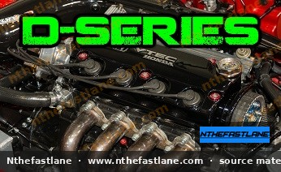

# Honda D-Series Engine Specifications and Identification

The Honda D-series engine family is a widely recognized and utilized line of inline four-cylinder engines, primarily found in various Honda Civic, CRX, and Del Sol models from the late 1980s through the early 2000s. Known for their compact design, fuel efficiency, and adaptability, D-series engines have powered a broad range of vehicles, from economy commuters to performance-oriented builds.

*Image placeholder - replace with a publication-cleared photo (d7f001_b72871854d394ee9ab2ed85dfaee2269~mv2.jpg).*

## Engine Identification

Identifying a specific D-series engine is crucial for maintenance, parts ordering, and performance modifications. The engine code, which indicates the engine series and specific variant, is typically stamped on the engine block.

### Locating the Engine Code

The engine code is usually found on a flat, machined surface on the front of the engine block, near the transmission bell housing or below the cylinder head. It will follow a format such as `D16A6` or `D17A2`.

> [!TIP]
> Clean the area thoroughly with a wire brush and degreaser if the stamp is obscured by dirt or oil buildup. A flashlight can also help in reading the code.

## D-Series Engine Families

The D-series encompasses several displacement variants, most commonly 1.5L (D15), 1.6L (D16), and 1.7L (D17). Each family includes various sub-variants, some featuring Honda's VTEC (Variable Valve Timing and Lift Electronic Control) technology.

### D15 Series

These 1.5-liter engines were prevalent in many entry-level Civic models. They typically feature a SOHC (Single Overhead Camshaft) design and can be found in both non-VTEC and VTEC-E (economy-focused VTEC) configurations. Common variants include the D15B, D15B7, and D15Z1.

### D16 Series

The 1.6-liter D16 engines are perhaps the most diverse and popular D-series variants, offering a balance of performance and efficiency. They are available in non-VTEC, SOHC VTEC, and VTEC-E forms. Notable examples include the D16A6, D16Z6, D16Y8, and D16Y7.

### D17 Series

The 1.7-liter D17 engines were introduced in the seventh-generation Civic (2001-2005). These engines exclusively feature SOHC VTEC technology, though some variants are designed for economy (VTEC-E) while others offer a more performance-oriented VTEC profile. Common variants include the D17A1 (non-VTEC in some markets, or VTEC-E) and D17A2 (VTEC).

## General Specifications

While specific figures vary significantly between individual D-series engine codes and market applications, some general characteristics apply across the family.

* **Cylinder Head:** Primarily SOHC (Single Overhead Camshaft) design.
* **Block Material:** Aluminum alloy.
* **Cylinder Head Material:** Aluminum alloy.
* **Valvetrain:** 4 valves per cylinder.
* **Fuel System:** Multi-point fuel injection (MPFI) is standard on most later models.

> [!IMPORTANT]
> For precise specifications such as bore, stroke, compression ratio, power output, and torque values for a specific D-series engine, always consult the official Honda factory service manual (FSM) corresponding to your vehicle's year and model. These figures vary widely even within the same engine family.

## VTEC Technology in D-Series Engines

Many D-series engines incorporate Honda's VTEC system, which optimizes valve lift and duration for improved performance or fuel economy. There are generally two types of VTEC found in D-series engines:

* **SOHC VTEC:** Utilizes a single camshaft with different cam profiles for intake valves (and sometimes exhaust valves) to enhance power at higher RPMs.
* **VTEC-E:** Designed for fuel efficiency, it uses a lean-burn mode at low RPMs by effectively deactivating one intake valve, then engaging both for higher RPM performance.

### Identifying VTEC Engines

VTEC-equipped D-series engines typically have a solenoid valve mounted on the cylinder head, usually on the exhaust side, which controls the VTEC oil pressure. Non-VTEC engines will lack this external solenoid.

## Maintenance Considerations

Proper maintenance is essential for the longevity and performance of any D-series engine. Key maintenance items include:

* **Timing Belt Replacement:** D-series engines are interference engines, meaning valve-to-piston contact will occur if the timing belt breaks. Adhere strictly to the factory-recommended replacement intervals, typically every 60,000 to 90,000 miles or every 7 years, whichever comes first.
* **Valve Lash Adjustment:** Many D-series engines require periodic valve lash adjustment to maintain optimal performance and prevent excessive valvetrain wear. Consult the FSM for specific clearance values and adjustment procedures.
* **Oil Changes:** Regular oil changes with the recommended viscosity and API rating are critical.
* **Coolant System:** Maintain the cooling system with Honda-approved coolant to prevent overheating and corrosion.

> [!CAUTION]
> Always refer to the factory service manual for exact maintenance schedules, fluid specifications, and torque values. Using incorrect parts or procedures can lead to engine damage.
