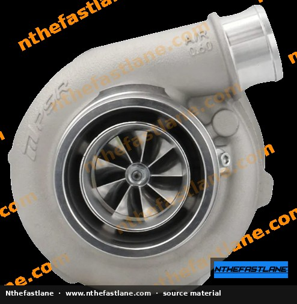
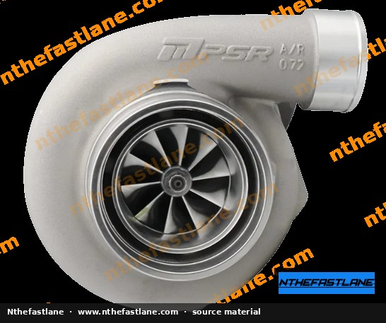
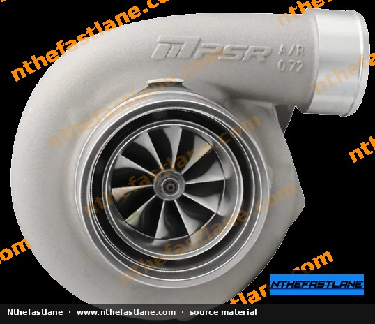
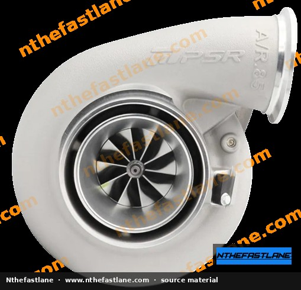
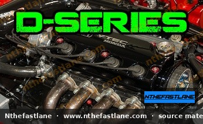

# Honda D-Series Torque Specifications and Tightening Sequences

Accurate torque application is critical for the reliability and longevity of any engine, especially during rebuilds or significant maintenance on Honda D-series engines (D13, D14, D15, D16, D17) found in models like the Civic, CRX, and Del Sol. This guide outlines general best practices and provides reported torque values for key components. However, specific values and tightening procedures can vary significantly by engine sub-model and year. 

> [!IMPORTANT]
> Always consult the official Honda Factory Service Manual (FSM) for your specific vehicle and engine model to confirm all torque specifications and tightening sequences. Discrepancies can lead to component failure or engine damage.

```carousel

<!-- slide -->

<!-- slide -->

<!-- slide -->

<!-- slide -->


```

## General Torque Application Guidelines

Proper torque application involves more than just tightening a bolt to a specific value. Adhering to these guidelines ensures fasteners achieve the correct clamping force.

*   **Clean Threads:** Ensure both bolt threads and tapped holes are clean and free of oil, grease, dirt, or old threadlocker. Contaminants can significantly alter the actual clamping force achieved at a given torque.
*   **Thread Lubrication:** Unless specified otherwise by the FSM, bolts should typically be clean and dry. For certain applications (e.g., cylinder head bolts with ARP studs), specific lubricants are required, which alter the target torque value. Always follow FSM or fastener manufacturer instructions regarding lubrication.
*   **Calibrated Torque Wrench:** Use a properly calibrated torque wrench. Torque wrenches should be checked periodically for accuracy.
*   **Multi-Step Tightening:** Critical fasteners, such as cylinder head bolts and main bearing cap bolts, often require a multi-step tightening sequence to ensure even clamping force across the mating surfaces.
*   **Tightening Pattern:** Follow the specified tightening pattern (e.g., center-out spiral) to prevent warping or uneven stress on components.

## Cylinder Head Bolt Torque

The cylinder head is a critical component, and its bolts must be torqued precisely to maintain head gasket integrity and prevent warping. The source material indicates various torque values for D-series cylinder head bolts, which likely correspond to different engine variants or steps within a multi-stage tightening procedure. It is crucial to follow the exact sequence and final torque specified in your FSM.

Reported individual torque values for D-series cylinder head bolts (confirm sequence and final values with FSM):

| Torque (ft-lbs) | Torque (in-lbs) |
| :-------------- | :-------------- |
| 16              | 192             |
| 33              | 396             |
| 40              | 480             |
| 43              | 516             |
| 47              | 564             |
| 54              | 648             |
| 61              | 732             |

> [!CAUTION]
> Never apply the final torque in a single step for cylinder head bolts. Always follow the FSM's prescribed multi-step sequence and pattern to avoid head warping or gasket failure.

## Main Bearing Cap Bolt Torque

Main bearing cap bolts secure the crankshaft within the engine block. Incorrect torque can lead to premature bearing wear or crankshaft damage. The source indicates a multi-step process for D-series main bearing cap bolts.

Reported values for D-series main bearing cap bolts:

| Step | Torque (ft-lbs) | Notes                                           |
| :--- | :-------------- | :---------------------------------------------- |
| 1    | 18              | Initial step (engine applicability unclear)     |
| Final| 47              | Final torque (specifically noted for D16A6)     |

> [!NOTE]
> The initial 18 ft-lbs step may apply broadly, but the final 47 ft-lbs is specifically associated with the D16A6 engine in the source. Always verify the correct sequence and final torque for your specific D-series engine with the FSM.

## Tightening Sequences

For components with multiple fasteners, such as cylinder heads, intake manifolds, and exhaust manifolds, a specific tightening sequence is essential to distribute clamping force evenly and prevent component distortion. While the exact pattern varies, a common approach is to start with the center fasteners and work outwards in a spiral or crisscross pattern.

> [!TIP]
> Refer to your FSM for detailed diagrams illustrating the correct tightening sequence for each component. This is often represented by numbered bolts in a diagram.

## Torque Wrench Maintenance

Regular calibration of your torque wrench is crucial for maintaining accuracy. Over time, or with improper use, torque wrenches can lose their calibration, leading to incorrect fastener tension. Consult your torque wrench manufacturer's guidelines for recommended calibration intervals and procedures.
