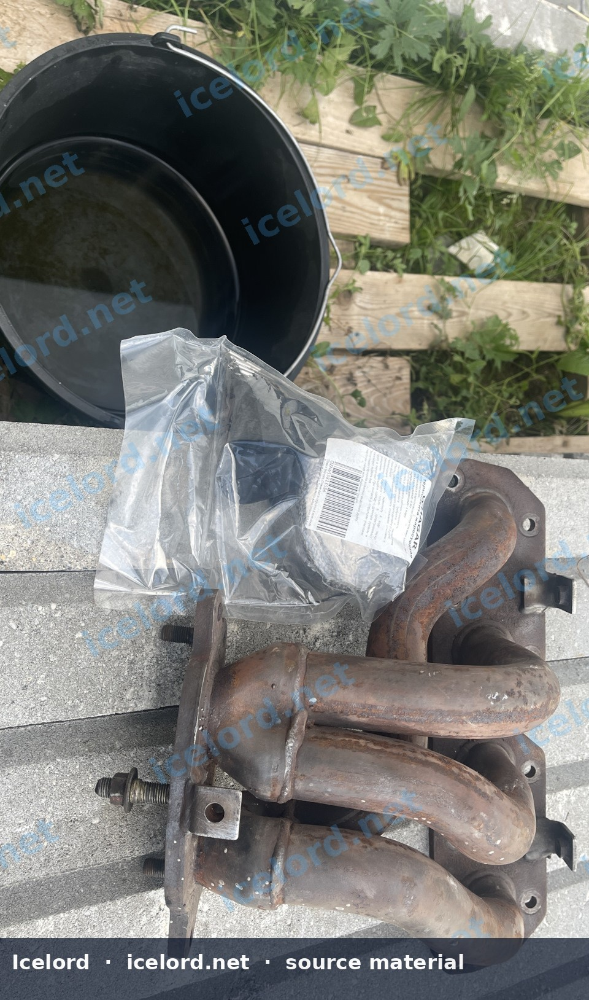
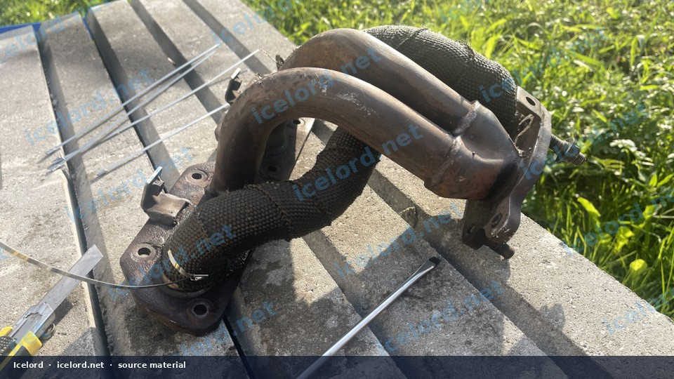
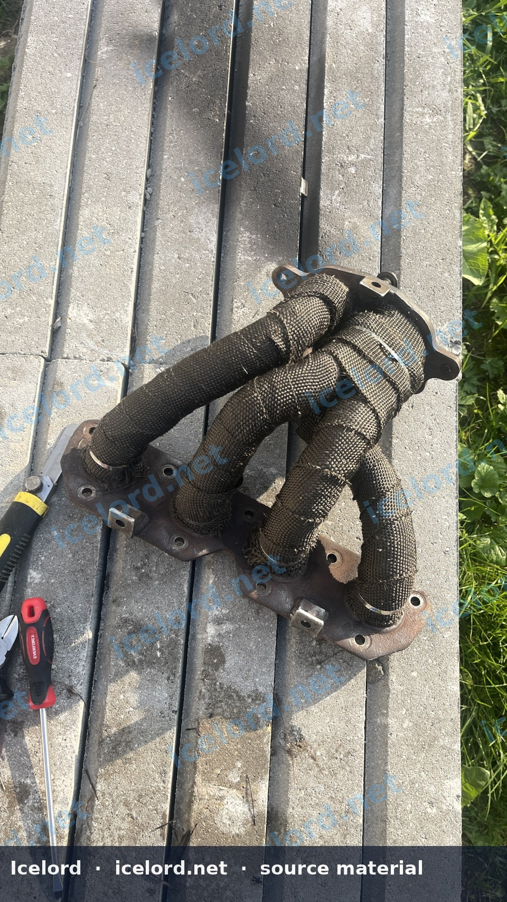
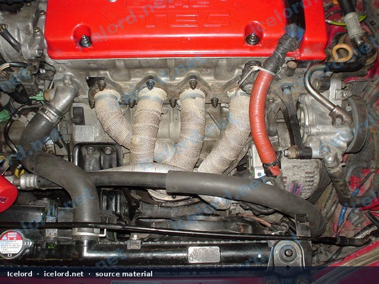
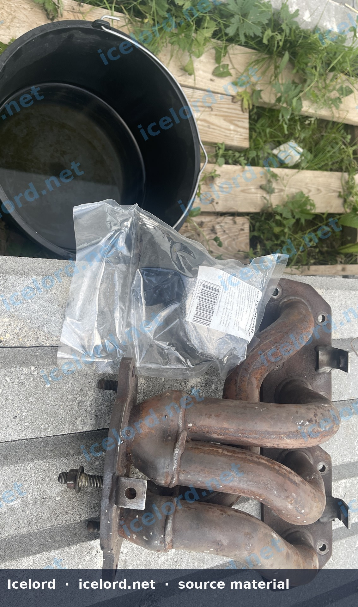
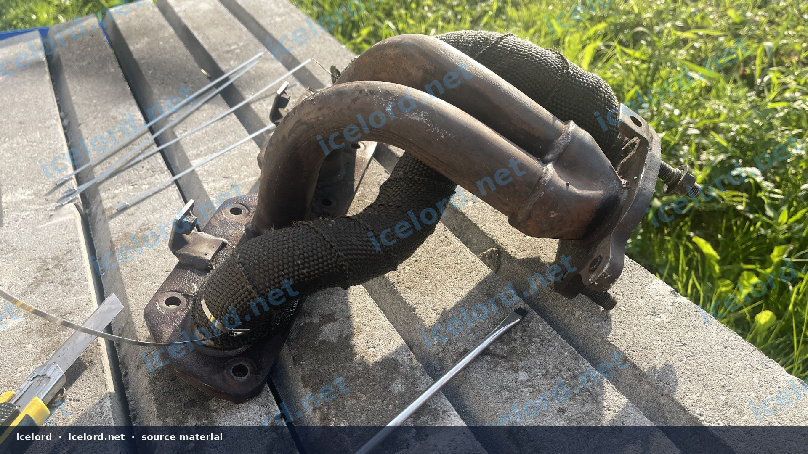
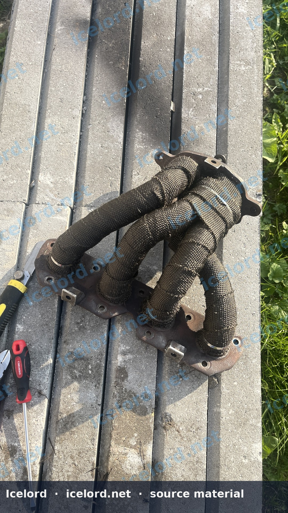

# Exhaust Header and Downpipe Heat-Wrap Installation

Exhaust wrap reduces radiant heat into the intake, wiring, and firewall. It also raises internal skin temperatures, so material choice and corrosion control matter - especially on mild-steel headers.

```carousel

<!-- slide -->

<!-- slide -->

<!-- slide -->

<!-- slide -->

<!-- slide -->

<!-- slide -->


```

## When Wrap Is Worth It

- Heat-soaked engine bays
- Clutch lines or wiring near primaries
- Cabin heat from the tunnel
- Close hood clearance to painted surfaces

## Materials

- Fiberglass or basalt wrap with an adequate continuous temperature rating
- Stainless locking ties or soft stainless wire
- Optional high-temp coating over the finished wrap
- Gloves, eye protection, and a dust mask when cutting wrap

## Preparation

1. Repair exhaust leaks first. Wrap does not seal cracks.
2. Degrease the tubing.
3. On mild steel, consider high-temp paint under the wrap or accept faster rust.
4. Mask oxygen-sensor bungs, flex joints, and slip joints that must move.

## Installation Technique

1. Start at the flange with a clean tuck under the first turn.
2. Maintain even tension; overlap about one-quarter of the wrap width (or the manufacturer’s guidance).
3. Keep layers tight without choking flex sections.
4. Finish ends with stainless ties; trim fibers cleanly.
5. Optional: apply a high-temp coating to reduce fraying and oil wicking.

> [!CAUTION]
> Wrapped primaries run hotter. Use fasteners, gaskets, and nearby hose materials rated for the extra heat. Inspect mild-steel headers for corrosion annually.

## First Heat Cycle

Expect some smoke and odor as binders burn off - do this outdoors. Retorque manifold flanges after the first full heat cycle. Confirm O2 sensors still switch; never bury a sensor tip under wrap.

## Maintenance

- Replace wrap that is oil-soaked (fire risk)
- Re-tie loose ends before they unravel into the belt path
- Recheck after off-road or track scrapes
