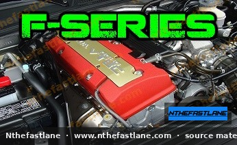

# Honda F-Series Engine Specifications and Identification

The Honda F-series engine family represents a range of inline four-cylinder powerplants primarily found in various Honda Accord and Prelude models. These engines are recognized for their robust design, fuel efficiency, and adaptability, serving as a foundation for both daily driving and performance applications.

*Image placeholder - replace with a publication-cleared photo (d7f001_dee4e20aace54fe08bb81e703c8a65ca~mv2.jpg).*

## Engine Identification

Honda F-series engines are typically identified by a stamped code found on the engine block, usually near the transmission mating surface or on the front of the block below the cylinder head. This code, such as `F22A` or `F23A`, indicates the engine series and its specific variant.

> [!TIP]
> When identifying an engine, always cross-reference the block code with the vehicle's factory service manual (FSM) to confirm the exact specifications and features.

## Common F-Series Variants

The F-series encompasses several displacement and valvetrain configurations. While many F-series engines are Single Overhead Cam (SOHC), some notable variants feature Double Overhead Cam (DOHC) and Honda's VTEC technology.

### F20 Variants

* **F20B:** Often a DOHC VTEC engine, commonly found in Japanese market Accord and Torneo models. Known for its higher-revving nature.

### F22 Variants

* **F22A:** A SOHC non-VTEC engine, widely used in early 1990s Honda Accord models. Reliable and known for its torque delivery.
* **F22B:** Available in both SOHC non-VTEC and SOHC VTEC configurations, found in later Accord and Prelude models. The VTEC version offers improved power delivery at higher RPMs.

### F23 Variants

* **F23A:** A SOHC VTEC engine, commonly found in late 1990s to early 2000s Accord models. Designed for a balance of power, fuel economy, and lower emissions, with some variants achieving Ultra-Low Emission Vehicle (ULEV) status.

## Key Features and Design

F-series engines share several fundamental design characteristics:

* **Block Construction:** High-pressure die-cast aluminum alloy block, contributing to lighter overall engine weight and efficient heat dissipation.
* **Crankshaft Support:** Features a five-main bearing crankshaft design, providing robust support and durability.
* **Valvetrain:** Primarily SOHC (Single Overhead Camshaft) designs, with some performance-oriented variants utilizing DOHC (Double Overhead Camshaft) configurations.
* **VTEC Technology:** Many F-series engines incorporate Honda's Variable Valve Timing and Lift Electronic Control (VTEC) system, optimizing valve operation for improved power and efficiency across the RPM range.

## General Performance Specifications

Peak torque figures vary significantly between F-series engine variants due to differences in displacement, compression ratio, valvetrain design, and tuning. The following are examples of peak torque values observed in various F-series engines:

| Engine Characteristic | Value (Approximate) |
| :-------------------- | :------------------ |
| Peak Torque Example 1 | 137.7 lb·ft (186 Nm) @ 5000 rpm |
| Peak Torque Example 2 | 150 lb·ft (203 Nm) |
| Peak Torque Example 3 | 153 lb·ft (206 Nm) @ 4500 rpm |

> [!IMPORTANT]
> These figures are general examples of peak engine output. For specific engine torque specifications, such as fastener torques for maintenance or assembly, always consult the official Honda factory service manual for your exact vehicle and engine code.

## Maintenance Considerations

Routine maintenance is crucial for the longevity and performance of any F-series engine. Key maintenance items include:

* **Oil Changes:** Adhere to recommended oil change intervals and use the specified oil viscosity.
* **Timing Belt Replacement:** F-series engines are interference designs, meaning timing belt failure can cause severe engine damage. Follow the factory recommended replacement schedule, typically every 60,000 to 105,000 miles, or as specified in the FSM.
* **Valve Lash Adjustment:** SOHC F-series engines require periodic valve lash inspection and adjustment to maintain optimal performance and prevent excessive valvetrain wear. Refer to the FSM for specific clearance values and procedures.
* **Spark Plugs:** Use the recommended spark plug type and gap for your specific engine variant.

> [!CAUTION]
> Always refer to the Honda factory service manual for precise maintenance schedules, fluid capacities, torque specifications, and repair procedures specific to your vehicle's year, model, and engine code. Using incorrect specifications can lead to engine damage or reduced performance.
