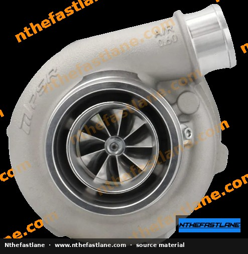
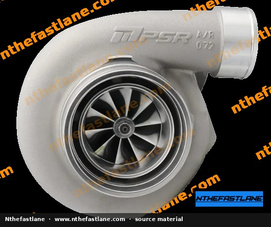
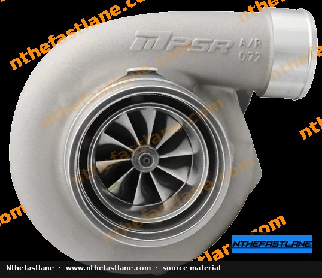
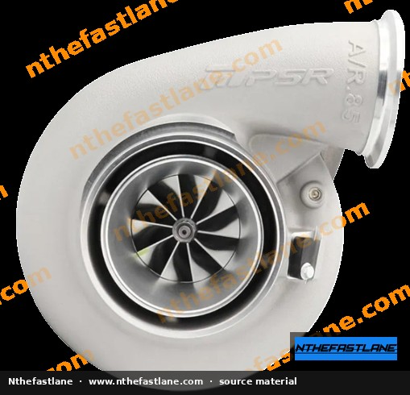
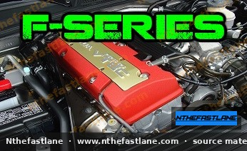

# Untitled

```yaml
summary: Provides essential torque specifications for Honda F-series engines, covering critical components like connecting rods, main caps, and ancillary hardware.
tags: [f-series, torque-specifications, engine-rebuild]
applies_to: {"models": ["accord", "prelude"], "engines": ["f20", "f22", "f23", "h22", "h23"]}
complexity: advanced
```

# Honda F-Series Engine Torque Specifications

This article compiles critical torque specifications for various components of Honda F-series engines, including the F20, F22, and F23 variants, often found in Accord and Prelude models. Accurate torque application is essential for engine reliability and longevity, especially during rebuilds or significant maintenance.

> [!IMPORTANT]
> Always consult the official Honda factory service manual (FSM) for your specific vehicle year and model to confirm all torque values and tightening sequences. Discrepancies may exist between engine variants or model years. While this article focuses on F-series engines, users working on H-series engines (H22, H23) should also consult their specific FSM, as some general principles may apply but specific values can differ.

```carousel

<!-- slide -->

<!-- slide -->

<!-- slide -->

<!-- slide -->


```

## Engine Internal Components

Precise torque values are vital for internal engine components to ensure proper bearing clearances, sealing, and overall structural integrity.

### Connecting Rod Bolts

Connecting rod bolts are critical for securing the connecting rod to the crankshaft. Incorrect torque can lead to catastrophic engine failure.

| Component         | Torque Specification |
| :---------------- | :------------------- |
| Connecting Rod Bolts | 18 ft-lb + 90°       |

### Main Cap Bolts

Main cap bolts secure the crankshaft main bearing caps to the engine block.

| Component      | Torque Specification |
| :------------- | :------------------- |
| Main Cap Bolts | 16 ft-lb + 90°       |

### Crank Pulley Bolt (Harmonic Balancer Bolt)

The crank pulley bolt secures the harmonic balancer to the crankshaft. This bolt is known for being very tight and requires specific attention.

| Component           | Torque Specification | Notes                                                              |
| :------------------ | :------------------- | :----------------------------------------------------------------- |
| Crank Pulley Bolt   | 181 ft-lb            | Some Technical Service Bulletins (TSBs) recommend 220 ft-lb for improved retention. Confirm with FSM. |

### Flywheel Bolts

Flywheel bolts attach the flywheel to the crankshaft.

| Component      | Torque Specification |
| :------------- | :------------------- |
| Flywheel Bolts | 79.6 ft-lb           |

## Cylinder Head and Valvetrain

Proper torque for cylinder head components ensures valve timing accuracy and prevents oil leaks.

### Cam Cap Bolts

Cam cap bolts secure the camshaft bearing caps.

| Component    | Torque Specification |
| :----------- | :------------------- |
| Cam Cap Bolts | 8.7 ft-lb            |

### Cam Gear Bolt

The cam gear bolt secures the camshaft sprocket to the camshaft.

| Component    | Torque Specification |
| :----------- | :------------------- |
| Cam Gear Bolt | 25 ft-lb             |

### Valve Cover Bolts

Valve cover bolts seal the valve cover to the cylinder head.

| Component        | Torque Specification |
| :--------------- | :------------------- |
| Valve Cover Bolts | 7.2 ft-lb            |

### Cylinder Head Bolts

> [!CAUTION]
> Cylinder head bolt torque and tightening sequence are extremely critical for proper head gasket sealing and engine integrity. The specific procedure often involves multiple steps, including initial torque, angle turns, and sometimes re-torquing after a heat cycle. **Always refer to the factory service manual for the precise F-series cylinder head bolt torque specifications and tightening sequence for your specific engine variant.** Incorrect procedure can lead to head gasket failure or cylinder head warpage.

## Engine Ancillary Components

These components are external to the main engine block but are crucial for engine operation.

### Alternator Components

| Component                 | Torque Specification |
| :------------------------ | :------------------- |
| Alternator Power Nut      | 9 ft-lb              |
| Alternator Pulley Lock Nut | 81.7 ft-lb           |
| Alternator Support        | 33 ft-lb             |

### Belt Tensioner Components

| Component               | Torque Specification |
| :---------------------- | :------------------- |
| Belt Tensioner (to block) | 16 ft-lb             |
| Belt Tensioner Pulley   | 31 ft-lb             |

### Oil System Components

| Component           | Torque Specification |
| :------------------ | :------------------- |
| Block Drain Bolt    | 61 ft-lb             |
| Oil Pan Bolts       | 8.7 ft-lb            |
| Oil Pump Bolts      | 8.7 ft-lb            |
| Oil Pump Relief Valve | 29 ft-lb             |

### Cooling System Components

| Component                | Torque Specification |
| :----------------------- | :------------------- |
| Water Pump Bolts         | 8.7 ft-lb            |
| Thermostat Housing Bolts | 8.7 ft-lb            |

### Ignition System

| Component   | Torque Specification | Notes                                                              |
| :---------- | :------------------- | :----------------------------------------------------------------- |
| Spark Plugs | 13 ft-lb or 22 ft-lb | Confirm specific value with FSM; generally hand-tighten then turn 1/2 to 2/3 turn. |

## General Torque Application Guidelines

*   **Clean Threads:** Always ensure bolt threads and mating surfaces are clean and free of oil, grease, or debris unless specified otherwise (e.g., oil on main/rod bolts).
*   **Thread Lubrication:** Unless specified, torque values are typically for clean, dry threads. If using thread locker or anti-seize, adjust torque values according to the product manufacturer's recommendations or FSM guidance.
*   **Gradual Tightening:** For components with multiple bolts (e.g., oil pan, valve cover), tighten bolts in a crisscross or spiral pattern in several stages until the final torque is reached. This helps prevent warpage and ensures even clamping force.
*   **Torque Wrench Calibration:** Use a properly calibrated torque wrench for accurate results.
*   **Angle Torque:** For bolts requiring an angle turn (e.g., connecting rods, main caps), ensure the initial torque is applied accurately before performing the angle turn.

> [!TIP]
> When reassembling, consider replacing critical fasteners like connecting rod bolts, main cap bolts, and cylinder head bolts, especially if they are torque-to-yield (TTY) type bolts, as they are designed for single use. Consult your FSM for recommendations.
