# Fourth-Generation Honda Prelude Stealth Subwoofer Enclosure

A stealth sub uses existing Prelude BB trunk cavities so the cargo area still looks factory while adding bass. Good results come from correct net volume and rigid, sealed construction - not from cramming the largest woofer into the spare well.

```carousel
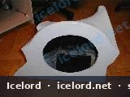
<!-- slide -->
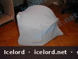
<!-- slide -->
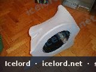
<!-- slide -->
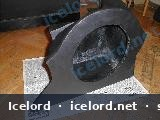
<!-- slide -->
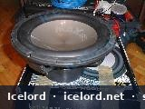
<!-- slide -->

<!-- slide -->
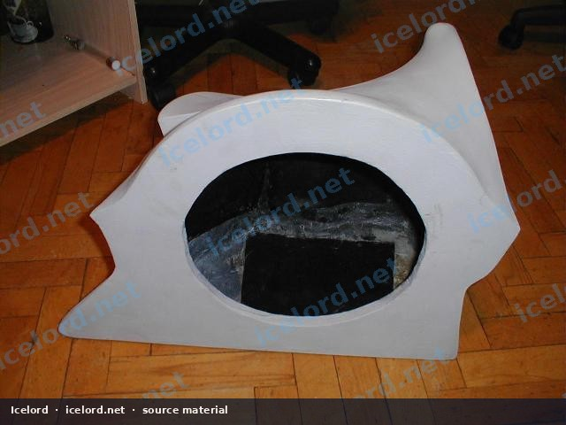
<!-- slide -->


```

```carousel
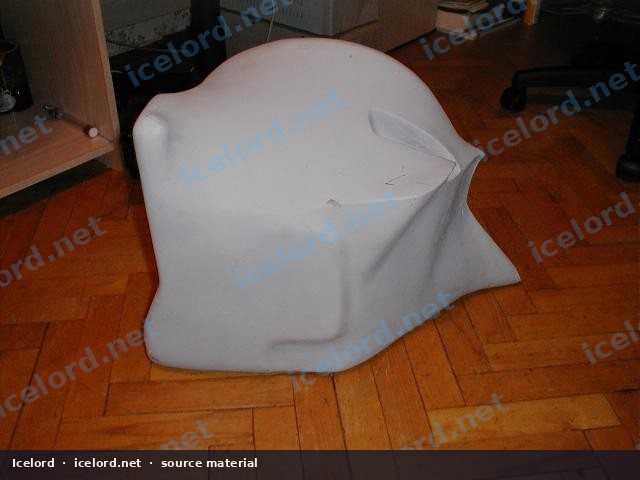
<!-- slide -->
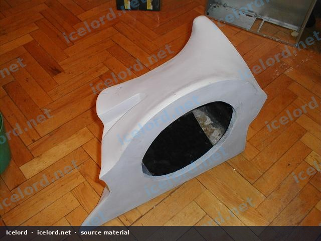
<!-- slide -->
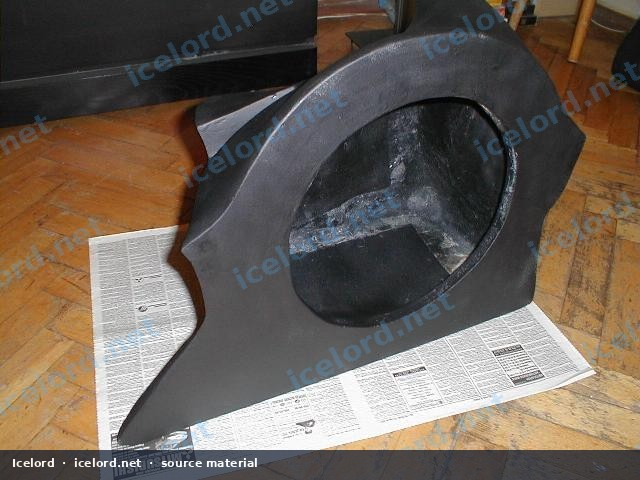
<!-- slide -->
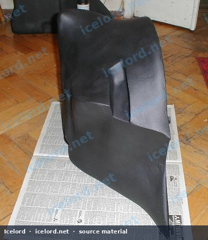
<!-- slide -->
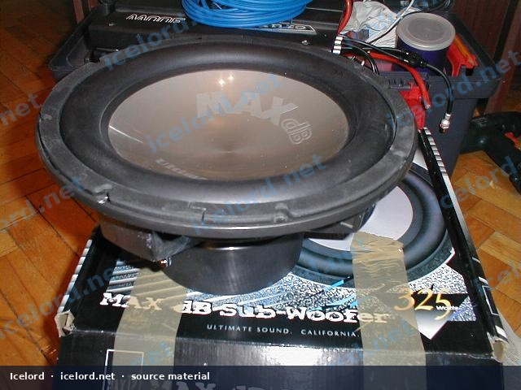
<!-- slide -->
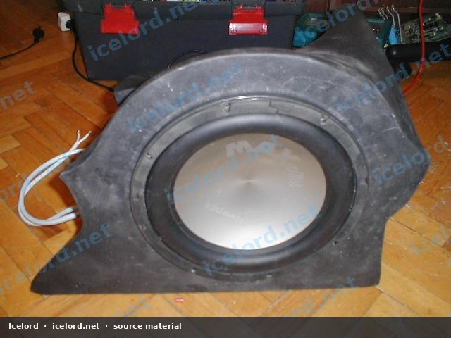

```

## Design Inputs

| Input | Why |
| :--- | :--- |
| Driver parameters (Fs, Vas, Qts) | Sealed vs ported and liters required |
| Cavity map | Side pocket, false floor, or spare area |
| Amplifier power | Wire gauge, fuse, thermal load |
| Factory brace points | Safe mounting without crushing sheet metal |

## Construction

1. Cardboard-template the cavity before cutting wood.
2. Use stiff plywood or MDF; brace large panels.
3. Glue and screw every joint; seal air leaks with glue fillets or silicone.
4. Provide a service hatch for the driver.
5. Carpet visible faces to match the trunk.

## Electrical

- Fused power at the battery
- Short ground to bare metal
- RCAs routed away from ECU and fuel-pump noise sources
- Grommets at every bulkhead pass-through

## Validation

- Impedance check before power-up
- No buzzes over rough roads
- Gains set without audible distortion
- Terminals rechecked after a week

If the box volume is wrong, no amount of EQ will make it sound right - fix the enclosure first.
