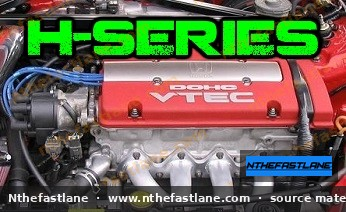

# Honda H-Series Engine Specifications and Identification

The Honda H-series engine family is renowned for its performance and durability, primarily found in the Prelude and Accord models. This guide provides an overview of how to identify these engines and their general characteristics, emphasizing the importance of consulting the factory service manual for precise specifications.

*Image placeholder - replace with a publication-cleared photo (d7f001_3f3b883e321c49a2bc355708c2cb2b21~mv2.jpg).*

## Engine Identification

Identifying a specific H-series engine is crucial for correct maintenance and part selection. The engine code is typically stamped on the engine block, usually near the transmission mating surface or below the cylinder head on the exhaust side.

### Common H-Series Engine Codes

* **H22A/H22A1/H22A4:** These are the most common performance-oriented H-series engines, featuring DOHC VTEC technology. They are frequently found in Honda Preludes and some Accord models, particularly in international markets.
* **H23A:** While some H23A variants are non-VTEC (often found in Accords), there are also VTEC versions, particularly from Japanese domestic market (JDM) applications. These are typically 2.3-liter DOHC engines.

> [!NOTE]
> The F-series engines (e.g., F20B, F22B, F23A) are sometimes confused with or swapped into chassis originally equipped with H-series engines due to their similar architecture and mounting points. While distinct, they share some design principles and applications with the H-series family.

### Visual Identification Cues

* **DOHC VTEC Valve Cover:** Most performance H-series engines, such as the H22A, feature a distinctive valve cover prominently displaying "DOHC VTEC" across the top.
* **Block Casting:** The engine code (e.g., H22A) is cast or stamped into the engine block, providing definitive identification.

## General Engine Characteristics

H-series engines are known for their double overhead camshaft (DOHC) design, with many popular variants incorporating Honda's Variable Valve Timing and Lift Electronic Control (VTEC) system.

* **Displacement:** The H-series primarily consists of 2.2-liter (H22) and 2.3-liter (H23) displacements. The F20B, often considered a close relative, is a 2.0-liter variant.
* **Cylinder Head:** All H-series engines utilize a DOHC cylinder head, providing excellent airflow characteristics.
* **VTEC System:** Most performance H-series engines (e.g., H22A) feature VTEC, which optimizes valve lift and duration for improved power across the RPM range.

## Important Considerations for Specifications

> [!IMPORTANT]
> Due to numerous regional variations, model year differences, and specific engine codes (e.g., H22A vs. H22A4), it is critical to consult the official Honda Factory Service Manual (FSM) for the exact specifications pertaining to your specific engine. This includes, but is not limited to:

* **Bore and Stroke:** Precise cylinder dimensions.
* **Compression Ratio:** The ratio of cylinder volume at bottom dead center to top dead center.
* **Horsepower and Torque:** Output figures can vary significantly between variants.
* **Torque Specifications:** Critical fastening torques for components like cylinder head bolts, connecting rod bolts, and main bearing caps.
* **Valve Clearances:** Essential for proper engine operation and longevity.
* **Timing Belt Replacement Interval:** A crucial maintenance item for interference engines like the H-series.

Always verify any technical figures against the FSM for the specific vehicle and engine code to ensure accuracy and prevent potential damage during service or modification.
