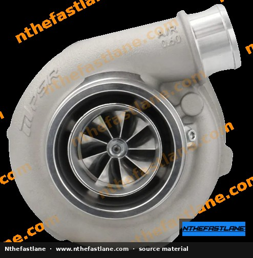
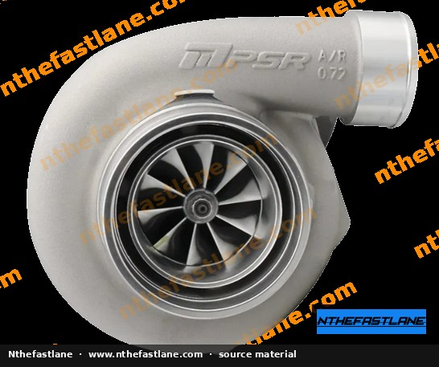
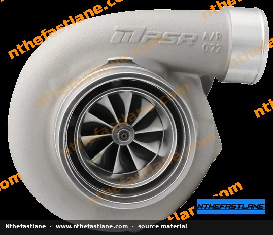
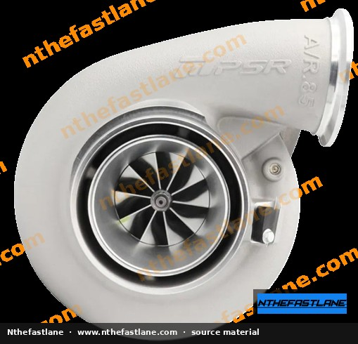
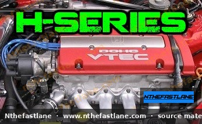

# Honda H-Series Engine Torque Specifications and Tightening Sequences

Accurate torque application is critical for the proper assembly, sealing, and long-term reliability of any engine, especially high-performance Honda H-series powerplants. Incorrectly torqued fasteners can lead to oil leaks, gasket failures, component damage, or even catastrophic engine failure. This guide outlines key torque specifications and best practices for H-series engines.

```carousel

<!-- slide -->

<!-- slide -->

<!-- slide -->

<!-- slide -->

<!-- slide -->


```

## General Torquing Principles

Adhering to fundamental torquing practices ensures that fasteners are tightened correctly and consistently.

*   **Cleanliness:** Always ensure that bolt threads and mating surfaces are clean and free of oil, grease, dirt, or old threadlocker. Contaminants can significantly alter the actual clamping force achieved.
*   **Lubrication:** Unless specified as "dry torque," most Honda fasteners require a light coat of engine oil on the threads and under the bolt head to achieve accurate torque readings. Always confirm the specific lubrication requirements in the factory service manual (FSM).
*   **Calibrated Tools:** Use a high-quality, recently calibrated torque wrench. For critical fasteners, a click-type or beam-type wrench is recommended.
*   **Multi-Step Torquing:** Many components require a multi-step tightening process, gradually increasing torque to the final specification. This ensures even clamping force and prevents component distortion.

> [!IMPORTANT]
> Always consult the official Honda Factory Service Manual (FSM) for your specific engine model (e.g., H22A, H23A, F20B, F22B, F23A) to confirm all torque specifications and tightening sequences. Values can vary slightly between engine variants and model years.

## Key Component Torque Specifications

The following table provides common torque specifications for certain H-series engine components. These values should always be cross-referenced with your specific FSM.

| Component                  | Fastener Size | Torque (Nm) | Torque (lb-ft) | Notes                               |
| :------------------------- | :------------ | :---------- | :------------- | :---------------------------------- |
| Cam Cap Bolts              | 8 x 1.25 mm   | 22          | 19 (H22)       | 16 lb-ft for H23A                   |
| Cam Cap Bolts              | 6 x 10 mm     | 12          | 9              |                                     |
| Thermostat Housing to Head | 6 x 1.0 mm    | 12          | 9              | Confirm with FSM                    |

> [!CAUTION]
> The values provided are for reference only. Discrepancies may exist due to engine variant, model year, or specific repair procedures. **Always refer to the official Honda Factory Service Manual for the most accurate and up-to-date specifications for your vehicle.**

### Other Critical Components Requiring FSM Confirmation

Many other engine components require precise torque specifications and, in some cases, specific tightening sequences. These values are crucial for engine integrity and must be obtained directly from the FSM:

*   **Cylinder Head Bolts:** Often require a multi-step sequence and may be torque-to-yield (TTY) bolts, which are single-use.
*   **Connecting Rod Cap Nuts:** Critical for bearing longevity and engine performance.
*   **Main Bearing Cap Bolts:** Essential for crankshaft stability and bearing life.
*   **Crankshaft Pulley Bolt (Crank Bolt):** Extremely high torque, often requiring specialized tools and procedures.
*   **Flywheel / Flexplate Bolts:** Secure the flywheel or flexplate to the crankshaft.
*   **Oil Pan Bolts:** Ensure a leak-free seal.
*   **Valve Cover Bolts:** Prevent oil leaks from the top end.
*   **Intake Manifold Nuts/Bolts:** Critical for preventing vacuum leaks.
*   **Exhaust Manifold Nuts/Bolts:** Ensure a proper seal and prevent exhaust leaks.
*   **Spark Plugs:** Proper torque prevents damage to cylinder head threads and ensures good heat transfer.
*   **Transmission Bell Housing Bolts:** Secure the transmission to the engine block.

## Tightening Sequences

For components with multiple fasteners, such as cylinder heads, intake manifolds, and valve covers, a specific tightening sequence is often required. These sequences ensure even pressure distribution across the gasket or mating surface, preventing warpage and promoting a proper seal.

*   **Cylinder Head:** Typically involves a spiral pattern, starting from the center and working outwards, often in multiple passes.
*   **Intake/Exhaust Manifolds:** Also commonly use a center-out pattern.
*   **Valve Cover:** Usually a simple criss-cross or center-out pattern to prevent distortion.

> [!TIP]
> When performing any engine assembly, it is good practice to mark each fastener with a paint pen or marker after it has been torqued to its final specification. This helps visually confirm that no bolts have been missed or undertorqued.

## Verification and Best Practices

After torquing, it's good practice to re-check critical fasteners, especially after a short run-in period for some components (e.g., cylinder head bolts, if specified by the FSM). Always replace torque-to-yield (TTY) bolts, if applicable, as they are designed to stretch permanently during initial tightening and cannot be reused.

Precision in torquing is a cornerstone of reliable engine assembly. By diligently following FSM specifications and best practices, you can ensure the longevity and performance of your Honda H-series engine.
