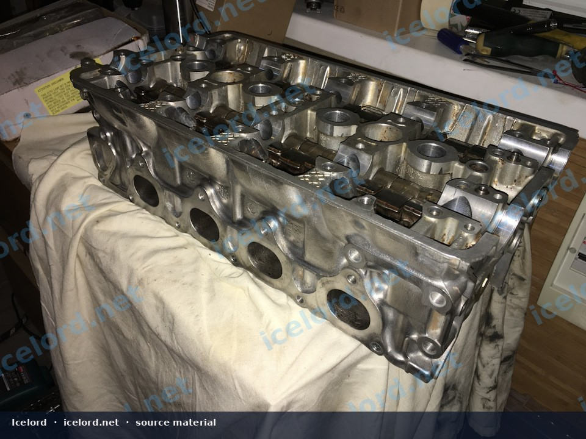
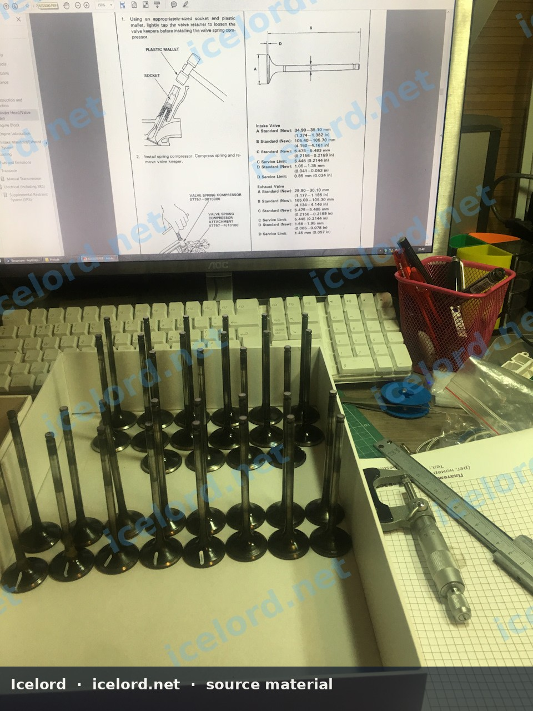
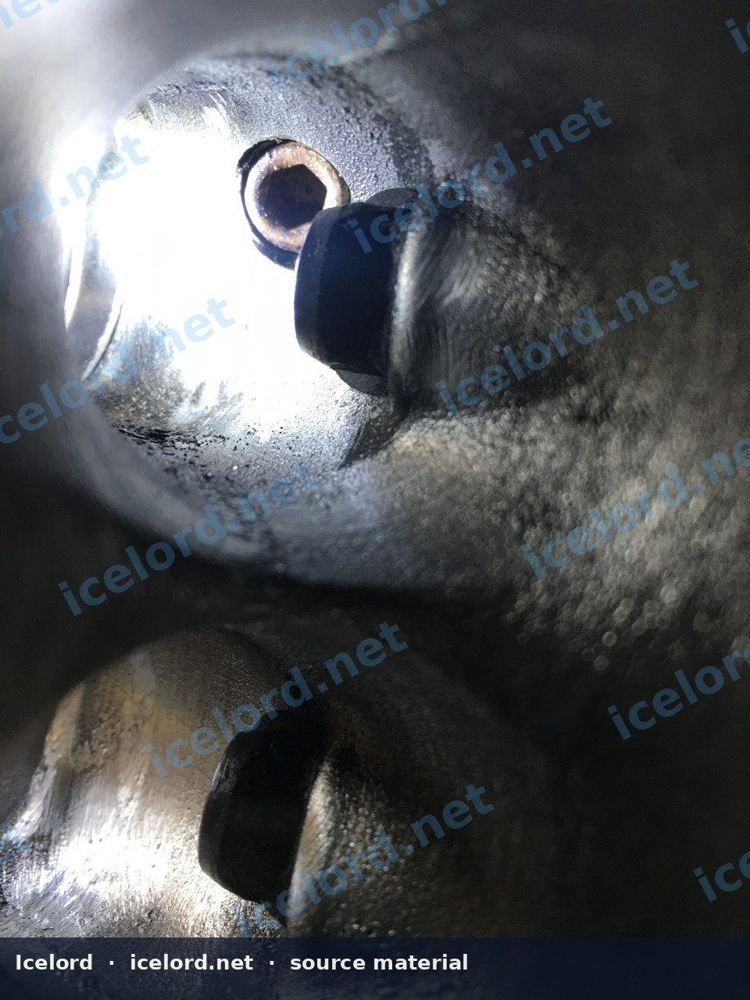
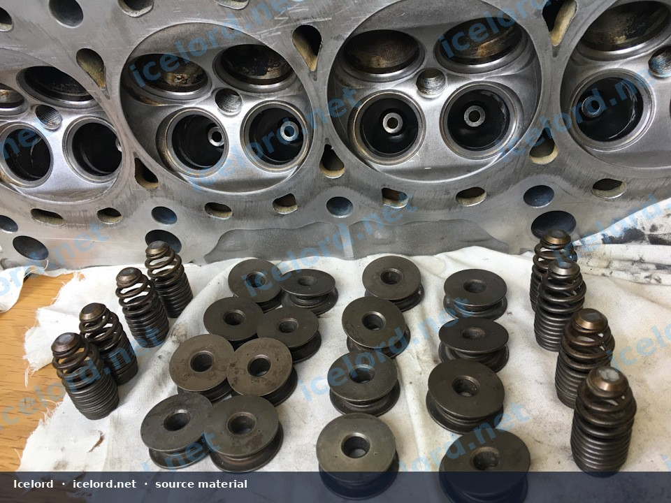
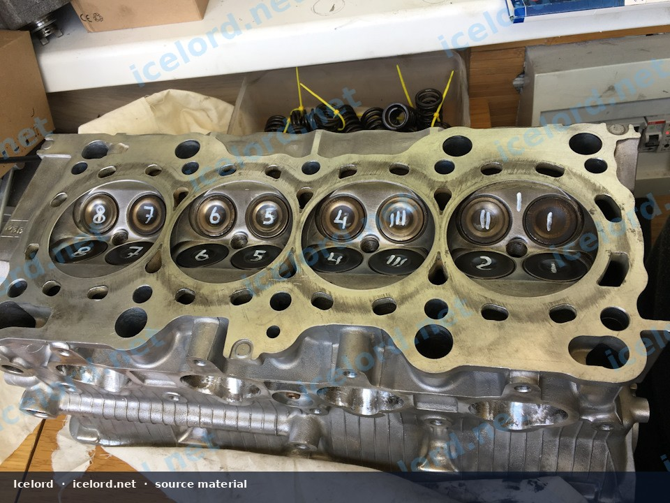
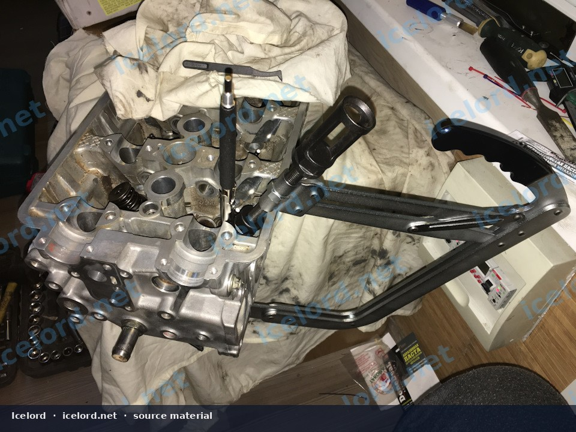

# Honda H22/H23 Cylinder Head Inspection and Rebuild

H22 and H23 cylinder heads are high-value cores. A rebuild is measurement-driven: warp, cracks, guide wear, and VTEC oiling faults decide whether the head is worth assembling.

```carousel

<!-- slide -->

<!-- slide -->

<!-- slide -->

<!-- slide -->

<!-- slide -->


```

## Scope

- H22A VTEC heads (Prelude/Accord family applications)
- H23 non-VTEC heads and hybrid swaps using H22 VTEC hardware
- Cam holders, rockers, valves, seats, guides, and oil-control components

## Disassembly Notes

1. Mark cam caps and rockers so they return to their original journals.
2. Measure valve stem-to-guide clearance before heating or blasting parts.
3. Keep VTEC rockers and the spool valve together for inspection - do not mix random rocker sets.
4. Clean oil galleries thoroughly; aluminum chips from previous machine work are a common failure seed.

## Inspection Criteria

| Check | Why |
| :--- | :--- |
| Deck warp | Causes head-gasket coolant/oil mixing |
| Cracks (seats, between valves) | Scrap criteria on most street builds |
| Guide wear | Oil consumption and seat sealing loss |
| Seat concentricity | Idle quality and compression |
| Cam journals / rocker pads | Tick and accelerated lobe wear |
| VTEC passages and screens | Failed engagement or partial lockover |

## Machine Work

- Pressure test before expensive valve work when overheating history exists
- Resurface only within FSM material limits
- Perform a multi-angle valve job if seats are worn; replace guides when clearance is out of range
- Check spring free length and installed height if the engine is high-mileage or cammed

## Assembly

1. Install new valve stem seals; oil stems during install.
2. Confirm seat seal with solvent or vacuum testing.
3. Oil cam journals; torque cam caps in sequence to avoid pinching.
4. Set cold valve clearance to the engine-specific intake/exhaust values.
5. Verify VTEC rocker movement and oil supply path before the valve cover goes on.

## Sealing to the Block

- Use the correct head gasket for bore size and MLS vs composite design
- Replace torque-to-yield head bolts
- Follow multi-stage torque sequence from the center outward
- Replace coolant and oil after any contamination event

## First-Fire and Break-In

Prime the oiling system if possible. Confirm oil pressure quickly, check for external leaks, and recheck valve cover and exhaust fasteners after heat. If the head was resurfaced, recheck idle mixture and timing because compression and geometry can shift slightly.

## Related Jobs

Pair head rebuilds with timing-belt components, water pump, and thermostat service while access is open.
