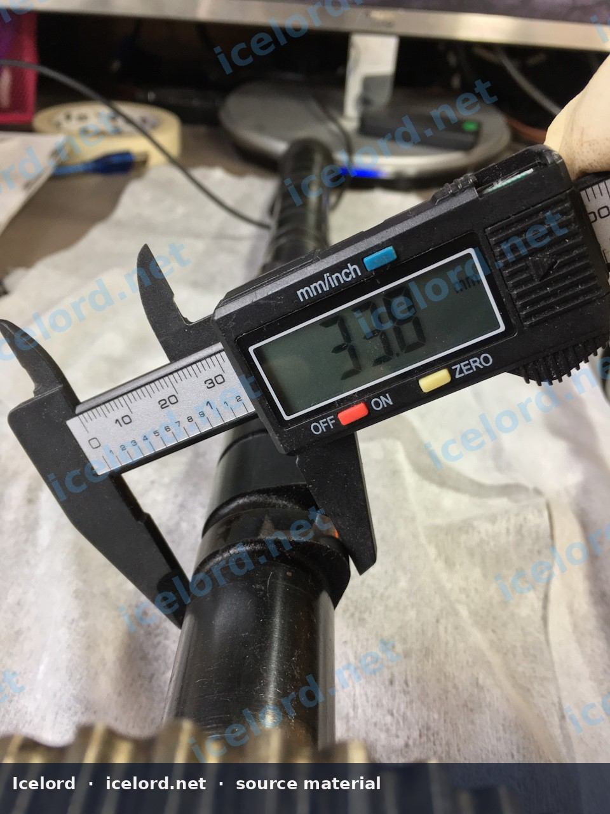
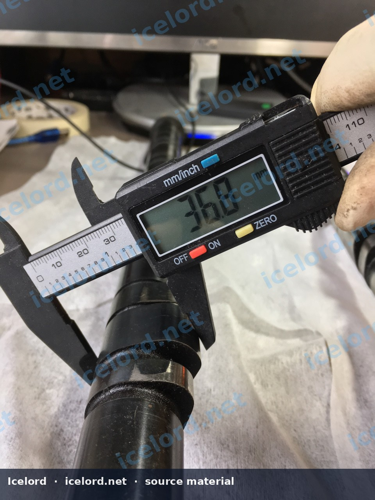
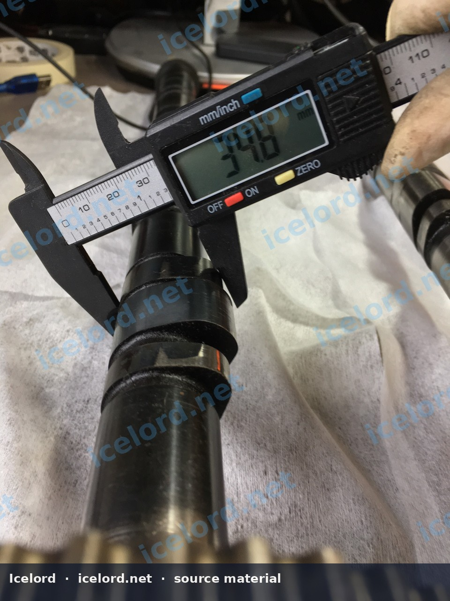
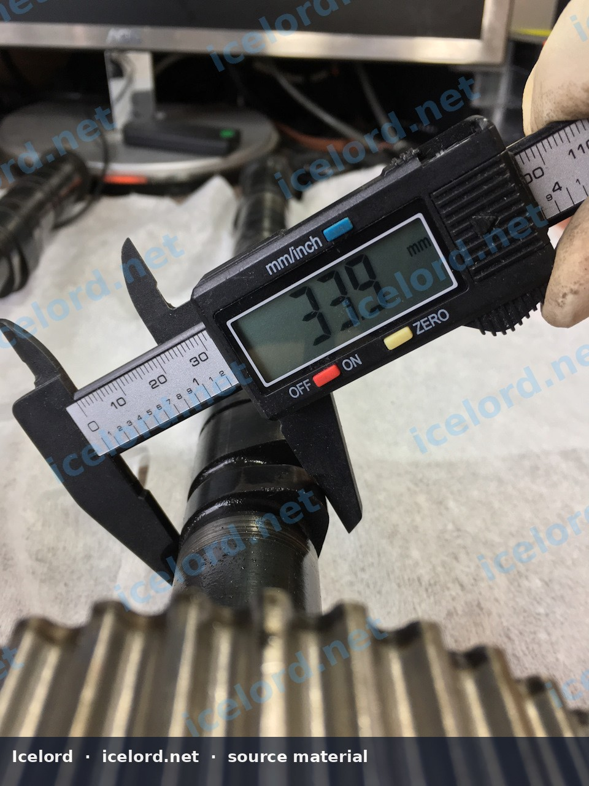
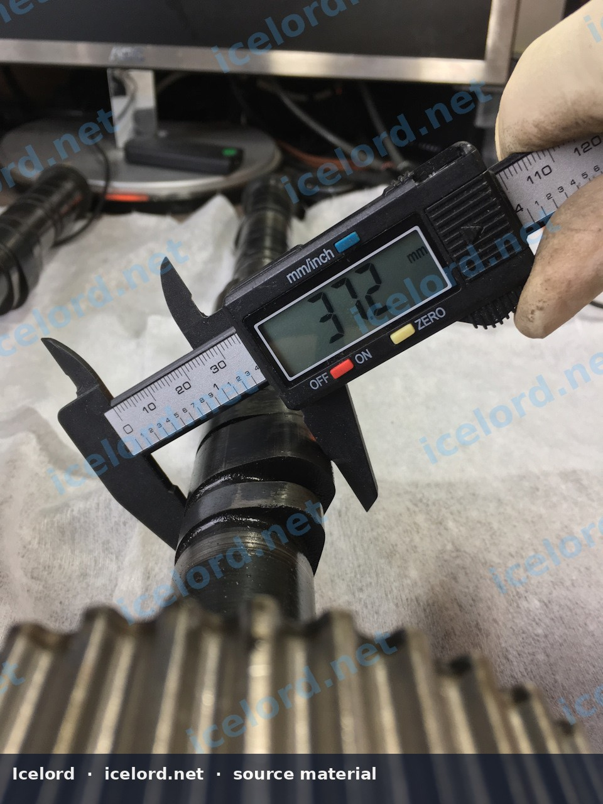
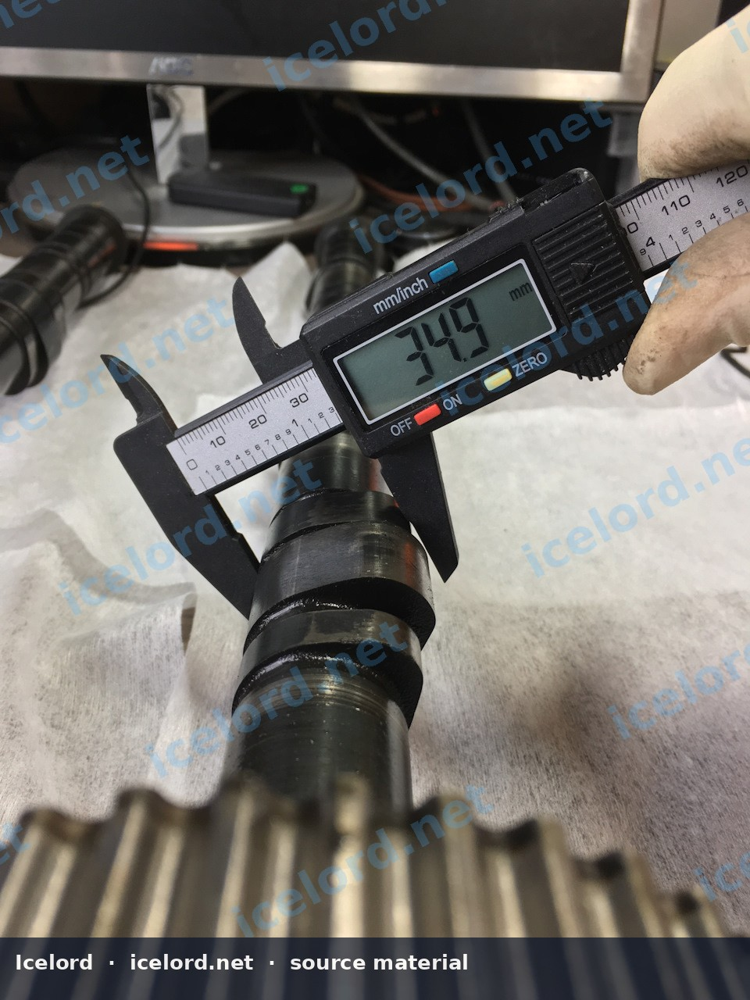
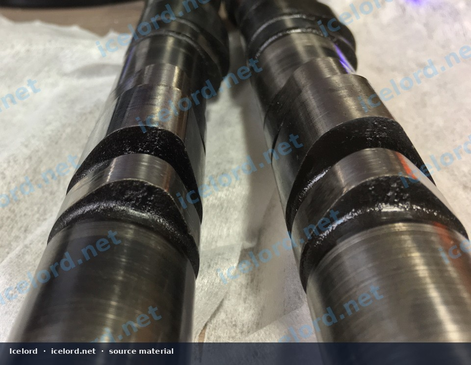

# Honda H22A P13 and P5M Camshaft Comparison

## Overview
This article provides a technical comparison of the camshafts utilized in the Honda H22A P13 (commonly referred to as "Blacktop") and H22A P5M (commonly referred to as "Redtop") engines. While the exhaust camshafts are generally considered identical between these two variants, significant differences exist in the intake camshaft profiles, particularly concerning lobe heights.

> [!IMPORTANT]
> All measurements provided are for the intake camshafts. The exhaust camshafts for both P13 and P5M H22A engines are reported to be identical in profile and specifications.

```carousel

<!-- slide -->

<!-- slide -->

<!-- slide -->

<!-- slide -->

<!-- slide -->

<!-- slide -->


```

## Intake Camshaft Specifications
The primary distinction between the P13 and P5M H22A engines lies in their intake camshaft lobe profiles. The P5M intake camshaft features slightly higher lift on its lobes compared to the P13 variant.

The following table details the measured lobe heights for both intake camshafts:

| Camshaft Type | Lobe 1 (mm) | Lobe 2 (mm) | Lobe 3 (mm) |
| :------------ | :---------- | :---------- | :---------- |
| **H22A P13** | 33.8 | 36.8 | 34.8 |
| **H22A P5M** | 33.9 | 37.2 | 34.9 |

> [!NOTE]
> These lobe heights represent the various profiles designed for different valve timing and lift characteristics across the engine's operating range, particularly in VTEC-equipped engines. Always confirm specific lobe identification and measurement procedures with the official Honda factory service manual for precise verification.

## Exhaust Camshafts
Based on available information, the exhaust camshafts for both the H22A P13 and H22A P5M engines are functionally and dimensionally identical. Therefore, no specific comparison data is presented for the exhaust side.

## Visual Differences
Beyond the measurable lobe height differences, the physical shape and profile of the intake camshaft lobes also exhibit visual distinctions between the P13 and P5M versions. These subtle variations in form contribute to the differing performance characteristics of each engine variant.

## Identification
* **H22A P13 (Blacktop):** Typically found in earlier JDM Honda Prelude models.
* **H22A P5M (Redtop):** Typically found in later JDM Honda Prelude Type S and S-Spec models.

Always verify the engine code and camshaft markings against the factory service manual when identifying components to ensure accuracy.
