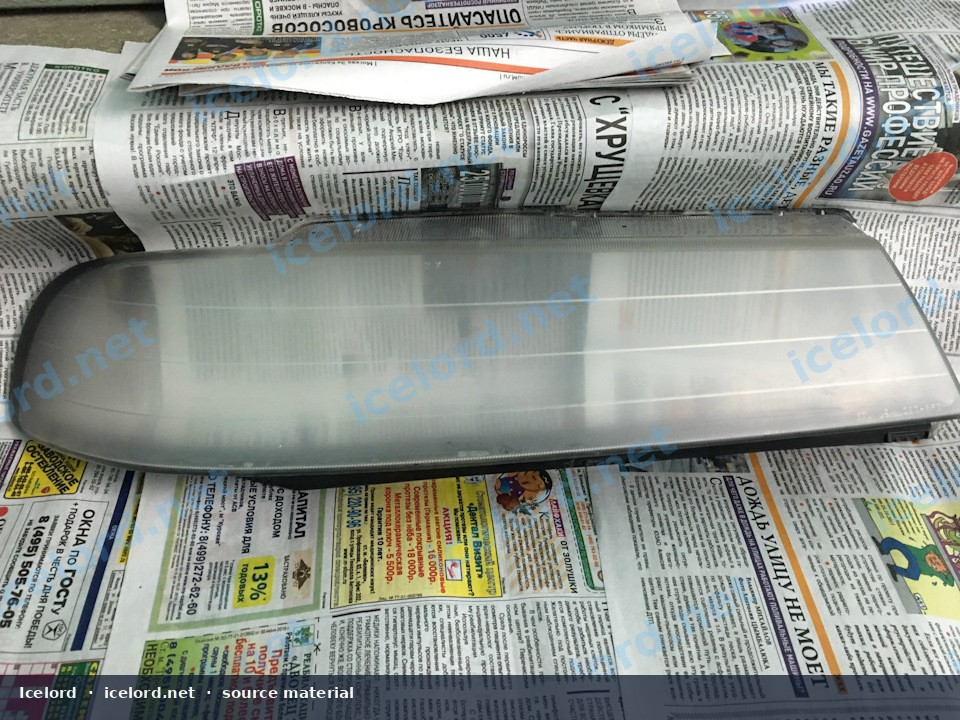
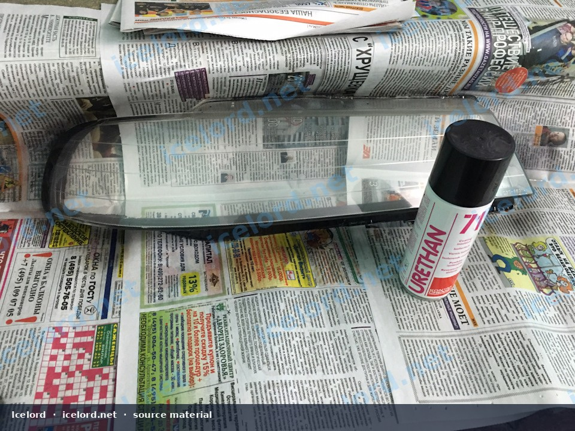
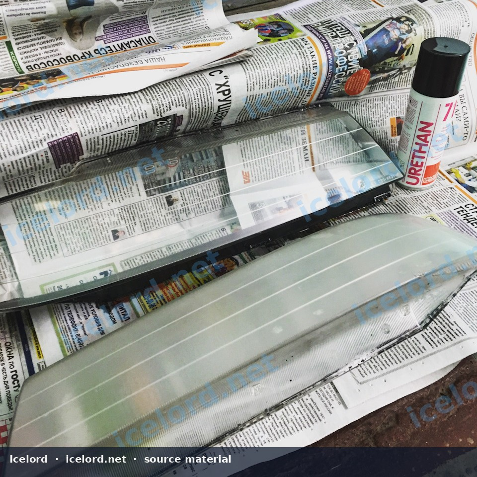

# Plastic Headlamp Lens Wet-Sanding and UV-Resistant Refinishing

Over time, the polycarbonate lenses of modern headlamps can degrade due to exposure to ultraviolet (UV) radiation, road debris, and environmental factors. This degradation manifests as yellowing, hazing, or cloudiness, significantly reducing light output and detracting from the vehicle's appearance. This guide outlines a procedure for restoring headlamp clarity and applying a durable UV-resistant protective coating.

```carousel

<!-- slide -->

<!-- slide -->


```

## 1. Tools and Materials

Successful headlamp restoration requires a few key items:

* **Safety Gear:** Nitrile gloves, safety glasses, respirator (for clear coat application).
* **Cleaning Supplies:** Car wash soap, degreaser, microfiber towels.
* **Masking Tape:** Automotive-grade painter's tape (e.g., 3M blue tape).
* **Wet-Sanding Paper:** Assorted grits, typically starting with 600-grit, then progressing to 1000-grit, 1500-grit, and finally 2000-grit or 2500-grit. Wet/dry sandpaper is essential.
* **Spray Bottle:** Filled with water for constant lubrication during sanding.
* **Rubbing Alcohol or Wax/Grease Remover:** For final cleaning before coating.
* **UV-Resistant Clear Coat:** A specialized polyurethane or acrylic clear coat designed for plastics and UV protection. Products like URETHAN 71 are examples of suitable industrial-grade, UV-stable coatings.

> [!IMPORTANT]
> Do not use standard automotive clear coats not specifically formulated for flexible plastics or UV protection on headlamps, as they may yellow, peel, or crack prematurely.

## 2. Preparation

Proper preparation is crucial for a lasting finish.

### 2.1 Clean the Headlamp Lens

Thoroughly wash the entire headlamp assembly and surrounding bodywork with car wash soap and water to remove dirt, grime, and loose debris. Follow with a degreaser to eliminate any oils or waxes that could interfere with sanding or coating adhesion.

### 2.2 Mask Surrounding Areas

Apply automotive masking tape around the perimeter of the headlamp lens, ensuring all painted surfaces, trim, and rubber seals adjacent to the lens are completely covered. This protects the paint from accidental sanding marks and overspray from the clear coat.

## 3. Wet-Sanding Procedure

Wet-sanding progressively removes the damaged outer layer of the plastic. The key is to use plenty of water and consistent pressure.

### 3.1 Initial Coarse Sanding (600-grit)

* Begin with 600-grit wet/dry sandpaper. Keep the lens and sandpaper constantly wet using a spray bottle.
* Sand in a consistent, overlapping pattern (e.g., horizontal strokes across the lens).
* Apply moderate, even pressure. The goal is to remove all yellowing, hazing, and oxidation. The lens will appear uniformly cloudy or matte.
* Periodically wipe the lens clean with a microfiber towel to inspect your progress. Ensure all original damage is gone before moving to the next grit.

> [!CAUTION]
> Insufficient sanding at this stage will result in residual damage being visible through the final clear coat.

### 3.2 Progressive Finer Sanding (1000-grit, 1500-grit, 2000/2500-grit)

* After the 600-grit stage, switch to 1000-grit sandpaper. Sand in a perpendicular direction to the previous grit (e.g., vertical strokes). Continue until the lens has a finer, more uniform matte appearance and all deeper 600-grit scratches are removed.
* Repeat this process with 1500-grit, then 2000-grit (or 2500-grit for an even smoother finish), changing sanding direction with each grit. Always keep the lens and sandpaper wet.
* The lens should appear uniformly matte and translucent after the final sanding stage, with no visible deep scratches or clear spots.

> [!TIP]
> The goal of each successive grit is to remove the scratches left by the previous, coarser grit. Take your time and ensure uniformity before moving on.

## 4. Final Cleaning and Drying

Before applying the clear coat, the lens must be impeccably clean and dry.

* Thoroughly rinse the headlamp lens and surrounding masked areas with water to remove all sanding residue.
* Wipe the lens dry with a clean, lint-free microfiber towel.
* Follow with a wipe-down using rubbing alcohol or a dedicated wax/grease remover. This ensures no contaminants remain that could affect clear coat adhesion.
* Allow the lens to air dry completely. Ensure there is no moisture trapped in crevices or around the edges.

## 5. UV-Resistant Clear Coat Application

This step provides the crucial UV protection and restores optical clarity.

* **Ventilation:** Work in a well-ventilated area, ideally outdoors on a calm day, or in a garage with proper exhaust and a respirator.
* **Application:** Shake the clear coat can thoroughly according to manufacturer instructions.
* Apply the clear coat in thin, even coats. Hold the can at the recommended distance (typically 6-10 inches) and use sweeping motions across the lens.
* Allow appropriate flash-off time between coats as specified by the product manufacturer (e.g., 5-10 minutes).
* Apply 2-3 light to medium coats, ensuring full, even coverage without runs or sags. The lens should begin to regain its clarity with the first coat.

> [!NOTE]
> Products like URETHAN 71 are designed to be fast-drying and provide excellent UV and scratch resistance. Always refer to the specific product's instructions for optimal application and curing.

## 6. Curing and Post-Application Care

* Allow the clear coat to cure fully according to the manufacturer's recommendations. This typically ranges from a few hours to 24 hours before handling or exposing to moisture.
* Once cured, carefully remove the masking tape.
* To maintain the restored finish, regularly wash the headlamps and consider applying a ceramic coating or wax designed for plastics to add an extra layer of protection against environmental elements.
