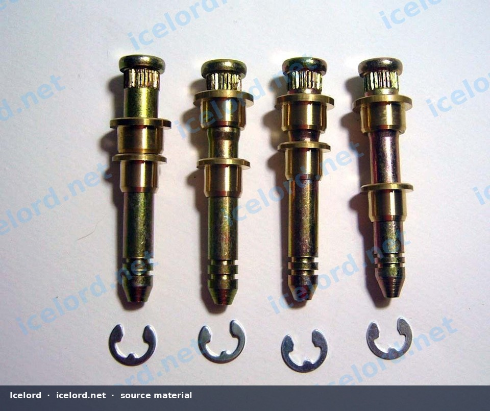

# Honda/Acura Door Hinge Pin and Bushing Repair

Over time, the door hinges on many Honda and Acura models can wear, leading to a sagging door, excessive play, and difficulty in opening or closing. This common issue is often resolved by replacing the hinge pins and their associated bushings.

*Image placeholder - replace with a publication-cleared photo (be470a9s-960.jpg).*

## Symptoms of Worn Door Hinges

Recognizing the signs of worn hinges is the first step in addressing the problem:

* **Door Sag:** The door appears to drop slightly when opened, often rubbing against the door sill or striker plate.
* **Excessive Play:** When the door is partially open, lifting and lowering it reveals significant vertical movement.
* **Clunking or Squeaking Noises:** Worn components can create audible sounds during door operation.
* **Difficulty Closing:** The door may not latch properly or require extra force to close.
* **Misalignment:** Gaps around the door may be uneven, or the door may not sit flush with the body.

## Required Tools and Materials

Performing this repair typically requires a few basic hand tools and a specific repair kit.

* **Door Hinge Pin and Bushing Repair Kit:** These kits are commonly available for various Honda/Acura models and include new pins, bushings, and retaining clips.
* **Basic Hand Tools:**
* Socket wrench set
* Pry tools or flat-head screwdrivers
* Hammer
* Pin punch set (specifically a punch slightly smaller than the hinge pin diameter)
* Vise grips or locking pliers (optional, for stubborn pins)
* **Safety Gear:**
* Safety glasses
* Work gloves
* **Support Equipment:**
* Floor jack with a wooden block or jack stand (to support the door)
* Shop rags or towels (to protect paint)
* **Lubricants:**
* Penetrating oil (for rusted pins)
* White lithium grease or equivalent (for new pins and bushings)

## Safety Precautions

> [!CAUTION]
> Always wear safety glasses when using a hammer and punch to prevent eye injury from flying debris or metal fragments.

> [!IMPORTANT]
> The door is heavy. Ensure it is properly supported throughout the repair process to prevent damage to the door, hinges, or personal injury. Never allow the door to hang unsupported from a single hinge.

## Repair Procedure

This procedure outlines the general steps for replacing door hinge pins and bushings. Specific details, such as hinge bolt torque values or exact pin removal techniques, should always be confirmed with the factory service manual (FSM) for your specific vehicle.

### 1. Door Support and Preparation

1. Open the door to a comfortable working position.
2. Place a floor jack with a wooden block or a jack stand directly under the bottom edge of the door, near the latch side, to support its weight. Ensure the support is stable and padded to prevent paint damage.
3. Carefully adjust the jack to take the weight of the door, ensuring it is level and does not lift the door beyond its natural resting position.
4. If necessary, remove any trim panels or wiring harnesses that obstruct access to the hinges. For some models, it may be beneficial to remove the door check strap to allow for greater door movement or easier access.

### 2. Old Pin and Bushing Removal

1. **Upper Hinge:** Locate the retaining clip or E-clip on the bottom of the upper hinge pin. Use a small flat-head screwdriver or pry tool to carefully remove it.
2. Apply penetrating oil to the hinge pin if it appears rusted or seized.
3. Position a suitable pin punch against the bottom of the hinge pin. While supporting the hinge, strike the punch firmly with a hammer to drive the pin upwards and out of the hinge. If the pin is stubborn, apply more penetrating oil and allow it to soak, or use a vise grip to rotate the pin slightly to break it free before punching.
4. Once the pin is removed, the old bushings can typically be pulled out by hand or carefully pried out with a small tool.
5. **Lower Hinge:** Repeat the same process for the lower hinge pin and bushings.

### 3. Hinge Inspection and Cleaning

1. Thoroughly inspect the hinge knuckles for any signs of damage, cracks, or excessive wear beyond the bushings. If the hinge itself is damaged, a full hinge replacement may be necessary.
2. Clean the hinge bores where the bushings sit. Use a wire brush or sandpaper to remove any rust, corrosion, or old grease. Ensure the bores are smooth and free of obstructions.

### 4. New Pin and Bushing Installation

1. Insert the new bushings into the hinge knuckles. They should fit snugly. If they are difficult to insert, a light tap with a rubber mallet or a socket of appropriate size can help seat them.
2. Apply a generous amount of white lithium grease or a similar long-lasting lubricant to the new hinge pins.
3. Align the hinge knuckles and carefully insert the lubricated new hinge pin from the top, guiding it through the bushings in both hinge halves.
4. Once the pin is fully seated, install the new retaining clip on the bottom of the pin to secure it.
5. Repeat the process for the other hinge.

### 5. Door Reinstallation and Adjustment

1. Carefully remove the jack or support from under the door.
2. Open and close the door several times to cycle the new hinges and distribute the lubricant.
3. Check the door alignment. If the door is still sagging or misaligned, loosen the hinge bolts (where the hinge attaches to the door or body) slightly and adjust the door's position until it aligns correctly with the body lines and closes smoothly without rubbing.
4. Once alignment is satisfactory, tighten the hinge bolts to the torque specifications provided in your factory service manual.

> [!TIP]
> It can be helpful to mark the original position of the hinge bolts with a marker before loosening them. This provides a reference point for re-alignment.

## Verification

After completing the repair and adjustment:

* **Check for Play:** With the door partially open, gently lift and lower it to ensure there is no excessive vertical play.
* **Smooth Operation:** Open and close the door several times, checking for smooth, quiet operation without binding or rubbing.
* **Alignment:** Visually inspect the door gaps and ensure the door sits flush with the body when closed.

If any issues persist, re-check the hinge pin installation and door alignment. If the door still sags significantly, inspect the door striker on the body pillar, as it may also contribute to perceived sag if worn or misadjusted.
