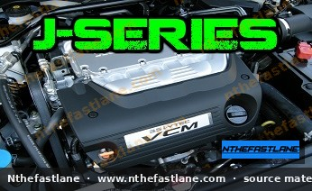

# Honda J-Series V6 Engine Specifications and Identification

## Introduction

The Honda J-Series V6 engine family represents a significant line of transversely mounted V6 powerplants used across a wide range of Honda and Acura vehicles, including sedans, SUVs, and minivans. Introduced in the late 1990s, these engines are renowned for their smooth operation, reliability, and integration of Honda's VTEC (Variable Valve Timing and Lift Electronic Control) technology, with later variants also featuring VCM (Variable Cylinder Management).

This article provides an overview of J-Series engine identification and general specifications, emphasizing the importance of consulting the factory service manual (FSM) for precise, model-specific details.

*Image placeholder - replace with a publication-cleared photo (d7f001_c4b2038e7b274d08b5bebc1c958635f8~mv2.jpg).*

## J-Series Engine Identification

Accurate engine identification is crucial for proper maintenance, repair, and parts ordering. The J-Series engine code provides key information about the engine's displacement and specific variant.

### Locating the Engine Code

The engine code is typically stamped directly onto the engine block. For most J-Series engines, this stamp can be found on the front side of the engine block, often near the transmission bellhousing or below the cylinder head on the exhaust side. It is usually a series of alphanumeric characters.

> [!TIP]
> Cleaning the area around the suspected engine code location with a wire brush and degreaser may be necessary to reveal the stamp clearly, especially on older engines.

### Decoding the Engine Code

The J-Series engine code follows a standard Honda format, such as `J35A1` or `J32A2`.

* The first letter (`J`) identifies the engine family.
* The subsequent two digits (`35`, `32`) indicate the approximate displacement in deciliters (e.g., `35` for 3.5 liters, `32` for 3.2 liters).
* The letter following the displacement (`A`, `Y`) often denotes the specific generation or primary design variant.
* The final digit (`1`, `2`, `3`, etc.) specifies the exact sub-variant, which can indicate differences in power output, VTEC implementation, or specific vehicle application.

## Common J-Series Engine Variants

The J-Series family encompasses several displacements and numerous sub-variants, each tailored for specific vehicle applications and performance targets. The most common displacements include:

* **J25**: Primarily 2.5-liter variants.
* **J30**: Commonly 3.0-liter variants, often found in Accord and Odyssey models.
* **J32**: Typically 3.2-liter variants, prominent in Acura TL and CL models.
* **J35**: The most widespread, 3.5-liter variants, used across a broad range of Honda and Acura vehicles, including Accord, Pilot, Odyssey, and TL.
* **J37**: The largest displacement, 3.7-liter variants, found in later Acura models like the MDX and TL.

Many J-Series engines feature VTEC, and later 3.5L and 3.7L variants often incorporate VCM for improved fuel economy by deactivating cylinders under light load conditions.

## Key Technical Specifications

While specific figures vary greatly by engine code and model year, the following outlines general technical aspects of the J-Series engine family.

> [!IMPORTANT]
> Always refer to the specific factory service manual (FSM) for your vehicle's exact engine code to confirm all technical specifications, including torque values, fluid capacities, and maintenance intervals.

### General Architecture

* **Cylinder Configuration:** 60-degree V6
* **Valvetrain:** SOHC (Single Overhead Camshaft) with 4 valves per cylinder, typically incorporating VTEC.
* **Fuel System:** Multi-point Programmed Fuel Injection (PGM-FI).
* **Block Material:** Aluminum alloy.
* **Head Material:** Aluminum alloy.

### Lubrication System

* **Oil Capacity:** Varies significantly by engine variant and oil pan design. Confirm against the FSM.
* **Recommended Oil Viscosity:** Typically 5W-20 or 0W-20, but always confirm the specific recommendation for your engine and climate in the FSM.
* **Oil Filter:** Cartridge or spin-on type, depending on the specific engine and model year.

### Ignition System

* **Spark Plug Type:** Specific type (e.g., NGK, Denso) and heat range are critical. Confirm against the FSM.
* **Spark Plug Gap:** Varies by engine variant. Confirm against the FSM.
* **Ignition System:** Coil-on-plug (COP) direct ignition system.

### Timing System

* **Timing Drive:** The J-Series engine utilizes a timing belt to synchronize the crankshaft and camshafts. This is a critical maintenance item.
* **Timing Belt Replacement Interval:** Varies, but typically around 60,000 to 105,000 miles or 7 years, whichever comes first. Always confirm the exact interval in your FSM.

### Torque Specifications

Specific torque values for fasteners (e.g., cylinder head bolts, connecting rod bolts, main bearing caps, spark plugs) are unique to each engine variant and critical for proper assembly and reliability. These must be obtained directly from the factory service manual for the specific engine code.

## Maintenance Considerations

Regular maintenance is key to the longevity of any J-Series engine. Key maintenance items include:

* **Oil Changes:** Adhere to the recommended oil type and interval.
* **Timing Belt Service:** This critical service often includes replacing the water pump, tensioner, and idler pulleys simultaneously.
* **Valve Adjustment:** While many J-Series engines are known for their robust valvetrain, some variants may require periodic valve clearance inspection and adjustment. Consult the FSM for specific requirements.
* **Spark Plug Replacement:** Follow the recommended interval and use the specified spark plug type and gap.

## Conclusion

The Honda J-Series V6 engine family offers a blend of performance, efficiency, and reliability across numerous Honda and Acura platforms. While this article provides a general overview, always prioritize the specific information found in your vehicle's factory service manual for accurate identification, detailed specifications, and proper maintenance procedures.
