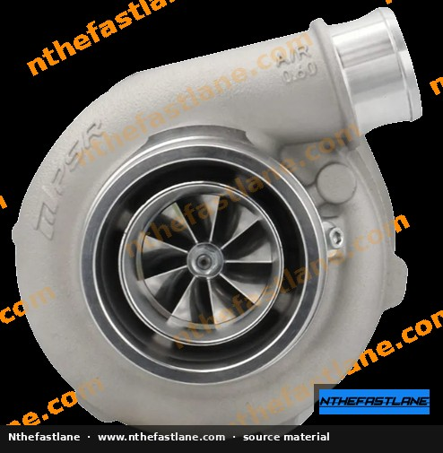
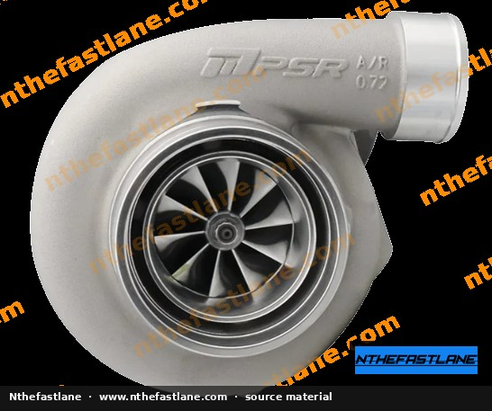
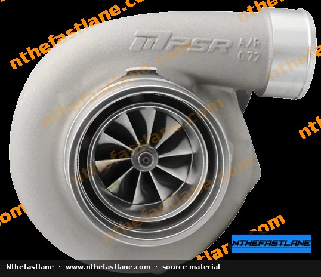
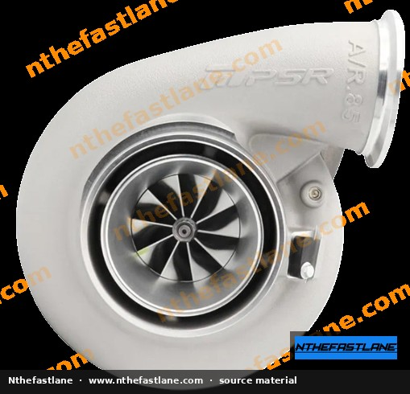

# Honda J-Series Torque Specifications and Tightening Sequences

Proper torque application and tightening sequences are paramount for the reliable assembly and longevity of any Honda J-Series engine. Incorrect torque can lead to gasket leaks, fastener failure, or component damage. This guide provides general best practices and highlights critical fasteners for J-Series engines.

> [!IMPORTANT]
> **Always refer to the official Honda/Acura Factory Service Manual (FSM) for your specific vehicle model and engine variant.** The exact torque specifications, tightening sequences, and procedures can vary significantly between J-Series engine generations and applications (e.g., J30, J32, J35, J37).

```carousel

<!-- slide -->

<!-- slide -->

<!-- slide -->

<!-- slide -->


```

## General Torque Practices

Adhering to fundamental torque principles ensures accuracy and prevents issues during engine assembly.

*   **Clean Threads:** Ensure all bolt threads and threaded holes are clean and free of oil, grease, dirt, or old threadlocker. Use a tap to chase internal threads and a die to clean external bolt threads if necessary.
*   **Lubrication:** Unless otherwise specified by the FSM, apply a light coat of clean engine oil to bolt threads and under the bolt head for fasteners that require lubrication. This ensures accurate torque readings by reducing friction. The FSM will specify if dry threads or a threadlocking compound are required.
*   **Torque Wrench Calibration:** Use a properly calibrated torque wrench. For critical fasteners, a click-type or digital torque wrench is recommended.
*   **Multi-Stage Tightening:** Many critical fasteners, especially those for cylinder heads and bearing caps, require a multi-stage tightening process (e.g., initial snug, then specific torque values, followed by an angle-tightening step).
*   **Tightening Sequence:** Follow the specified tightening sequence (pattern) provided in the FSM to ensure even clamping force across the component.

## Critical J-Series Engine Torque Specifications

While specific values must be confirmed with the FSM, the following components typically require precise torque and often a specific sequence.

### Cylinder Head Bolts

Cylinder head bolts are crucial for maintaining cylinder sealing and preventing coolant or oil leaks. They almost always require a multi-stage tightening process and a specific sequence to ensure even pressure distribution across the head gasket.

*   **Procedure:**
    1.  Clean all bolt threads and threaded holes thoroughly.
    2.  Apply a specified lubricant (often clean engine oil) to the bolt threads and under the bolt head, as directed by the FSM.
    3.  Follow the FSM's numerical tightening sequence, typically starting from the center and working outwards in a spiral pattern.
    4.  Perform tightening in multiple stages, often including a final angle-tightening step (e.g., 22 lb-ft, then +90 degrees, then +90 degrees).

### Main Bearing Cap Bolts

Main bearing cap bolts secure the crankshaft within the engine block. Proper torque is vital for correct bearing crush and crankshaft rotation.

*   **Procedure:**
    1.  Ensure threads are clean.
    2.  **Dip main bearing bolts in clean engine oil prior to installation.**
    3.  Follow the FSM's specified tightening sequence and multi-stage torque procedure. This often involves an initial torque, followed by an angle-tightening step.

### Connecting Rod Cap Bolts

Connecting rod cap bolts secure the connecting rods to the crankshaft journals. These are highly stressed fasteners.

*   **Procedure:**
    1.  Ensure threads are clean.
    2.  Apply a specified lubricant (often clean engine oil or assembly lube) to the bolt threads and under the bolt head, as directed by the FSM.
    3.  Tighten in stages, typically using an initial torque followed by an angle-tightening step.

### Crankshaft Pulley (Crank Bolt)

This bolt secures the harmonic balancer/crankshaft pulley to the crankshaft. It is subjected to significant forces and often requires very high torque.

*   **Procedure:**
    1.  Ensure threads are clean.
    2.  **Dip the crankshaft damper bolt in clean engine oil prior to installation.**
    3.  Tighten to the FSM-specified torque value. This often requires a specialized crankshaft pulley holding tool.

> [!CAUTION]
> The crankshaft pulley bolt is extremely critical. Incorrect torque can lead to catastrophic engine damage or pulley detachment.

### Spark Plugs

Proper spark plug torque prevents loosening and ensures good heat transfer.

*   **Procedure:**
    1.  Ensure spark plug threads are clean.
    2.  Install spark plugs by hand to avoid cross-threading.
    3.  Tighten to the FSM-specified torque. Over-tightening can damage the cylinder head threads or the spark plug itself.

### Other Fasteners

Many other components require specific torque values, including:

*   Valve cover bolts
*   Oil pan bolts
*   Intake manifold bolts
*   Exhaust manifold bolts
*   Flywheel/flexplate bolts
*   Transmission bellhousing bolts

> [!TIP]
> When installing components with multiple fasteners (e.g., oil pan, valve cover), tighten bolts in a criss-cross or spiral pattern to ensure even gasket compression, typically to a lower torque value than critical engine internals.

## Verification

After completing any torque procedure, it is good practice to visually inspect for proper component seating and, where possible, re-check torque after a short period of engine operation (e.g., for valve covers after initial heat cycles), as specified by the FSM.
