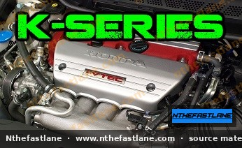

# Honda K-Series Engine Specifications and Identification

## Introduction to the K-Series Engine

The Honda K-series engine family represents a significant evolution in Honda's powertrain technology, widely recognized for its robust performance, efficiency, and the advanced i-VTEC valvetrain system. Introduced in the early 2000s, these engines have powered a diverse range of Honda and Acura vehicles, including popular models such as the Accord, Civic, CR-V, Integra, and RSX, utilizing variants like the K20, K23, and K24.

*Image placeholder - replace with a publication-cleared photo (d7f001_76cad05e2f9e418db8295331c6d7a06d~mv2.jpg).*

## K-Series Engine Identification

Accurate identification of a K-series engine is crucial for maintenance, repairs, and performance modifications. Each engine is stamped with a unique code that provides key information about its displacement, specific variant, and original application.

### Locating the Engine Code

The engine code is typically stamped directly onto the engine block. For most K-series engines, this code can be found on a flat pad located on the front of the block, often near the transmission mating surface or below the cylinder head, usually on the exhaust side.

> [!TIP]
> Cleaning the area around the suspected location with a wire brush or degreaser may be necessary to reveal the stamped code clearly.

### Decoding Engine Designations

Honda K-series engine codes follow a consistent pattern, generally `KXXY#`, where:

* `K`: Denotes the K-series engine family.
* `XX`: Indicates the approximate displacement in liters (e.g., `20` for 2.0L, `23` for 2.3L, `24` for 2.4L).
* `Y`: Represents the specific engine variant or market (e.g., `A` for North American variants, `Z` for specific applications).
* `#`: A numerical digit indicating further sub-variants or revisions within that engine type (e.g., K20A2, K24A1).

For example, a `K20A2` would identify a 2.0-liter K-series engine, specific variant 'A2'.

### i-VTEC System Overview

A hallmark of the K-series engine is its i-VTEC (intelligent Variable Valve Timing and Lift Electronic Control) system. Unlike earlier VTEC implementations, i-VTEC on K-series engines integrates VTC (Variable Timing Control) for continuous camshaft phasing on the intake cam, in addition to the traditional VTEC variable valve lift and duration. This combination optimizes valve overlap and lift for improved power and fuel efficiency across the entire RPM range.

## General K-Series Specifications

While specific figures vary significantly between K-series variants, some general characteristics define the family. For precise measurements, always refer to the Factory Service Manual (FSM) for your specific engine code.

### Displacement and Bore/Stroke

* **K20 Engines:** Typically feature a displacement around 2.0 liters. These engines are generally known for their 'oversquare' design, meaning the bore diameter is larger than the stroke length, contributing to higher-revving characteristics.
* **K23 Engines:** A less common variant, generally around 2.3 liters.
* **K24 Engines:** Typically feature a displacement around 2.4 liters. These engines are often 'undersquare' or 'square,' with a longer stroke relative to the bore, favoring torque production at lower RPMs.

### Cylinder Head and Valvetrain

All K-series engines utilize a DOHC (Dual Overhead Camshaft) design with 16 valves. The cylinder heads are aluminum alloy. The i-VTEC system is integral to the valvetrain, controlling both valve timing and lift. Different cylinder head castings (e.g., PRB, RBC, RBB, RRC) exist, each with distinct port designs and flow characteristics.

### Block Construction

K-series engine blocks are open-deck designs, cast from aluminum alloy, providing a balance of strength and weight reduction. They feature a cross-bolted main bearing cap design for enhanced rigidity of the crankshaft assembly.

## Distinguishing K20 and K24 Variants

The primary distinction between K20 and K24 engines lies in their displacement, which directly impacts their internal dimensions and performance characteristics:

* **Displacement:** K20 engines are 2.0L, while K24 engines are 2.4L.
* **Stroke:** K24 engines have a significantly longer crankshaft stroke compared to K20 engines, which is the primary reason for their increased displacement and typically higher torque output.
* **Deck Height:** The K24 block has a taller deck height to accommodate the longer stroke, leading to different connecting rod and piston specifications.
* **Applications:** K20 engines were often found in sportier models (e.g., RSX Type-S, Civic Si), while K24 engines were more common in larger sedans and SUVs (e.g., Accord, CR-V, TSX), though there are exceptions and high-performance K24 variants.

## Important Considerations and FSM Reference

> [!IMPORTANT]
> Due to the numerous variations within the K-series family, **it is critical to consult the official Honda/Acura Factory Service Manual (FSM) specific to your vehicle's year, make, model, and engine code.** The FSM provides precise and definitive specifications for bore, stroke, compression ratio, torque values, clearances, and all other technical data required for proper service and repair.

> [!CAUTION]
> Never assume specifications are interchangeable between different K-series engine variants without explicit confirmation from the FSM. Using incorrect specifications can lead to engine damage or component failure.

When performing any work on a K-series engine, always prioritize safety. Ensure the vehicle is properly supported, disconnect the battery, and use appropriate personal protective equipment.
