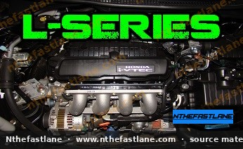

# Honda L-Series Engine Specifications and Identification

## Introduction

The Honda L-Series engine family represents a line of compact, lightweight, and fuel-efficient inline four-cylinder powerplants. Primarily known for their application in subcompact and compact vehicles, these engines are characterized by their advanced i-VTEC technology, which optimizes valve timing and lift for improved performance and economy across various operating conditions. The L-Series is a popular choice for daily driving due to its reliability and balanced characteristics.

*Image placeholder - replace with a publication-cleared photo (d7f001_67c012e35559430db800785e5e88273a~mv2.jpg).*

## Engine Identification

Identifying a specific L-Series engine variant is crucial for maintenance, parts ordering, and performance modifications. The engine code, which designates the specific L-Series variant (e.g., L15A, L13A), is typically stamped directly onto the engine block.

> [!IMPORTANT]
> Always locate and verify the engine code stamped on the block to ensure accurate identification. This code is essential for cross-referencing with the factory service manual for precise specifications and procedures.

## Key Features

L-Series engines incorporate several key technologies designed to enhance efficiency and performance:

* **i-VTEC (intelligent Variable Valve Timing and Lift Electronic Control):** This system dynamically adjusts valve operation to optimize power delivery and fuel consumption across the engine's RPM range.
* **Lightweight Construction:** The L-Series utilizes lightweight materials and a compact design, contributing to overall vehicle efficiency and handling.
* **Drive-by-Wire Throttle:** Many L-Series applications feature electronic throttle control for precise engine response and integration with other vehicle systems.

## Common L-Series Variants

The L-Series family includes several displacements, each with specific applications and characteristics. While exact specifications vary by market and model year, the primary variants include:

### L12 Series

* **Displacement:** Approximately 1.2 liters.
* **Common Applications:** Primarily found in certain international market Honda Fit (Jazz) models.
* **Characteristics:** Designed for maximum fuel efficiency in regions with specific tax or displacement regulations.

### L13 Series

* **Displacement:** Approximately 1.3 liters.
* **Common Applications:** Widely used in various generations of the Honda Fit (Jazz) and some Civic models in specific markets.
* **Characteristics:** Offers a balance of fuel economy and adequate power for urban driving.

### L15 Series

* **Displacement:** Approximately 1.5 liters.
* **Common Applications:** The most prevalent L-Series variant, powering numerous Honda Fit (Jazz) and Civic models globally.
* **Characteristics:** Provides a more robust power output suitable for highway driving and general performance, often featuring more advanced i-VTEC implementations.

## Technical Specifications

Detailed technical specifications such as horsepower, torque, bore, stroke, compression ratio, and specific VTEC engagement points vary significantly between L-Series sub-variants and model years. Due to these variations, it is imperative to consult the official Honda Factory Service Manual (FSM) for the exact specifications pertaining to your specific engine code and vehicle.

> [!CAUTION]
> Never rely on generalized specifications when performing critical engine work. Always confirm all torque values, clearances, and other technical data against the factory service manual for your specific engine and vehicle to prevent damage.

> [!NOTE]
> The L-Series engine is known for its relatively straightforward maintenance. Regular oil changes, valve adjustments (where applicable), and spark plug replacements are key to its longevity.
