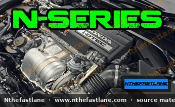

# Honda N-Series Diesel Engine Specifications and Identification

The Honda N-Series represents a family of modern diesel engines developed by Honda, primarily known for their efficiency, performance, and advanced emissions control. These engines are commonly found in various Honda models, offering a diesel powertrain option in markets where it is prevalent.

## Overview of N-Series Diesel Engines

The N-Series engines, often designated with the `i-DTEC` badge, incorporate advanced diesel technology to deliver a balance of power, torque, and fuel economy. Key design principles include lightweight construction and sophisticated fuel injection systems.

## Key Features

Honda N-Series diesel engines integrate several technologies to optimize performance and environmental impact:

* **i-DTEC (intelligent Diesel Technology):** This system utilizes common rail direct injection for precise fuel delivery and often includes a variable geometry turbocharger (VGT) to enhance responsiveness across the RPM range.
* **Lightweight Construction:** Many N-Series engines feature aluminum cylinder blocks and heads, contributing to overall vehicle weight reduction and improved handling.
* **Emissions Control:** Equipped with advanced exhaust gas recirculation (EGR) systems, diesel particulate filters (DPF), and sometimes Selective Catalytic Reduction (SCR) with AdBlue, these engines meet stringent emissions standards.

> [!NOTE]
> Specific features and technologies may vary depending on the engine variant, model year, and regional market.

## Engine Identification

Identifying your specific N-Series engine is crucial for correct maintenance, parts ordering, and diagnostics. The engine code provides vital information about the engine's displacement, generation, and specific variant.

### Locating the Engine Code

The engine code is typically stamped directly onto the engine block. Common locations include:

* On a flat machined surface near the cylinder head and transmission mating point.
* On the front of the block, often below the exhaust manifold.

**Example:** An engine code might appear as `N22A1` or `N16A1`. The first two characters (`N16`, `N22`) denote the engine series and approximate displacement (e.g., 1.6L, 2.2L), while the following characters indicate the specific variant.

> [!TIP]
> Always cross-reference the engine code found on the block with the vehicle's VIN plate or factory service manual to ensure accurate identification.

## Common Specifications

The N-Series family includes several displacements, with the N16 (1.6L) and N22 (2.2L) being prominent examples. While specific figures can vary significantly by market and tuning, general characteristics are outlined below. All specific torque values, power outputs, and detailed specifications should be confirmed against the official Honda factory service manual for your exact vehicle.

| Item | N16 (1.6L i-DTEC) | N22 (2.2L i-DTEC) |
| :--- | :--- | :--- |
| Displacement | 1.6 L | 2.2 L |
| Max power | Confirm FSM (varies by variant) | Example 132 kW @ 4000 rpm (confirm FSM) |
| Max torque | Confirm FSM (varies by variant) | Example 380 Nm @ 2000 rpm (confirm FSM) |
| Typical models | Accord, Civic, CR-V | Accord, CR-V |

> [!IMPORTANT]
> The power and torque figures provided are examples and can vary significantly based on the specific engine variant, model year, and market. Always refer to the official factory service manual for precise specifications relevant to your vehicle.

## Maintenance Considerations

N-Series diesel engines require specific maintenance practices to ensure longevity and optimal performance:

* **Fuel Filter Replacement:** Regular replacement of the diesel fuel filter is critical to protect the high-pressure fuel system from contaminants.
* **Diesel Particulate Filter (DPF) Care:** Vehicles equipped with a DPF require periodic regeneration. Short trips or prolonged low-speed driving can inhibit regeneration, potentially leading to DPF clogging.
* **Engine Oil:** Use only engine oil that meets Honda's specifications for diesel engines, typically low-SAPS (Sulphated Ash, Phosphorus, Sulphur) oils to protect the DPF.
* **AdBlue/DEF:** If your vehicle uses Selective Catalytic Reduction (SCR), ensure the AdBlue (Diesel Exhaust Fluid) tank is refilled as required.

> [!CAUTION]
> Using incorrect fluids or neglecting diesel-specific maintenance can lead to costly damage to the engine and emissions systems.
