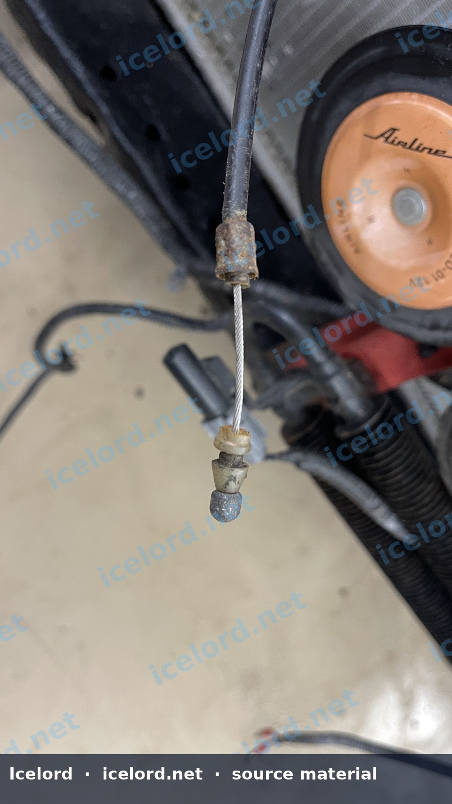
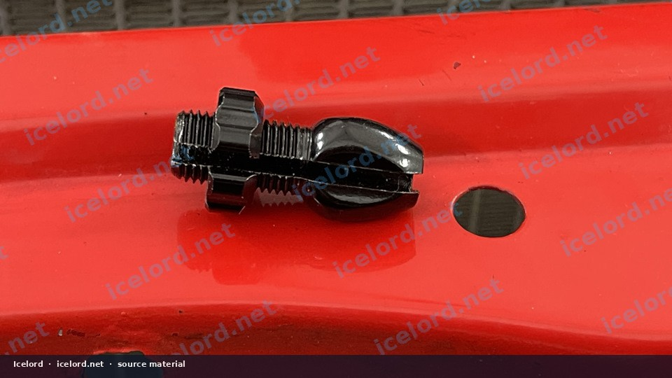
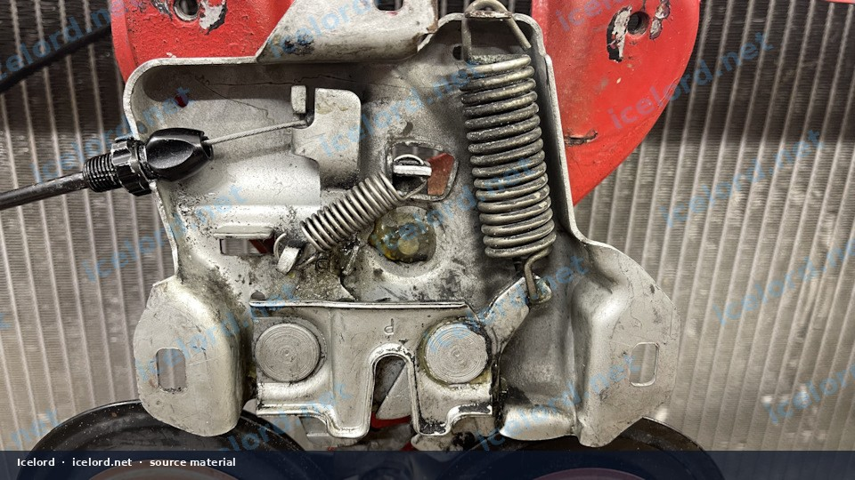
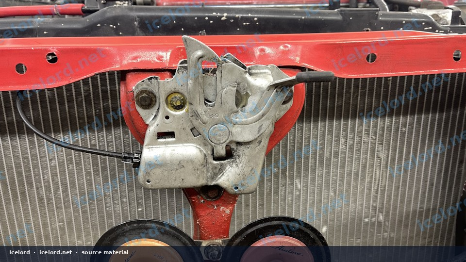
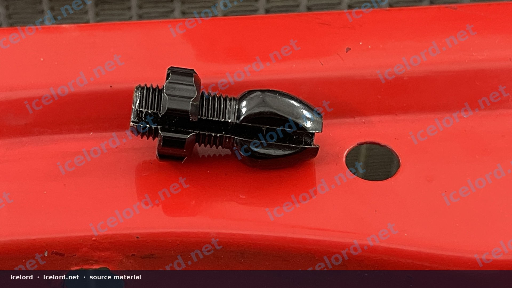
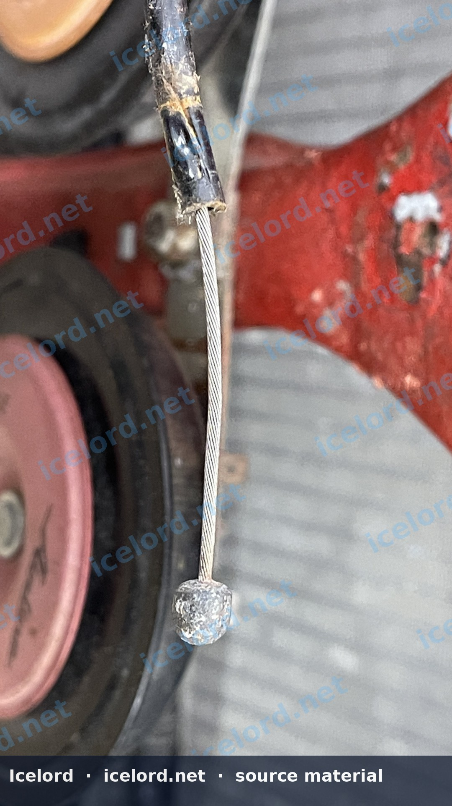
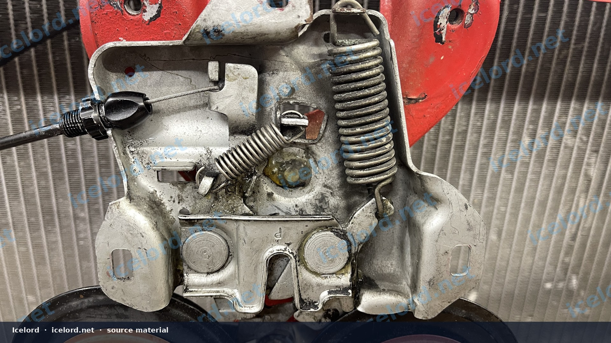
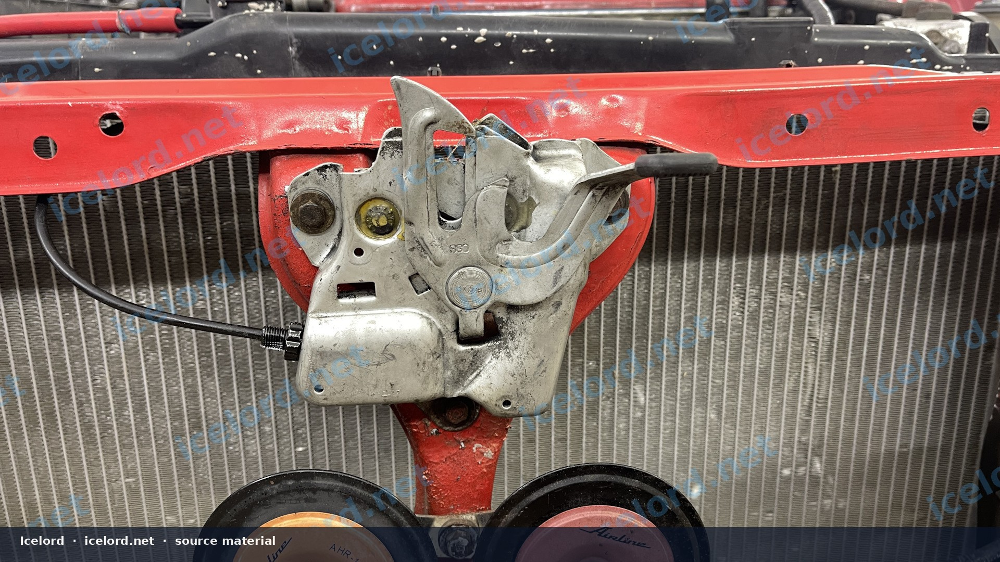

# Honda Prelude Hood Release Cable End Repair

Owners of older Honda Prelude models, particularly the BB chassis, may encounter a common issue where the hood release cable's end breaks or detaches from the latch mechanism. This often results in a hood that cannot be opened or a release lever that feels loose and ineffective. Replacing the entire hood release cable can be a complex and time-consuming task. This article outlines a practical and economical repair method using a readily available bicycle brake cable adjuster bolt.

```carousel

<!-- slide -->

<!-- slide -->

<!-- slide -->

<!-- slide -->

<!-- slide -->

<!-- slide -->

<!-- slide -->


```

```carousel

<!-- slide -->


```

## Symptoms of Failure

*   The hood release lever inside the cabin feels loose or has no tension.
*   Pulling the hood release lever does not unlatch the hood.
*   The hood remains securely closed despite attempts to open it.

## Required Tools and Materials

Before beginning the repair, gather the following items:

*   **Bicycle brake cable adjuster bolt (10mm)**: This is the primary repair component.
*   **Drill**: Capable of drilling metal.
*   **10mm drill bit**: To enlarge the latch mechanism hole.
*   **Basic hand tools**: Pliers, wrenches, screwdrivers, and possibly a trim removal tool to access the cable.
*   **Safety glasses**: Essential for eye protection when drilling.
*   **Work light**: To illuminate the work area under the hood.

## Repair Procedure

This repair involves modifying the hood latch mechanism to accept the new cable end. Proceed with caution and ensure all safety measures are observed.

### 1. Access the Hood Latch Mechanism

Open the hood using an alternative method if necessary (e.g., reaching the latch directly if possible). Once open, locate the hood latch mechanism at the front of the engine bay. The hood release cable typically connects to a lever or pivot point on this mechanism.

### 2. Remove the Damaged Cable End

Carefully detach the existing hood release cable from the latch mechanism. The original cable end, often made of plastic or a small metal crimp, will likely be broken or missing. Remove any remaining fragments of the old cable end, including any rubber grommets or sleeves that might be present around the cable's attachment point on the latch.

### 3. Modify the Latch Mechanism

> [!CAUTION]
> Wear safety glasses when drilling. Ensure the latch mechanism is stable and secured before drilling to prevent injury or damage.

Identify the hole on the hood latch mechanism where the original cable end was attached. This hole typically has a diameter smaller than 10mm. Using a drill and a 10mm drill bit, carefully enlarge this hole. The goal is to create an opening large enough to accommodate the threaded portion of the bicycle brake cable adjuster bolt.

> [!IMPORTANT]
> Drill slowly and steadily. Avoid applying excessive force, which could damage the latch mechanism or cause the drill bit to bind.

### 4. Install the New Cable End

*   Thread the existing hood release cable through the center of the bicycle brake cable adjuster bolt. The cable should pass through the bolt's barrel and out the other side.
*   Secure the cable within the adjuster bolt's internal mechanism. Most bicycle adjuster bolts have a small set screw or a clamping mechanism to hold the cable securely. Ensure the cable is taut and firmly gripped.
*   Insert the threaded end of the bicycle adjuster bolt into the newly enlarged 10mm hole on the hood latch mechanism. Secure it in place with its corresponding nut, if provided, or by threading it directly into the latch if it has internal threads.

### 5. Adjust and Test

Once the bicycle adjuster bolt is installed and the cable is secured, it's crucial to adjust the cable tension for proper operation.

*   Use the adjuster bolt to fine-tune the cable's length and tension. The hood release lever inside the cabin should have a firm, but not overly stiff, feel.
*   With the hood open, manually operate the latch mechanism to ensure it moves freely and fully engages/disengages.
*   Carefully close the hood and attempt to open it using the interior release lever. Verify that the hood unlatches smoothly and consistently.
*   Adjust the cable tension as needed until the hood latches securely when closed and releases reliably when the lever is pulled.

## Verification and Adjustment

After the repair, perform several tests to ensure the hood operates correctly:

*   **Secure Latching**: Close the hood gently to confirm it latches fully and securely without excessive force.
*   **Smooth Release**: Pull the interior hood release lever. The hood should pop open with minimal effort.
*   **Repeatability**: Test the latching and release mechanism multiple times to ensure consistent performance.

> [!TIP]
> If the hood does not release fully, increase cable tension slightly. If the hood does not latch securely, decrease tension. Lubricating the latch mechanism with a suitable grease can also improve operation.

## Final Notes

This repair provides a durable and cost-effective solution for a common failure point in older Honda Prelude hood release systems. By utilizing a readily available bicycle component, you can restore full functionality to your hood release without the expense and labor of replacing the entire cable assembly.
