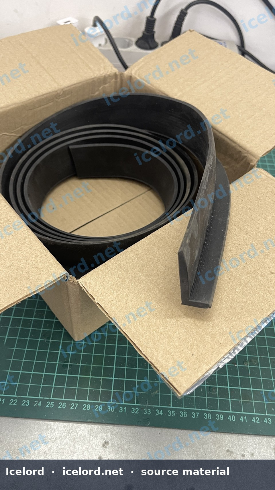
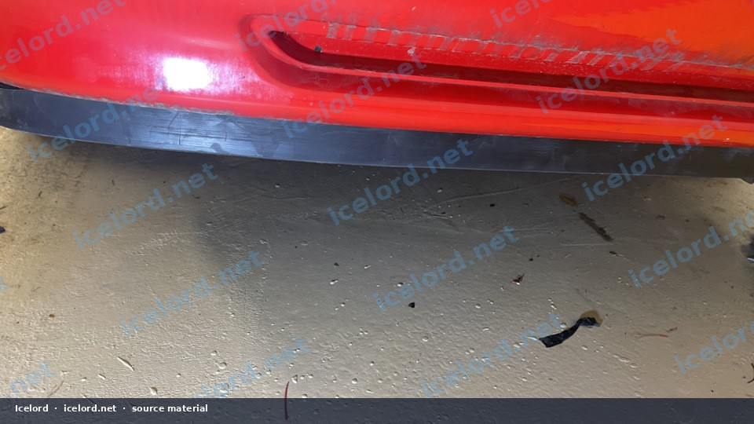
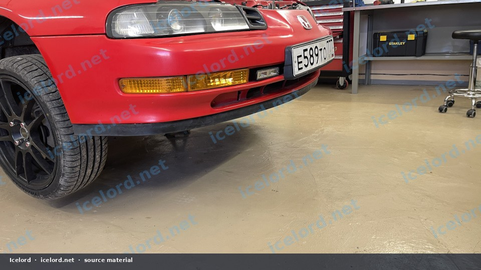
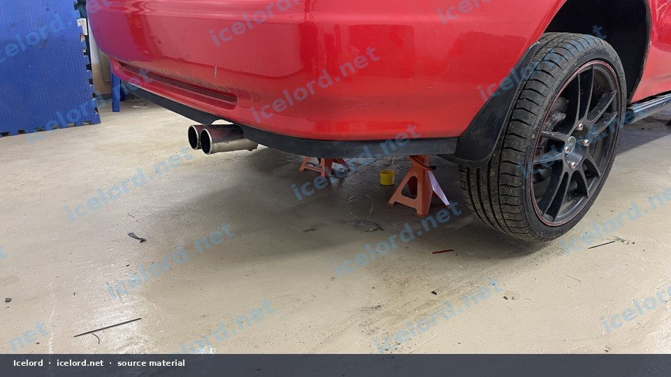
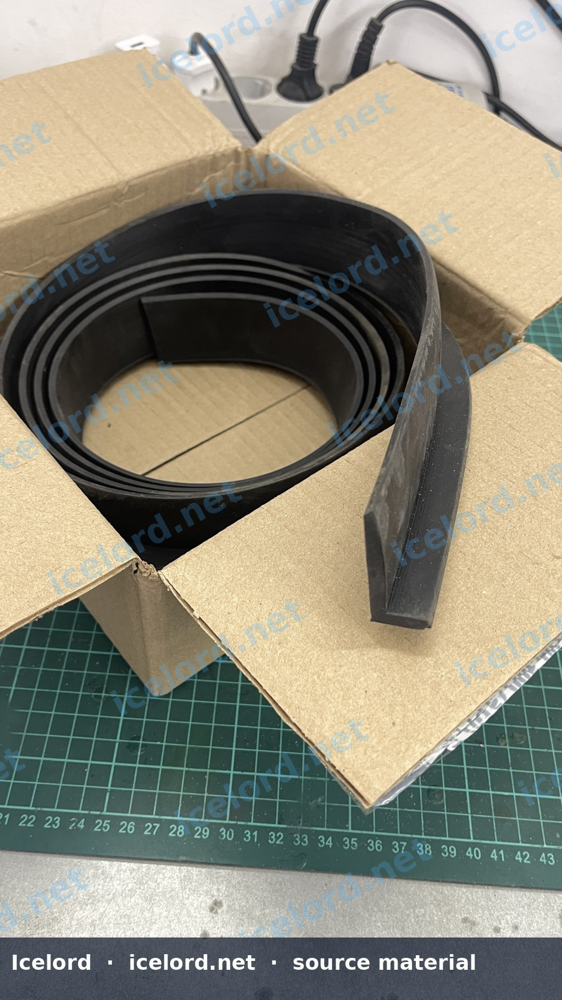
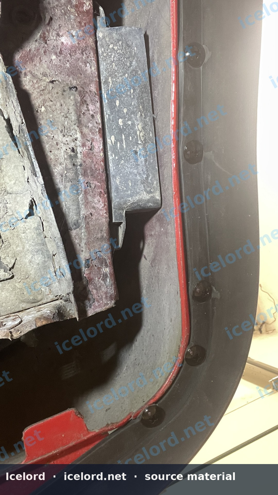
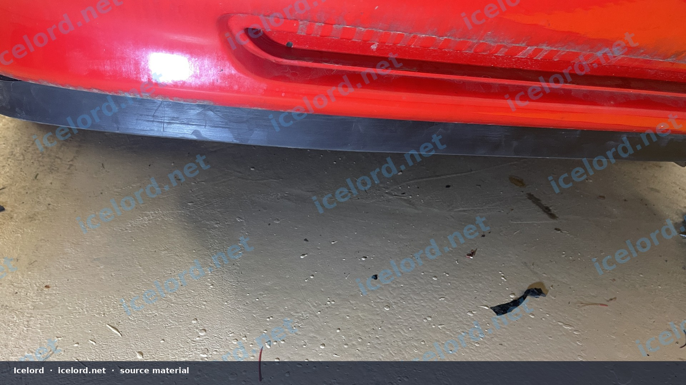
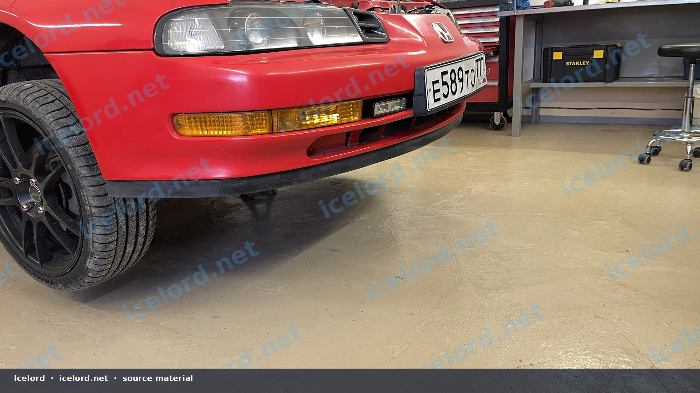

# Universal Rubber Bumper Lip Installation on a Honda Prelude

A universal L-profile rubber lip gives the Prelude BB front bumper a replaceable scraper edge and a slightly lower appearance. Adhesive-only installs fail; use mechanical fasteners as the primary attachment.

```carousel

<!-- slide -->

<!-- slide -->

<!-- slide -->

<!-- slide -->

<!-- slide -->

<!-- slide -->

<!-- slide -->


```

```carousel

<!-- slide -->


```

## Fitment Goals

- Smooth curve without waves or kinks
- Symmetric left/right reveal
- Clearance for license brackets, ducts, and sensors
- Accept that steep driveways will abrade the lip - that is intentional

## Materials

- Universal rubber bumper lip (L-section)
- Stainless screws or rivets with broad washers
- Optional adhesion promoter and automotive adhesive as a secondary seal
- Tape, measuring tools, drill, center punch

## Dry Fit

1. Wash the bumper; remove wax from the fastening zone.
2. Center the lip on the bumper and tape it in place.
3. Work outward to each wheel arch, relieving length gradually.
4. Mark a consistent height line with masking tape.

## Fastening

1. Drill pilot holes through the lip into the bumper’s lower return - not into crash beams.
2. Fasten from the center outward so slack does not gather in the middle.
3. Use enough fasteners to prevent peeling at parking blocks (spacing often 80–120 mm depending on rubber stiffness).
4. Trim the ends for a clean transition at the arch.
5. Optional: add adhesive behind the vertical face after screws are set.

## Verification

- Even appearance in front view
- No tire contact at full lock if ends wrap rearward
- Fasteners still tight after a week of heat and cold
- No cracked paint from over-tightened screws - washers help distribute load

> [!NOTE]
> The lip is sacrificial body armor for the painted bumper edge. If you bottom out constantly, raise the mounting line or choose a softer profile.
