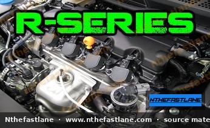

# Honda R-Series Engine Specifications and Identification

The Honda R-series engine family represents a significant evolution in Honda's four-cylinder engine design, primarily focusing on fuel efficiency, compact packaging, and a balance of performance. These Single Overhead Camshaft (SOHC) engines incorporate Honda's i-VTEC technology, optimized for economy and low-to-mid range torque delivery.

Commonly found in various Honda models, including the Civic, CR-V, and HR-V, the R-series engines are identifiable by their specific displacement variants: R16, R18, and R20.

*Image placeholder - replace with a publication-cleared photo (d7f001_7bc20f1b617c4b1aa924c801b279867f~mv2.jpg).*

## Engine Identification

Identifying your specific R-series engine is crucial for correct maintenance and parts ordering. The engine code is typically stamped directly onto the engine block.

* **Location:** Look for a stamped code on the engine block, usually near the transmission mating surface or below the exhaust manifold.
* **Format:** The code will begin with "R" followed by the displacement (e.g., R18A1, R20A3).

## Common R-Series Variants

While the R-series shares a common architecture, specific variants cater to different vehicle applications and market requirements.

### R16 Engine

This variant typically features a displacement of approximately 1.6 liters. It is less common in North American markets but can be found in certain international models.

### R18 Engine

The R18 is the most prevalent R-series engine, commonly found in the eighth and ninth generation Honda Civic. It features an approximate 1.8-liter displacement and is known for its balance of fuel economy and adequate power for daily driving.

### R20 Engine

With an approximate 2.0-liter displacement, the R20 variant provides increased power and torque, often utilized in larger or heavier vehicles such as the Honda CR-V and HR-V.

## Key Characteristics

The R-series engine family incorporates several design features that distinguish it from other Honda engine lines.

* **SOHC i-VTEC:** Unlike some DOHC VTEC engines, the R-series uses a single camshaft with an intelligent Variable Valve Timing and Lift Electronic Control system primarily designed to improve fuel economy by varying valve timing and lift on the intake side.
* **Aluminum Construction:** Both the engine block and cylinder head are constructed from aluminum, contributing to reduced overall vehicle weight.
* **Offset Cylinder Bores:** This design feature helps to reduce friction within the engine, further enhancing fuel efficiency.
* **Timing Chain:** R-series engines utilize a maintenance-free timing chain system, which typically does not require periodic replacement like a timing belt.

## Important Specifications

> [!IMPORTANT]
> Specific technical specifications such as bore, stroke, compression ratio, horsepower, torque, and fluid capacities vary significantly by engine variant, model year, and regional market. Always consult the official Honda Factory Service Manual (FSM) for your specific vehicle to obtain accurate and up-to-date information.

While exact figures must be confirmed against the FSM, here are general areas where specifications are critical:

* **Displacement:** Varies (e.g., 1.6L, 1.8L, 2.0L).
* **Bore & Stroke:** Critical dimensions for engine rebuilding and performance modifications.
* **Compression Ratio:** Influences fuel octane requirements and engine efficiency.
* **Horsepower & Torque Output:** Performance figures vary widely based on tuning and specific vehicle application.
* **Valve Lash Adjustment:** Proper valve clearance is essential for engine longevity and performance. Specifications are found in the FSM.
* **Oil Capacity & Viscosity:** Refer to the owner's manual or FSM for the correct type and volume of engine oil.
* **Spark Plug Type & Gap:** Using the correct spark plugs and gap is vital for optimal combustion and engine health.

> [!NOTE]
> The R-series engine's design prioritizes thermal efficiency and reduced emissions, making it a robust and reliable choice for a wide range of Honda vehicles.
