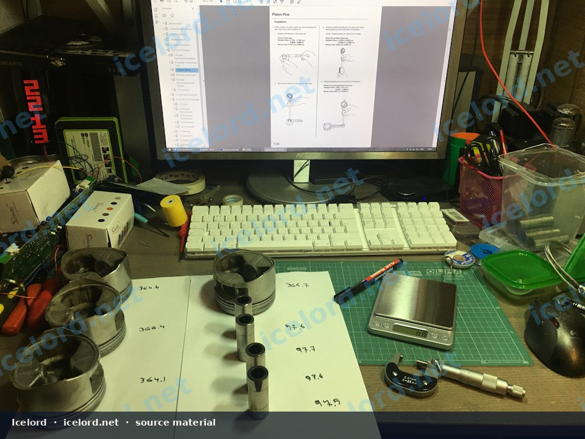
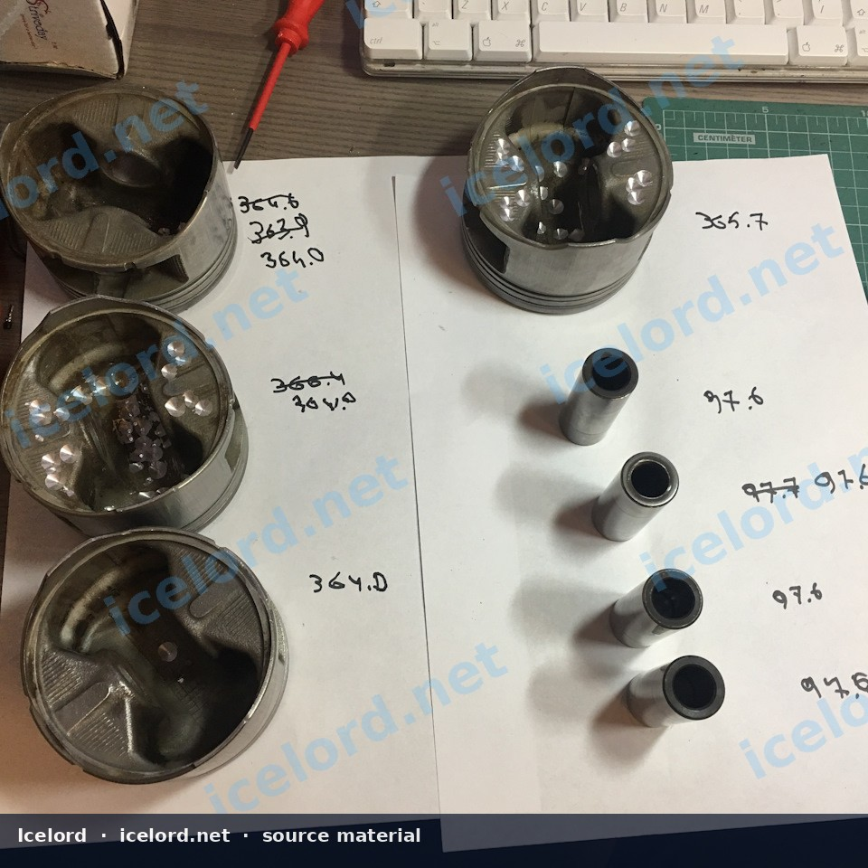
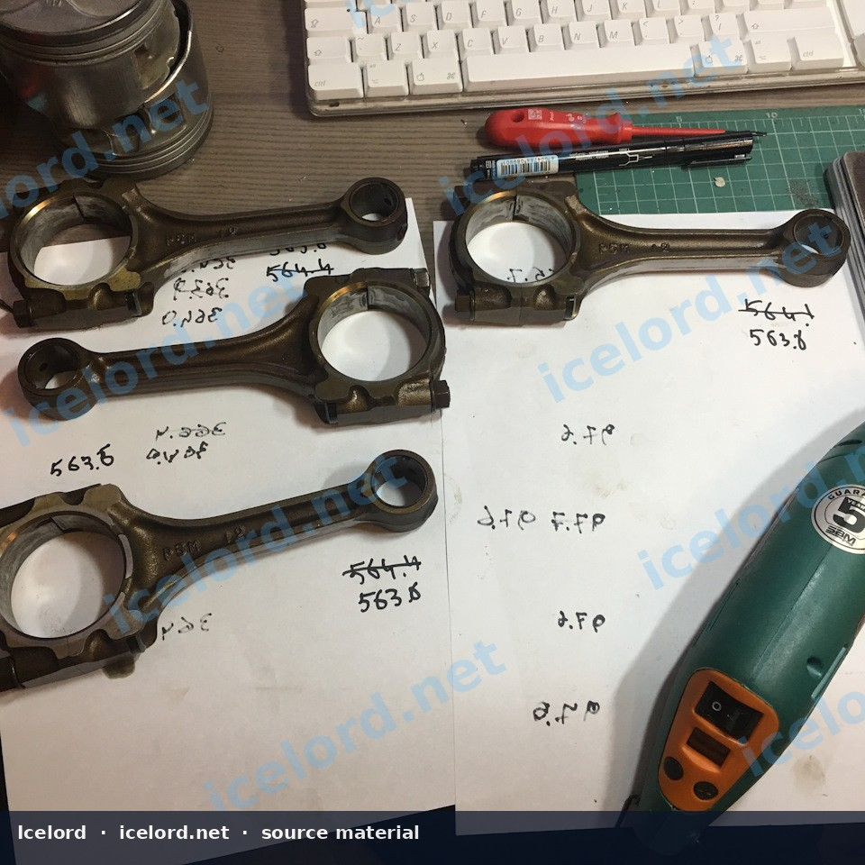
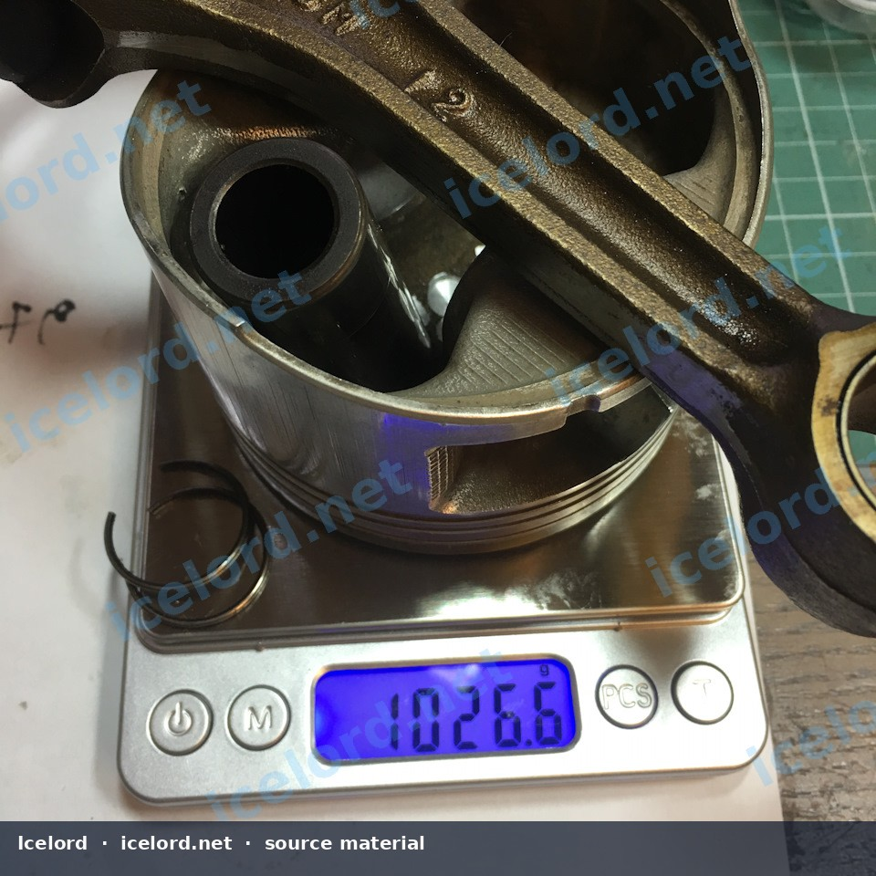
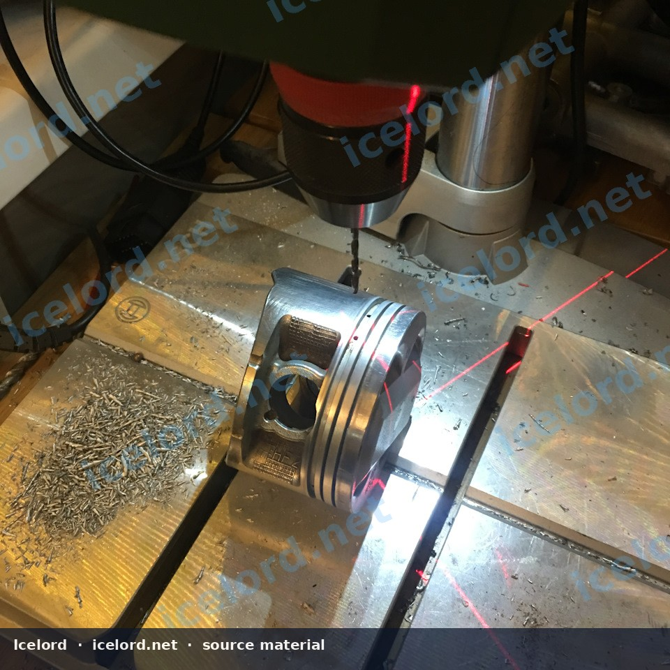

# Static Weight Matching of Connecting Rod and Piston Assemblies

Precise static weight matching of connecting rod and piston assemblies is a critical step during engine rebuilding to minimize vibration, reduce stress on crankshaft bearings, and ensure consistent power delivery across all cylinders. This process involves carefully measuring and adjusting the weight of individual components to achieve uniformity within a specified tolerance.

```carousel

<!-- slide -->

<!-- slide -->

<!-- slide -->

<!-- slide -->


```

## Importance of Weight Matching

An imbalance in the reciprocating and rotating mass of an engine can lead to several undesirable outcomes:

*   **Increased Vibration:** Unmatched weights cause uneven forces, leading to engine vibration that can be felt throughout the vehicle.
*   **Accelerated Wear:** Excessive vibration and uneven loading can prematurely wear crankshaft bearings, piston rings, and other engine components.
*   **Reduced Performance:** Inconsistent cylinder forces can lead to slight variations in power output and overall engine smoothness.
*   **Potential for Catastrophic Failure:** In extreme cases, severe imbalance can lead to component fatigue and failure, especially at high RPMs.

## Components for Weight Matching

Static weight matching typically focuses on these key components for each cylinder:

*   **Piston:** The main reciprocating mass.
*   **Piston Pin (Wrist Pin):** Connects the piston to the connecting rod.
*   **Connecting Rod:** Transfers force from the piston to the crankshaft. For static balancing, the total weight of the rod is considered, though dynamic balancing would separate big-end and small-end weights.

## Pre-Inspection and Measurement

Before any weight adjustments, thoroughly inspect and clean all components. Refer to the factory service manual (FSM) for specific inspection criteria and service limits for your engine.

> [!IMPORTANT]
> Always consult your specific Honda/Acura factory service manual for precise specifications, tolerances, and recommended procedures for your engine model. The values provided here are illustrative examples.

### Piston Pin Inspection

1.  **Visual Check:** Inspect the piston pin for any signs of wear, damage, discoloration, or bending.
2.  **Dimensional Measurement:** Measure the piston pin's outside diameter (O.D.) and the piston pin bore's inside diameter (I.D.) to determine the clearance. Ensure these measurements are within the FSM's standard and service limits.

| Measurement                  | Standard (mm) | Standard (in.) | Service Limit (mm) | Service Limit (in.) |
| :--------------------------- | :------------ | :------------- | :----------------- | :------------------ |
| Piston Pin O.D.              | 21.994-22.000 | 0.8659-0.8661  | 21.980             | 0.8654              |
| Piston Pin Bore I.D.         | 22.004-22.010 | 0.8663-0.8665  | 22.020             | 0.8669              |
| Pin-to-Bore Clearance        | 0.004-0.010   | 0.0002-0.0004  | 0.020              | 0.0008              |

> [!NOTE]
> The above specifications are examples and may vary by engine. Always refer to the FSM for your specific application.

## Weight Matching Procedure

The goal is to bring the weight of each component, or assembly of components, as close as possible to the lightest component in the set. Material should only be removed, never added.

### Tools and Equipment

*   **Digital Scale:** A high-precision digital scale capable of measuring to 0.1 gram (or finer) is essential.
*   **Micrometer/Calipers:** For precise dimensional measurements.
*   **Grinding Tools:** Small rotary tool (e.g., Dremel) with various burrs and grinding stones.
*   **Drill:** With appropriate drill bits for material removal from pistons.
*   **Safety Glasses and Gloves:** Always wear appropriate personal protective equipment.

### Piston and Pin Assembly Weighting

1.  **Weigh Pistons Individually:** Clean and weigh each piston without rings or pins. Record the weight.
2.  **Weigh Piston Pins Individually:** Clean and weigh each piston pin. Record the weight.
3.  **Assemble and Weigh Piston/Pin:** Install each piston pin into its corresponding piston. Weigh the combined piston and pin assembly. This is the primary target for matching.
4.  **Adjust Piston Pin Weight:** If a piston pin is heavier than the lightest pin, carefully remove material from the *inside* of the pin using a small rotary burr. Aim for a maximum variation of 0.1 gram between pins.
5.  **Adjust Piston Weight:** If a piston (or piston/pin assembly) is heavier than the lightest assembly, material can be removed from the *inside* of the piston skirt. Small depressions can be drilled with a drill bit (e.g., 10mm diameter, no more than 2mm deep) in non-stressed areas, typically the internal "fatigue belt" or skirt area, away from ring lands or critical structural points.

> [!CAUTION]
> When removing material from pistons or pins, do so incrementally and carefully. Removing too much material can weaken the component or make it unusable. Always clean components thoroughly after grinding to remove any metal shavings.

### Connecting Rod Weighting

1.  **Weigh Connecting Rods Individually:** Clean and weigh each connecting rod. For static balancing, the total weight is the primary concern. For more advanced dynamic balancing, separate small-end and big-end weights would be measured.
2.  **Adjust Connecting Rod Weight:** Identify the lightest connecting rod. For heavier rods, material can be carefully removed from non-critical areas, such as casting flash or minor imperfections on the beam or around the big-end or small-end bosses. A rotary tool with a burr is suitable for this. Focus on areas that will not compromise the rod's structural integrity.

> [!WARNING]
> Never remove material from highly stressed areas of the connecting rod, such as the bolt bosses, bearing surfaces, or the main beam, unless specifically instructed by a professional engine builder or the FSM. Improper material removal can lead to catastrophic rod failure.

### Final Assembly Weight Verification

After adjusting individual components, reassemble each piston, pin, and connecting rod. Weigh each complete assembly (piston, pin, rod). The goal is to have all assemblies within a very tight tolerance, typically within 0.5 to 1 gram of each other, or as specified by your engine builder or FSM.

> [!TIP]
> Keep detailed records of each component's weight before and after adjustment. This helps track progress and ensures accuracy.

## Additional Considerations During Rebuild

During an engine rebuild, other modifications might be performed, such as enlarging oil drain holes in the pistons. While not directly part of weight matching, this is a common practice to improve oil scavenging. For example, some builders may enlarge piston oil return holes from 2.0mm to 2.5mm.

> [!NOTE]
> This article focuses on static weight matching. For high-performance applications, dynamic balancing of the entire rotating assembly (crankshaft, connecting rods, pistons, flywheel/flexplate, harmonic balancer) is often recommended for even greater precision and reduced vibration.
