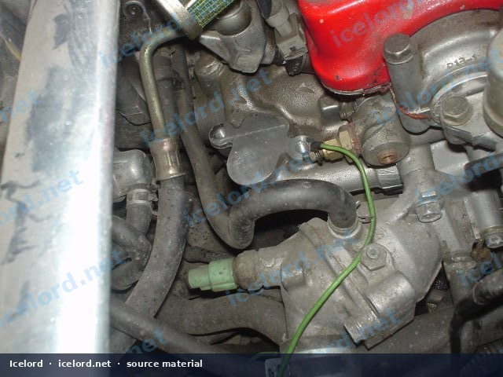
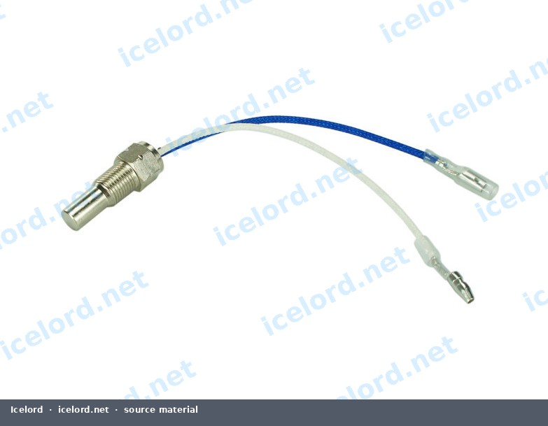
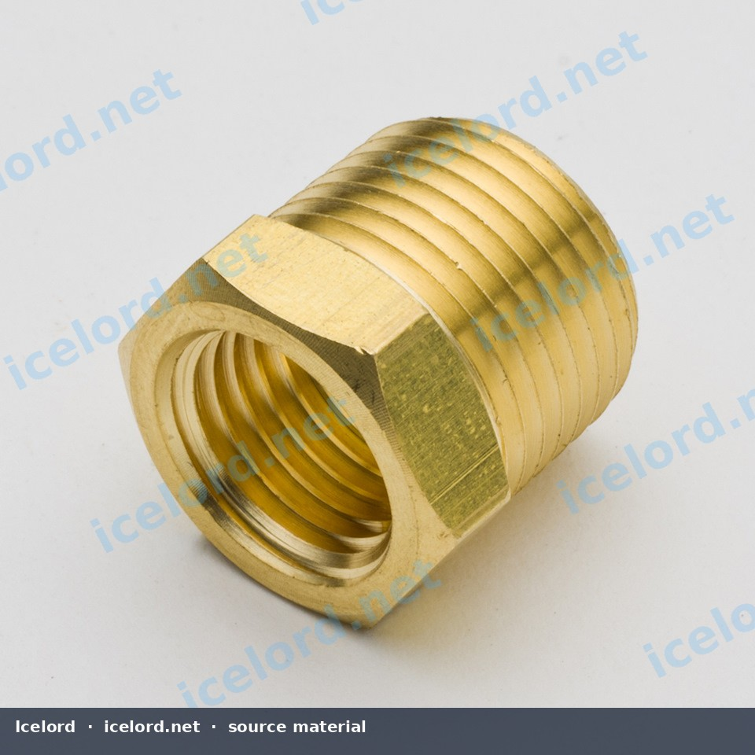

# Honda H22A Oil Temperature Sensor Installation

Accurate oil temperature monitoring is crucial for engine health and performance tuning. The H22A engine block offers an ideal location for an aftermarket oil temperature sensor, specifically the oil pressure port located before the VTEC solenoid valve. This position ensures the sensor reads the temperature of oil actively circulating through critical engine components, rather than static oil in the pan.

```carousel

<!-- slide -->

<!-- slide -->


```

## Optimal Sensor Location

The most suitable location for an oil temperature sensor on the H22A engine is the oil pressure port situated just before the VTEC solenoid valve. This port provides access to oil that has reached operating temperature after circulating through the engine, offering a more representative temperature reading for performance monitoring.

## Required Components

Installing an aftermarket oil temperature sensor typically requires an adapter due to differing thread specifications between common sensors and the H22A engine block.

*   **Oil Temperature Sensor:** Most aftermarket fluid temperature sensors utilize a **1/8-28 NPT** (National Pipe Taper) thread.
*   **H22A Engine Block Port:** The factory oil pressure port on the H22A engine block typically has a **3/8-19 NPT** thread.
*   **Adapter Bushing:** A reducer fitting is necessary to bridge the size difference. Search for a "Brass Pipe Hex Bushing Reducer Fitting 3/8" Male x 1/8" Female NPT".

> [!IMPORTANT]
> Ensure that all fittings and the sensor use **NPT (National Pipe Taper)** threads. BSPP (British Standard Parallel Pipe) or other thread types are not compatible and can cause damage or leaks if forced.

## Installation Procedure

Follow these steps to install the oil temperature sensor:

1.  **Engine Preparation:** Ensure the engine is cool. It may be beneficial to drain a small amount of engine oil, or perform the installation during an oil change, to minimize spillage when removing the factory plug.
2.  **Locate Port:** Identify the oil pressure port on the H22A engine block, typically near the VTEC solenoid valve.
3.  **Remove Factory Plug:** Carefully remove the existing factory plug from the oil pressure port. Have a drain pan ready to catch any oil that may escape.
4.  **Prepare Adapter:** Apply a high-quality thread sealant (e.g., PTFE paste or tape) to the male threads of the 3/8" NPT side of the adapter bushing. Ensure the sealant is compatible with engine oil.
5.  **Install Adapter:** Thread the adapter bushing into the H22A engine block port. Tighten it securely, but do not overtighten. Refer to the factory service manual (FSM) for specific torque specifications for the oil pressure port plug, and apply that to the adapter.
6.  **Prepare Sensor:** Apply thread sealant to the threads of the 1/8" NPT oil temperature sensor.
7.  **Install Sensor:** Carefully thread the oil temperature sensor into the female 1/8" NPT side of the adapter bushing. Tighten the sensor according to the manufacturer's recommendations or until snug, ensuring a good seal without overtightening.

> [!CAUTION]
> Overtightening NPT fittings can crack the engine block or the adapter, leading to severe oil leaks. Always confirm torque specifications with the factory service manual or sensor manufacturer's instructions.

8.  **Connect Wiring:** Connect the sensor's wiring harness according to the instructions provided with your aftermarket gauge or engine management system.
9.  **Refill Oil & Inspect:** If oil was drained, refill it to the appropriate level. Start the engine and carefully inspect the sensor and adapter area for any signs of oil leaks. Allow the engine to reach operating temperature and re-check for leaks.

> [!TIP]
> Use a flashlight and a clean rag to thoroughly check around the sensor and adapter for any weeping or dripping oil after the engine has run for a few minutes.

## Verification

After installation, verify that the oil temperature sensor is providing accurate readings to your gauge or engine management system. Compare readings to other known temperature sources if possible, or monitor for consistent and expected temperature increases as the engine warms up.
