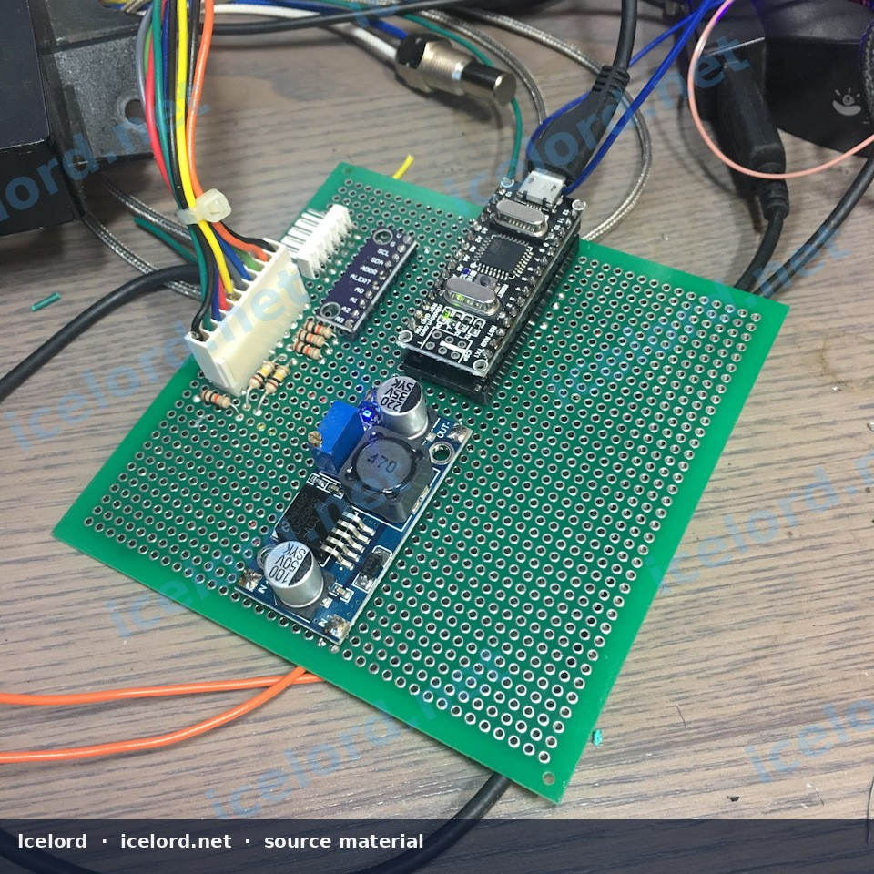

# Non-Contact Brake Rotor Temperature Sensor Installation

Non-contact infrared sensors measure rotor temperature without a sliding thermocouple. They are useful for pad comparisons, cooling-duct tests, and track sessions when mounting and emissivity are handled carefully.

*Image placeholder - replace with a publication-cleared photo (2ab7ad9s-960.jpg).*

## What the Sensor Needs

Most modules (for example MLX90614-class breakout boards) need:

- Stable 3.3 V or 5 V supply as specified
- Common ground with the logger
- Clear optical path to the rotor
- Firmware/logging that samples fast enough to catch a braking event

## Mechanical Mounting

1. Build a rigid bracket off a non-rotating upright/hub feature - not the dust shield alone if it flexes.
2. Aim at a consistent radius on the rotor (friction ring or hat - pick one and keep it).
3. Protect the optic from rocks and brake dust with a shroud that does not trap water against the lens.
4. Strain-relieve the cable so full lock and suspension travel cannot yank the connector.
5. Confirm clearance through bump, droop, and steering lock.

## Electrical Installation

1. Fuse the supply near the source.
2. Route signal wires away from coil-on-plug leads and alternator cables.
3. Use connectors that tolerate heat near the wheel well.
4. Log left and right channels with matching aim if you compare sides.

## Accuracy Limits

| Factor | Effect |
| :--- | :--- |
| Wrong emissivity | Absolute temps off by tens of degrees |
| Shiny steel target | Under-reads until surface oxidizes or is coated |
| Aim drift | Mixes hat and vane temperatures |
| Sample rate too low | Misses peak temp at end of stop |

Treat data as comparative unless you calibrate against a known reference.

## Safety

This is instrumentation. It does not replace proper fluid, pad compound, or bias setup. Mounting hardware must never be able to foul the wheel.

## Validation

- [ ] Live values move when brakes are applied
- [ ] Corners track similarly on a straight stop
- [ ] Wiring survives a full session without intermittent dropouts
