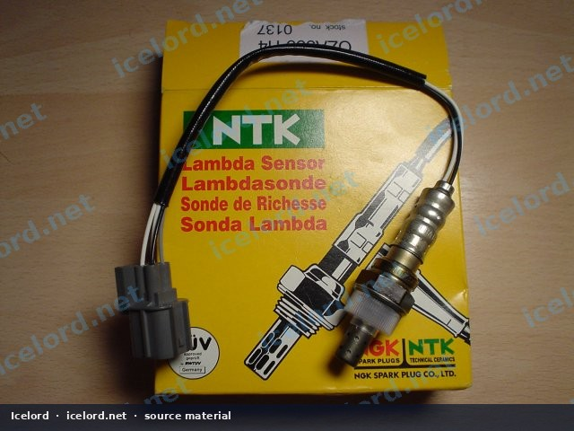

# Honda Oxygen Sensor OEM and NGK/NTK Cross-Reference Guide

## Understanding Oxygen Sensor Cross-References

Oxygen sensors are critical components in modern engine management systems, providing feedback to the Engine Control Unit (ECU) for fuel mixture adjustments and emissions control. Replacing a faulty oxygen sensor with a quality aftermarket equivalent can offer significant cost savings compared to purchasing an original equipment manufacturer (OEM) part, without compromising performance. NGK/NTK is a reputable manufacturer known for producing high-quality automotive sensors that meet or exceed OEM specifications.

*Image placeholder - replace with a publication-cleared photo (dsc01636.jpg).*

## Common OEM to NGK/NTK Equivalents

This section provides a cross-reference for specific Honda/Acura OEM oxygen sensor part numbers to their corresponding NGK/NTK aftermarket equivalents.

> [!IMPORTANT]
> Always verify the exact part number, connector type, and wire length against your vehicle's factory service manual (FSM) or by physically inspecting the original sensor before purchasing a replacement.

A known cross-reference for certain Honda/Acura applications is:

* **OEM Part Number:** `36531-P72-J01`
* **NGK Stock Number:** `0137`
* **NTK Part Number:** `0ZA333-H4`
* **Other Reference:** `KBA16693`

This specific NGK/NTK alternative is often a more economical choice compared to the OEM part.

## Heater Circuit Resistance

The heater circuit within an oxygen sensor is vital for bringing the sensor up to operating temperature quickly, ensuring accurate readings shortly after engine start-up. For the `NGK 0137 / NTK 0ZA333-H4` sensor, the heater circuit typically exhibits a resistance of **15 ohms**.

> [!NOTE]
> Heater circuit resistance can vary slightly between manufacturers and specific sensor designs. Always confirm the correct specification for your application using the factory service manual. An incorrect heater resistance can lead to diagnostic trouble codes (DTCs) or improper sensor function.

## Verifying Sensor Compatibility

When selecting an aftermarket oxygen sensor, several factors beyond the part number are crucial for ensuring proper function:

* **Connector Type:** Ensure the replacement sensor's electrical connector matches the vehicle's harness exactly.
* **Wire Length:** The wire length must be appropriate to reach the harness connector without tension or excess slack.
* **Sensor Type:** Confirm if it's a primary (upstream) or secondary (downstream) sensor, as their characteristics and locations differ.
* **Heater Circuit:** As noted, verify the heater resistance and voltage requirements.

> [!TIP]
> While cross-reference guides are helpful, the most reliable method to confirm compatibility is to compare the new sensor directly with the old one, paying close attention to the connector, wire length, and physical dimensions.

## Why Choose NGK/NTK?

NGK/NTK is a leading supplier of ignition and sensor components to automotive manufacturers worldwide. Their aftermarket oxygen sensors are engineered to provide:

* **Reliable Performance:** Designed to meet or exceed OEM specifications for accuracy and longevity.
* **Cost-Effectiveness:** Often available at a lower price point than OEM parts, offering significant savings.
* **Wide Availability:** Easily sourced through various automotive parts retailers.
