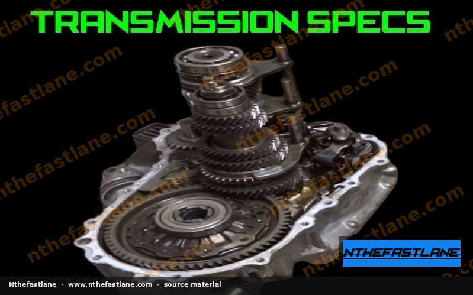

# Honda F-Series Manual Transmission Specifications

## Overview of F-Series Manual Transmissions

Honda F-series engines, paired with various manual transmissions, were utilized across a range of models including the Accord and Prelude. These transmissions are known for their reliability and distinct gearing, which varies significantly depending on the specific engine (e.g., F20, F22, F23, H22, H23) and vehicle application. Understanding these specifications is crucial for maintenance, repair, and performance modifications.

*Image placeholder - replace with a publication-cleared photo (d7f001_436c3a99fc9446caad455e48c4922ec0~mv2.jpg).*

## Key Transmission Specifications

Specific gear ratios, final drive ratios, and fluid capacities differ between F-series transmission variants. Always refer to the official Honda factory service manual for the exact specifications applicable to your vehicle's year, model, and engine code.

### Gear Ratios

Gear ratios determine the speed-to-RPM relationship in each gear. Variations exist between different F-series transmissions, often optimized for fuel economy or performance depending on the vehicle's original intent.

| Gear | Ratio (Example - Confirm with FSM) |
| :------ | :--------------------------------- |
| 1st | Consult FSM |
| 2nd | Consult FSM |
| 3rd | Consult FSM |
| 4th | Consult FSM |
| 5th | Consult FSM |
| Reverse | Consult FSM |

### Final Drive Ratios

The final drive ratio, located in the differential, is a critical factor in overall vehicle acceleration and top speed. Different F-series transmissions may share similar gear ratios but feature distinct final drive ratios.

| Component | Ratio (Example - Confirm with FSM) |
| :---------- | :--------------------------------- |
| Final Drive | Consult FSM |

### Fluid Capacity and Type

Proper transmission fluid is essential for lubrication, cooling, and smooth operation. Using the correct type and quantity of fluid is paramount to transmission longevity.

> [!IMPORTANT]
> Always use genuine Honda Manual Transmission Fluid (MTF) or an equivalent fluid that meets Honda's specifications. The use of incorrect fluid can lead to premature wear and shifting issues.

| Specification | Value (Confirm with FSM) |
| :------------ | :----------------------- |
| Fluid Type | Honda MTF (or equivalent) |
| Capacity | Consult FSM |

## Maintenance and Inspection

Regular maintenance helps ensure the longevity and performance of your F-series manual transmission.

### Fluid Changes

Transmission fluid should be changed at recommended intervals or sooner under severe driving conditions.

1. **Preparation:** Ensure the vehicle is on a level surface and the transmission is at operating temperature.
2. **Drain:** Locate and remove the transmission drain plug. Allow all fluid to drain completely.
3. **Refill:** Reinstall the drain plug with a new crush washer and torque to factory specifications (consult FSM). Fill the transmission with the specified amount of new Honda MTF through the fill hole.
4. **Check Level:** Once filled, ensure the fluid level is correct according to FSM procedures, typically until fluid begins to seep from the fill hole.

> [!CAUTION]
> Overtightening or undertightening drain and fill plugs can cause damage or leaks. Always use a torque wrench and refer to the FSM for specific torque values.

### Common Inspection Points

During routine maintenance, inspect the following:

* **Fluid Leaks:** Check around the axle seals, input shaft seal, and case seams for any signs of fluid leakage.
* **Shifter Bushings:** Inspect shifter linkage bushings for wear, which can lead to loose or imprecise shifting.
* **Clutch Operation:** Ensure the clutch engages and disengages smoothly without slipping or grabbing.
* **Mounts:** Check transmission mounts for cracks or excessive wear.

## Torque Specifications

Accurate torque application is vital for all fasteners during transmission service.

| Component | Torque Value (Confirm with FSM) |
| :-------------------- | :------------------------------ |
| Drain Plug | Consult FSM |
| Fill Plug | Consult FSM |
| Bell Housing Bolts | Consult FSM |
| Transmission Mounts | Consult FSM |
| Axle Nut | Consult FSM |

> [!WARNING]
> Incorrect torque values can lead to component failure, fluid leaks, or damage. Always consult the Honda factory service manual for precise torque specifications for your specific transmission and application.
