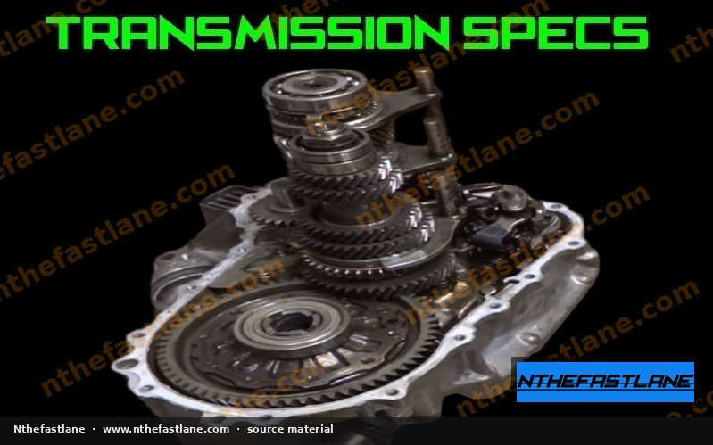

# Honda H-Series Manual Transmission Specifications

## Overview
Honda H-series manual transmissions are renowned for their robust design and performance characteristics, commonly paired with H-series and some F-series engines in models like the Accord and Prelude. These transmissions offer various gear ratio sets and final drive options, influencing vehicle acceleration and top speed.

*Image placeholder - replace with a publication-cleared photo (d7f001_436c3a99fc9446caad455e48c4922ec0~mv2.jpg).*

## Common H-Series Transmission Variants
Several manual transmission codes are associated with the H-series engine family, each potentially featuring distinct gear ratios and final drive specifications. Key variants often include:

* **M2B4:** Often found in earlier H22A applications, known for its limited-slip differential (LSD).
* **M2Y4 / M2F4:** Common in later H22A/H22A4 applications, typically without an LSD from the factory.
* **T2W4:** A later variant, often featuring an LSD.

> [!IMPORTANT]
> Specific gear ratios, final drive ratios, and the presence of a limited-slip differential (LSD) vary significantly between these variants. Always confirm the exact specifications for your transmission code against the factory service manual.

## Gear Ratios and Final Drive
Understanding the gear ratios and final drive is crucial for performance tuning and maintenance.

### Gear Ratios
Each forward gear has a specific ratio that multiplies engine torque. These ratios determine the vehicle's acceleration characteristics in each gear.

### Final Drive Ratio
The final drive ratio, located in the differential, provides the final reduction in gearing before power reaches the wheels. It significantly impacts overall acceleration and cruising RPMs.

> [!NOTE]
> Precise gear ratio and final drive values are unique to each transmission variant and model year. Refer to the official Honda factory service manual for your specific vehicle and transmission code to obtain accurate figures.

## Fluid Specifications
Maintaining the correct transmission fluid type and level is vital for longevity and smooth operation.

### Recommended Fluid Type
Honda manual transmissions typically require Honda Manual Transmission Fluid (MTF). Using alternative fluids may lead to suboptimal performance or premature wear.

### Fluid Capacity
The transmission fluid capacity varies slightly between H-series variants.

> [!CAUTION]
> Always use genuine Honda MTF or an equivalent fluid that meets Honda's specifications. Confirm the exact fluid capacity for your specific transmission model in the factory service manual before performing a fluid change.

## Common Torque Specifications
Accurate torque application is essential when servicing the transmission to prevent damage and ensure proper sealing.

* **Transmission Drain Plug:** Secures the fluid within the transmission.
* **Transmission Fill Plug:** Allows for fluid addition.
* **Clutch Pressure Plate Bolts:** Secure the pressure plate to the flywheel.
* **Flywheel Bolts:** Attach the flywheel to the crankshaft.
* **Bell Housing Bolts:** Connect the transmission to the engine block.

> [!WARNING]
> Do not guess torque values. Incorrect torque can lead to stripped threads, fluid leaks, or component failure. Always consult the factory service manual for the precise torque specifications for all fasteners related to your H-series manual transmission.

## Inspection and Maintenance
Regular inspection and maintenance can extend the life of your H-series manual transmission.

* **Fluid Level Check:** Periodically check the fluid level using the fill plug.
* **Fluid Change Interval:** Adhere to the manufacturer's recommended fluid change intervals.
* **Leak Detection:** Inspect for any signs of fluid leaks around seals and gaskets.
* **Shift Feel:** Pay attention to any changes in shift feel, such as notching or difficulty engaging gears, which could indicate internal wear.

## Troubleshooting Common Issues
While H-series transmissions are generally robust, some common issues may arise:

* **Grinding Gears:** Often indicates worn synchronizers or incorrect clutch adjustment.
* **Difficulty Shifting:** Can be caused by low fluid, incorrect fluid, or clutch hydraulic issues.
* **Noise:** Whining or clunking noises can point to worn bearings or gear damage.

> [!TIP]
> For any persistent issues, a thorough diagnostic process, often starting with fluid inspection and external linkage checks, is recommended. Always refer to the factory service manual for detailed troubleshooting procedures.
