# Honda Prelude ATTS Delete Intermediate-Shaft Adapter Plate Fabrication

When performing an ATTS (Active Torque Transfer System) delete on a Honda Prelude, it is often necessary to replace the ATTS-specific intermediate shaft with a standard non-ATTS shaft. Due to differences in mounting points on the engine block, a custom adapter plate is required to correctly secure the non-ATTS intermediate shaft.

This article outlines the fabrication process for such an adapter plate, ensuring proper fitment and structural integrity.

```carousel
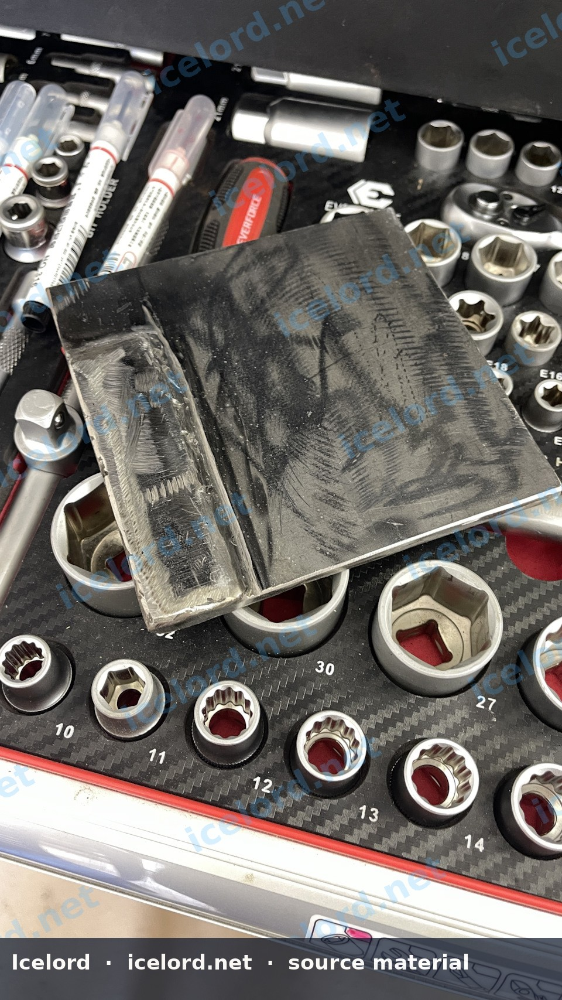
<!-- slide -->
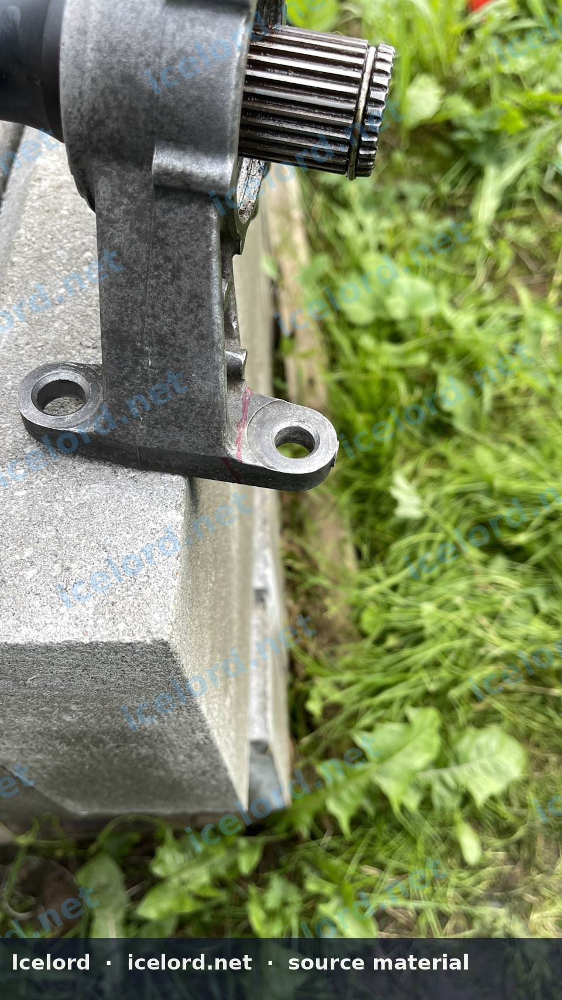
<!-- slide -->
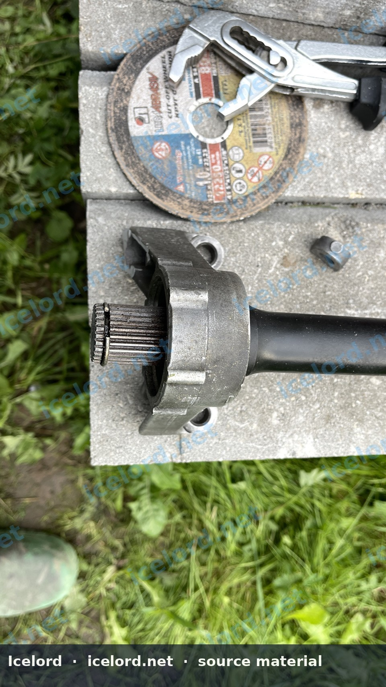
<!-- slide -->
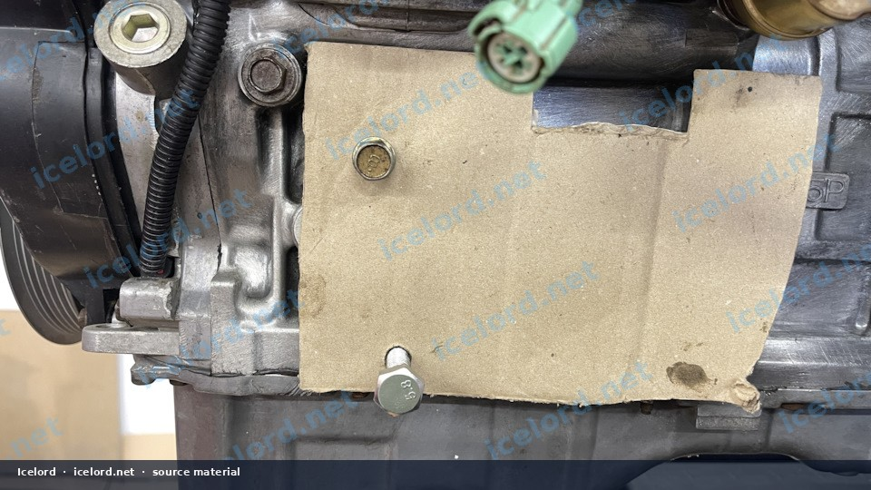
<!-- slide -->
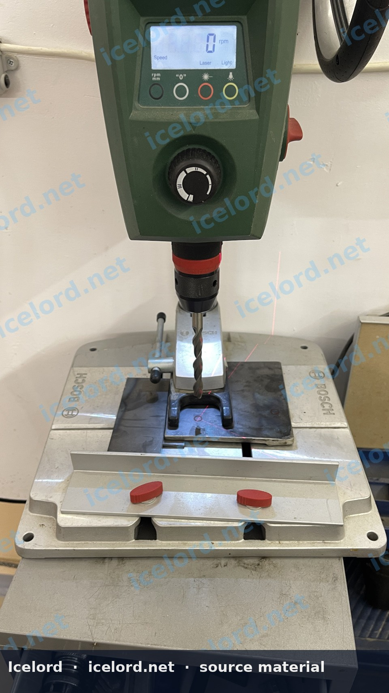
<!-- slide -->
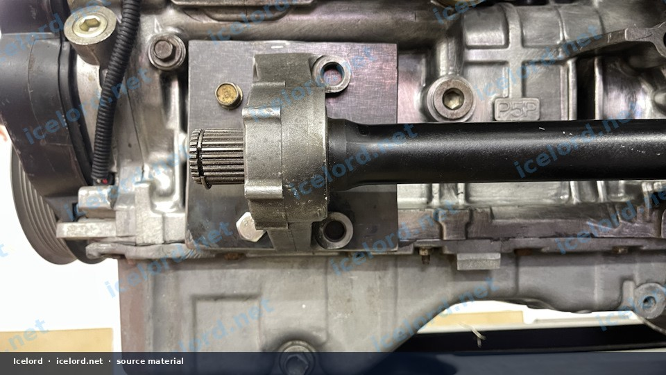
<!-- slide -->
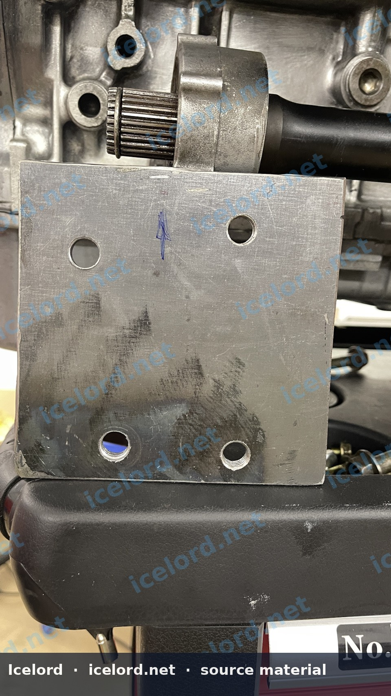
<!-- slide -->


```

```carousel
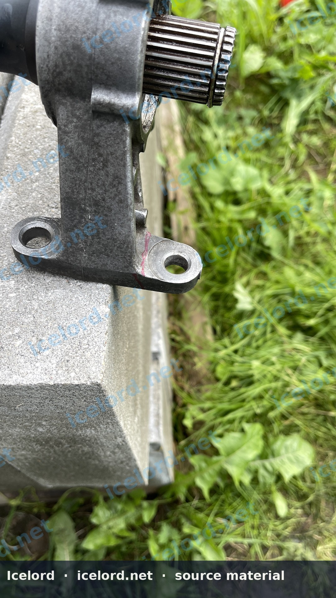
<!-- slide -->
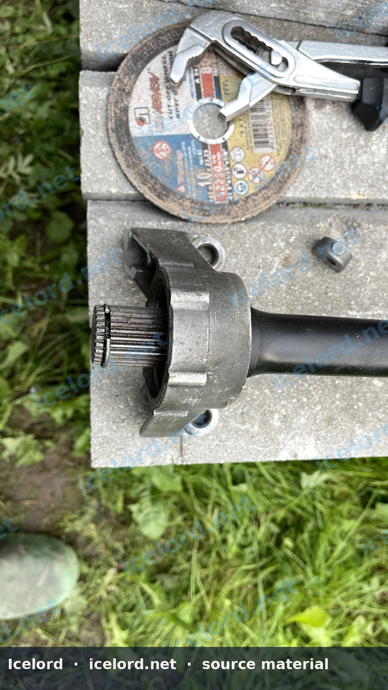
<!-- slide -->

<!-- slide -->
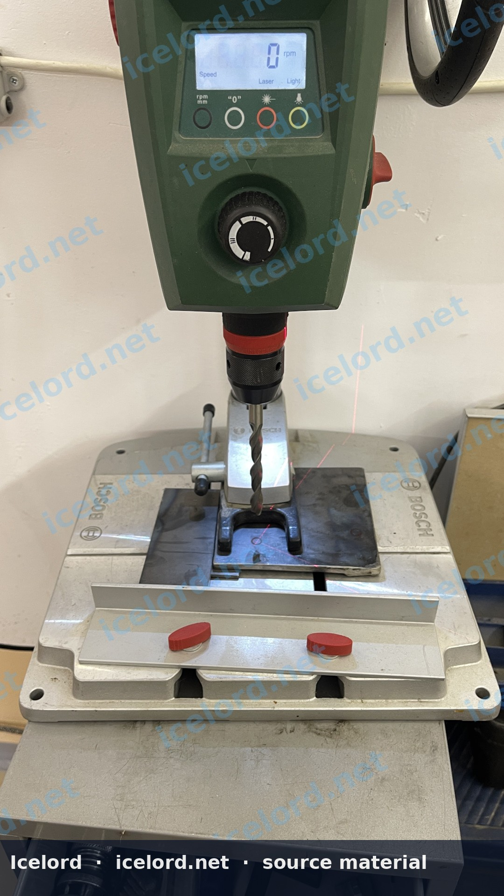
<!-- slide -->

<!-- slide -->

<!-- slide -->
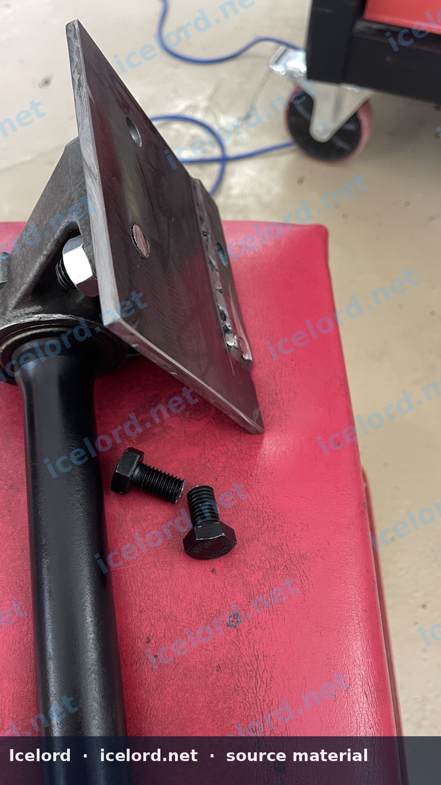
<!-- slide -->


```

```carousel
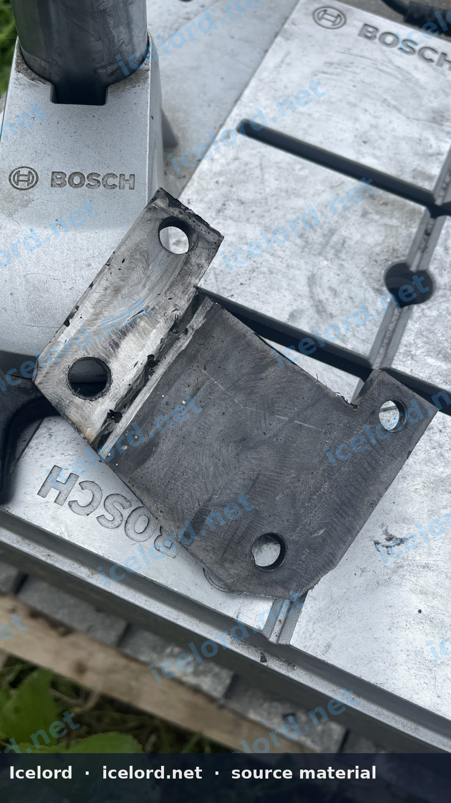
<!-- slide -->
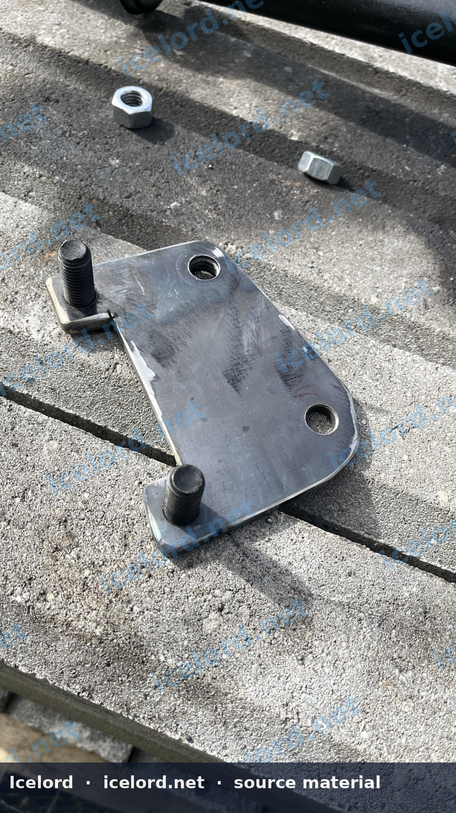
<!-- slide -->

<!-- slide -->

<!-- slide -->

<!-- slide -->
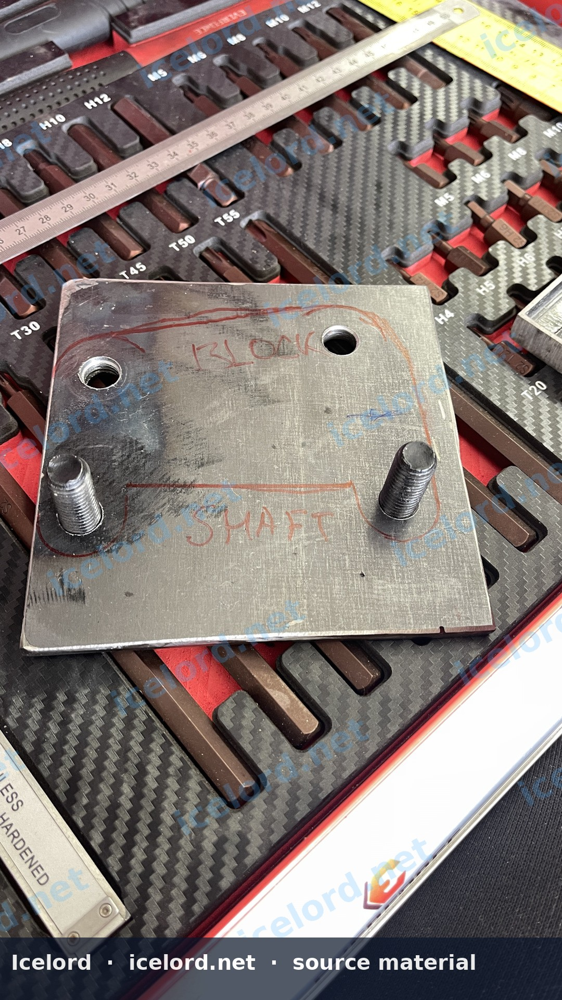
<!-- slide -->

<!-- slide -->


```

```carousel
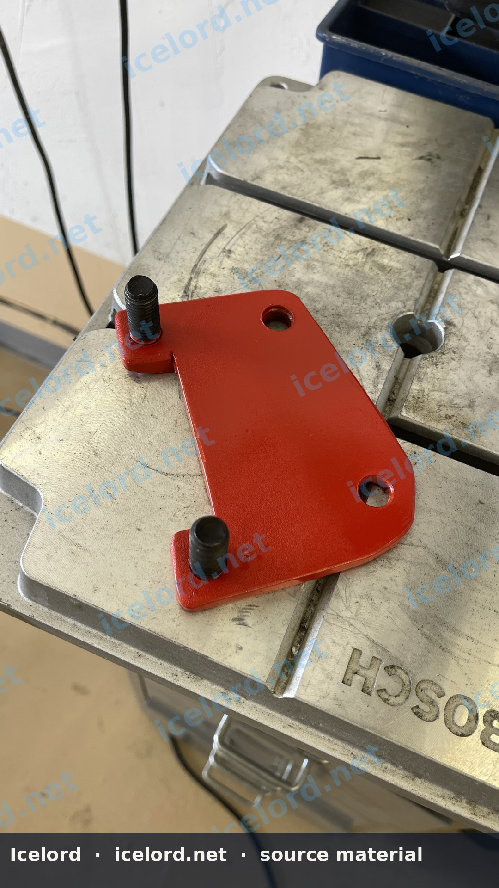
<!-- slide -->
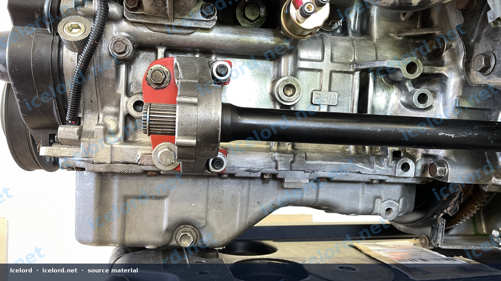

```

## Understanding the ATTS Intermediate Shaft Difference

The Honda Prelude's ATTS system utilizes a unique intermediate shaft that integrates with the ATTS unit. When removing the ATTS system, a standard intermediate shaft (typically from a non-ATTS H-series engine) is used. This standard shaft lacks the third mounting ear present on the ATTS version, which bolts directly to the engine block. The adapter plate bridges this gap, providing a secure mounting point for the standard intermediate shaft.

## Required Materials and Tools

Successful fabrication of this adapter plate requires precision and appropriate tools.

### Materials

*   **Steel Plate:** A base plate approximately 6mm thick is recommended for structural rigidity. An additional 3mm plate or spacer may be needed for specific bolt locations.
*   **High-Strength Bolts:** M10 bolts, grade 10.8 or higher, are crucial for creating the studs that will secure the intermediate shaft. Confirm bolt length against the factory service manual (FSM) for proper engagement.
*   **Templating Material:** Cardboard, thick paper, or thin sheet metal for creating accurate templates.
*   **Marking Tools:** Scribe, permanent marker, center punch.

### Tools

*   **Welding Equipment:** MIG or TIG welder for securing studs and potentially reinforcing the plate.
*   **Angle Grinder/Cut-off Wheel:** For shaping the plate and removing excess material from the intermediate shaft.
*   **Drill Press/Hand Drill:** With appropriate metal drill bits.
*   **Measuring Tools:** Calipers, ruler, protractor.
*   **Bench Vise:** For holding components securely during cutting, drilling, and welding.
*   **Safety Gear:** Welding helmet, gloves, eye protection, hearing protection, respirator.

> [!WARNING]
> Welding and grinding operations produce sparks, fumes, and intense light. Always wear appropriate personal protective equipment (PPE) to prevent injury. Ensure adequate ventilation in the work area.

## Intermediate Shaft Modification

The standard non-ATTS intermediate shaft typically has two mounting points to the engine block. The ATTS-equipped block, however, has an additional mounting point that the standard shaft does not utilize. Conversely, the ATTS intermediate shaft has a third ear that must be removed if adapting it for a non-ATTS setup, or if using a different intermediate shaft that requires this modification.

### Procedure for Third Ear Removal (if applicable)

1.  **Identify the Ear:** Locate the third mounting ear on the intermediate shaft that interferes with the non-ATTS setup or is not needed for the adapter plate.
2.  **Mark the Cut Line:** Carefully mark the section to be removed, ensuring not to compromise the shaft's structural integrity or interfere with other components.
3.  **Secure the Shaft:** Mount the intermediate shaft securely in a vise.
4.  **Cut the Ear:** Using an angle grinder with a metal cut-off wheel, carefully cut along the marked line. Take care to avoid overheating the shaft.
5.  **Smooth Edges:** Deburr and smooth any sharp edges left by the cutting process.

> [!CAUTION]
> Improper cutting or excessive heat can weaken the intermediate shaft. Exercise extreme care during this step. If unsure, consult a professional machinist.

## Adapter Plate Fabrication

This section details the steps to create the custom adapter plate.

### 1. Templating the Block Mounting Points

1.  **Access the Block:** With the transmission removed, expose the mounting points on the engine block where the intermediate shaft typically bolts.
2.  **Create a Template:** Place a piece of cardboard or thin sheet metal against the engine block. Using a hammer or by carefully marking, create an impression or trace the bolt hole pattern for the intermediate shaft.
3.  **Transfer to Plate:** Transfer this template accurately to the 6mm steel base plate.

### 2. Drilling Block Mounting Holes

1.  **Center Punch:** Center punch the marked bolt hole locations on the steel plate.
2.  **Drill Pilot Holes:** Drill small pilot holes.
3.  **Enlarge Holes:** Gradually enlarge the holes to the correct diameter for the bolts that will secure the adapter plate to the engine block. Confirm bolt sizes and torque specifications against the factory service manual.

> [!IMPORTANT]
> Precision is critical. Incorrectly drilled holes will prevent proper alignment and secure mounting. Double-check all measurements before drilling.

### 3. Templating Intermediate Shaft Mounting Points

1.  **Position the Shaft:** Temporarily position the non-ATTS intermediate shaft against the adapter plate, aligning it as it would sit when installed.
2.  **Mark Shaft Holes:** Mark the locations on the adapter plate where the intermediate shaft will bolt to it. This may require careful measurement and alignment to ensure the shaft's spline end is correctly centered.

### 4. Cutting and Shaping the Plate

1.  **Outline the Plate:** Mark the final desired shape of the adapter plate, ensuring it provides sufficient material around all bolt holes and clears surrounding components.
2.  **Cut the Shape:** Use an angle grinder with a cut-off wheel to cut the plate to its final shape.
3.  **Refine Edges:** Grind and deburr all edges for a clean, professional finish.

### 5. Fabricating and Welding Studs

Instead of using bolts that pass through the adapter plate, studs are often preferred for easier installation and to maintain thread integrity.

1.  **Prepare Bolts:** Obtain M10, grade 10.8 (or higher) bolts. Cut them to the appropriate length to create studs, ensuring sufficient thread engagement into the intermediate shaft and enough exposed thread for nuts.
2.  **Chamfer Holes:** Chamfer the edges of the intermediate shaft mounting holes on the adapter plate where the studs will be welded.
3.  **Weld Studs:** Insert the cut bolts into the adapter plate holes from the back. Weld them securely in place, ensuring full penetration without compromising the temper of the high-strength bolt material. This may involve careful, controlled welding passes and allowing the stud to cool between passes.

> [!WARNING]
> Welding high-strength bolts requires skill. Improper welding can weaken the bolt, leading to catastrophic failure. If you are not experienced, seek professional welding services.

### 6. Finishing and Coating

1.  **Clean:** Thoroughly clean the adapter plate to remove any welding slag, grinding dust, and contaminants.
2.  **Coat:** Apply a durable, rust-preventative coating (e.g., paint or powder coat) to protect the steel from corrosion.

## Installation Considerations

Once the adapter plate is fabricated and finished:

*   **Test Fit:** Always test fit the adapter plate to the engine block and then the intermediate shaft to the plate before final installation.
*   **Hardware:** Use new, high-quality hardware (bolts, washers, nuts) for all connections.
*   **Torque Specifications:** Adhere strictly to the factory service manual's torque specifications for all fasteners. If specific torque values for the adapter plate are not available, consult a professional for guidance or use general torque specifications for the bolt size and grade, applying thread locker as appropriate.

> [!TIP]
> Consider using thread-locking compound on all critical fasteners to prevent loosening due to vibration.
