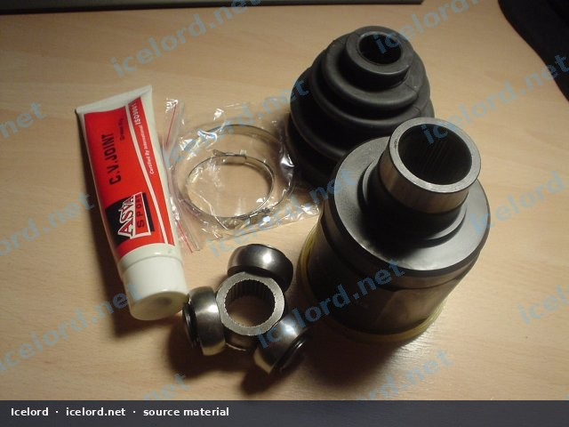
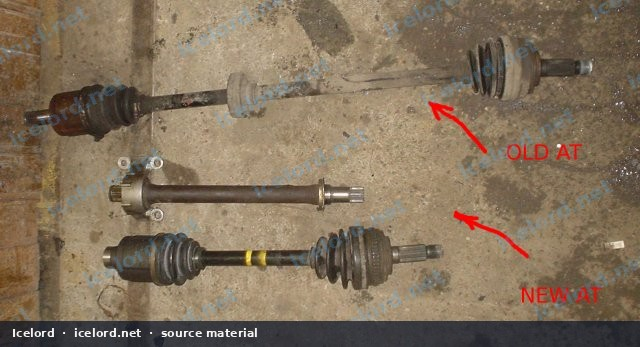
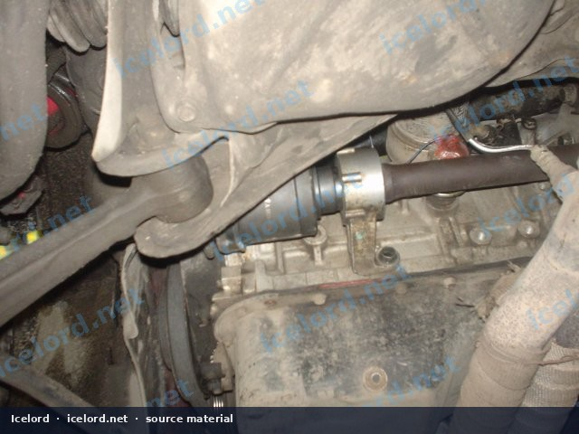
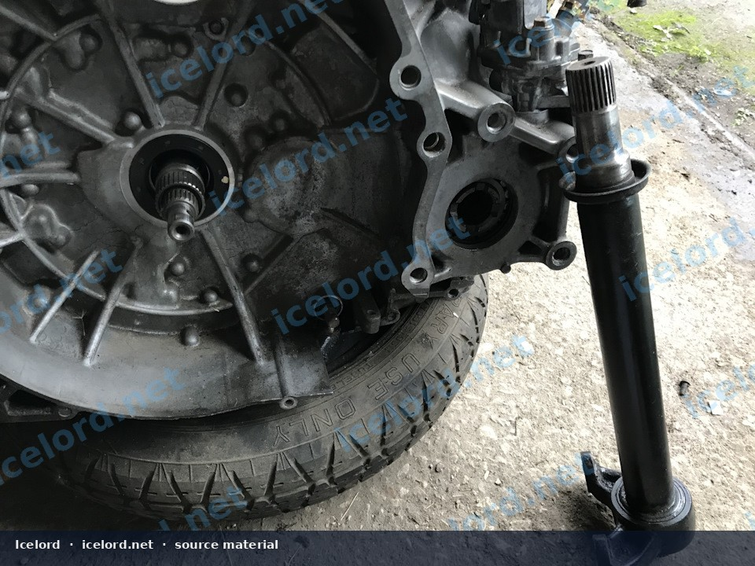
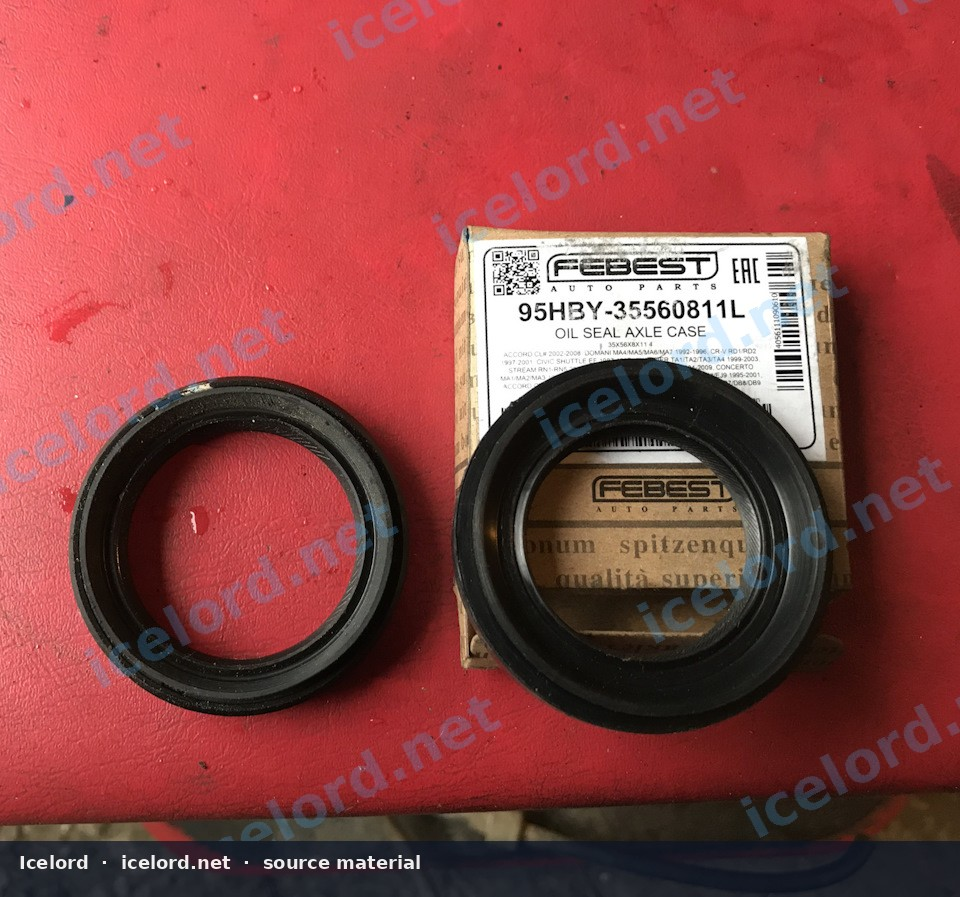

# Honda Prelude BB-Chassis Equal-Length Axle Conversion

This modification addresses the inherent torque steer often experienced with front-wheel drive vehicles, particularly those with unequal-length axles like the Honda Prelude BB-chassis equipped with an automatic transmission. By converting to an equal-length axle setup, which utilizes a manual transmission intermediate shaft, drivers can achieve improved handling dynamics and reduced steering wheel pull during acceleration.

```carousel

<!-- slide -->

<!-- slide -->

<!-- slide -->

<!-- slide -->


```

## Understanding the Equal-Length Axle Principle

Factory automatic transmission Preludes (BB-chassis) typically use a long left-side CV axle that connects directly to the transmission, while the right-side axle is shorter. This length difference can cause varying torsional loads on the axles, leading to torque steer. The equal-length conversion introduces an intermediate shaft on the left side, effectively making both left and right CV axles of similar length, thus balancing the torsional forces.

## Required Components

Performing this conversion requires specific parts, primarily sourced from manual transmission variants of the BB-chassis Prelude or equivalent aftermarket options. It is crucial to verify all part numbers against the factory service manual for your specific vehicle.

*   **Manual Transmission Intermediate Shaft:** This component replaces the long left-side automatic transmission axle. It mounts to the transmission and provides a consistent length for the left CV axle.
*   **Left CV Axle (Manual Transmission Type):** A shorter CV axle designed to connect the intermediate shaft to the left wheel hub. Aftermarket examples like ASVA HNIR-507R (left, manual transmission type) are available, sometimes featuring improved inner CV joint designs with retaining rings for rollers, enhancing durability over some OEM designs.
*   **Right CV Axle (Standard Length):** The existing right-side automatic transmission CV axle may be compatible, or a replacement equivalent to a manual transmission right axle (e.g., ASVA HNIP-516) can be used. Confirm compatibility.
*   **Transmission Oil Seal (Left Side):** This is a critical component. The original automatic transmission seal for the long axle is larger than what is required for the intermediate shaft. A smaller seal, Honda part number **91205-PL3-A01**, with dimensions of **35x56x8 mm**, must be used. The original seal is approximately 5mm larger in outer diameter.

> [!IMPORTANT]
> The transmission oil seal for the left side *must* be replaced with Honda P/N 91205-PL3-A01 (35x56x8 mm) when installing the manual transmission intermediate shaft. Failure to do so will result in transmission fluid leaks.

## Installation Procedure

This procedure involves working with drivetrain components and transmission fluid. Ensure you have the necessary tools, a safe working environment, and refer to your factory service manual for specific torque specifications and detailed steps.

> [!CAUTION]
> Always ensure the vehicle is securely supported on jack stands on a level surface before beginning any work. Disconnect the negative battery terminal. Wear appropriate personal protective equipment.

### 1. Preparation and Fluid Drain

1.  Safely lift the front of the vehicle and support it with jack stands.
2.  Remove the front wheels.
3.  Place a drain pan beneath the transmission and drain the transmission fluid. Refer to the factory service manual for the correct drain plug location and torque specification for reinstallation.

### 2. Axle and Seal Removal

1.  Remove the cotter pin and castle nut securing the axle shaft to the hub. You may need to loosen the lug nuts before lifting the vehicle.
2.  Separate the lower ball joint from the lower control arm, or unbolt other suspension components (e.g., tie rod end, shock fork) to allow sufficient movement of the hub assembly.
3.  Carefully pull the hub assembly outwards to free the axle shaft from the hub.
4.  Pry the long left automatic transmission CV axle from the transmission. Be prepared for residual fluid leakage.
5.  Remove the right CV axle from the transmission.
6.  Using an appropriate seal puller, carefully remove the original left-side transmission oil seal. Take care not to damage the transmission case or shaft bore.

### 3. Intermediate Shaft and New Seal Installation

1.  Clean the transmission seal bore thoroughly.
2.  Lubricate the new **35x56x8 mm** oil seal (Honda P/N 91205-PL3-A01) with fresh transmission fluid.
3.  Carefully tap the new seal into place using a seal driver or a socket of appropriate size, ensuring it is seated squarely and flush with the transmission case.
4.  Lubricate the splines of the manual transmission intermediate shaft with fresh transmission fluid.
5.  Insert the intermediate shaft into the transmission until it fully seats and locks into place. Ensure the retaining clip (if present) engages correctly.

### 4. CV Axle Installation

1.  Lubricate the splines of the new left and right CV axles with CV joint grease.
2.  Insert the right CV axle into the transmission until it fully seats.
3.  Insert the shorter, manual transmission type left CV axle into the intermediate shaft, ensuring it fully seats.
4.  Guide both axle shafts through their respective wheel hubs.
5.  Reassemble all suspension components that were disconnected. Tighten all fasteners to factory specifications, referring to the factory service manual.
6.  Install the axle nuts and new cotter pins. Torque the axle nuts to the specification provided in the factory service manual.

### 5. Final Steps

1.  Refill the transmission with the specified type and amount of transmission fluid. Check the fluid level according to the factory service manual procedure.
2.  Reinstall the front wheels and torque the lug nuts to specification.
3.  Lower the vehicle.
4.  Start the engine and check for any leaks around the transmission and axle seals.
5.  Perform a test drive to confirm proper operation and ensure there are no abnormal noises or vibrations. Pay attention to steering feel and any signs of fluid leakage after the drive.

> [!TIP]
> When installing new CV axles, ensure the retaining clips (if equipped) are properly seated to prevent the axles from dislodging during operation.

> [!NOTE]
> Always consult the official Honda factory service manual for your specific Prelude model and year for precise torque specifications, fluid capacities, and detailed procedural steps. This article provides a general overview.
