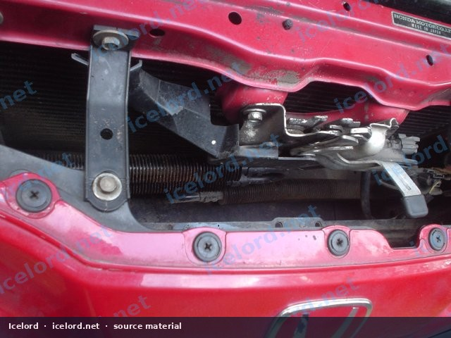
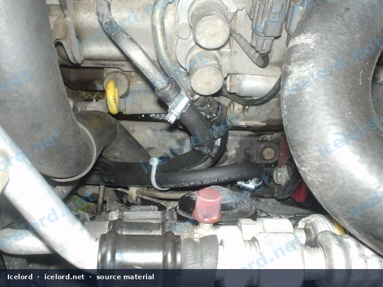
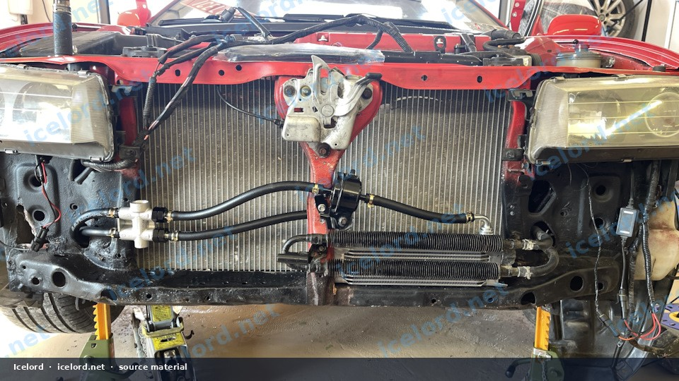
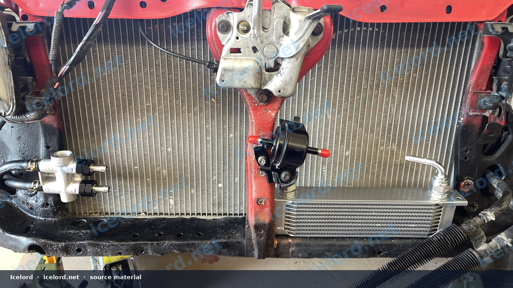

# Honda Prelude External Automatic Transmission Cooler Installation

Upgrading the automatic transmission cooling system on a Honda Prelude, particularly models with the BB chassis, can significantly enhance transmission longevity and performance. The factory cooling setup, often integrated as a simple tube within the engine's main radiator, provides minimal heat dissipation, especially under demanding conditions. An external cooler offers superior thermal management, helping to maintain optimal fluid temperatures.

```carousel

<!-- slide -->

<!-- slide -->

<!-- slide -->

<!-- slide -->

<!-- slide -->


```

## Why Upgrade Your Transmission Cooling?

The original equipment manufacturer (OEM) automatic transmission cooler in many Honda Prelude models is a basic heat exchanger located within the engine's primary radiator. While adequate for light duty, this design can lead to elevated transmission fluid temperatures during spirited driving, heavy traffic, or in warmer climates. Excessive heat is a primary cause of automatic transmission wear and failure.

Installing a dedicated external transmission cooler provides several benefits:

*   **Improved Thermal Regulation:** Dissipates heat more effectively than the OEM setup.
*   **Extended Transmission Life:** Cooler fluid reduces wear on internal components and prolongs fluid lifespan.
*   **Consistent Performance:** Helps maintain stable shift quality and prevents performance degradation due to overheating.

## Required Components

Before beginning the installation, gather all necessary components. Specific brands and sizes may vary, so confirm compatibility with your vehicle.

*   **External Automatic Transmission Cooler:** A multi-row cooler (e.g., 10-row design) is recommended for effective heat exchange.
*   **Automatic Transmission Fluid (ATF) Rated Hoses:** Ensure hoses are designed for ATF and high temperatures, such as those meeting SAE J1019R3 specifications.
*   **Hose Clamps or AN Fittings:** Depending on your chosen hose type and cooler connections.
*   **Optional: Thermostatic Bypass Valve:** A valve that directs fluid through the cooler only when it reaches a set temperature (e.g., 75 degrees Celsius, as some aftermarket units are designed). This prevents overcooling in colder conditions.
*   **Optional: Inline ATF Filter:** An additional filter can provide extra protection against contaminants.
*   **Mounting Hardware:** Brackets, bolts, and nuts suitable for securing the cooler and other components.
*   **Additional Automatic Transmission Fluid:** Account for the increased system capacity.

## Installation Procedure

### Safety Precautions

> [!WARNING]
> Always ensure the vehicle is securely supported on jack stands on a level surface before working underneath. Wear appropriate personal protective equipment, including eye protection and gloves. Transmission fluid can be hot and cause burns.

### Component Placement and Mounting

1.  **Vehicle Preparation:** Park the vehicle on a level surface, engage the parking brake, and disconnect the negative battery terminal.
2.  **Locate Mounting Area:** Identify a suitable location for the external cooler, typically in front of the main engine radiator or air conditioning condenser. Ensure adequate airflow and clearance from other components.
3.  **Mount the Cooler:** Secure the external cooler using appropriate brackets and hardware. Ensure it is firmly attached and will not vibrate or interfere with other parts.
4.  **Optional Component Placement:** If using a thermostatic bypass valve or inline filter, determine their optimal placement in the fluid path, ensuring accessibility for future maintenance.

### Plumbing the System

> [!IMPORTANT]
> Pay close attention to the flow direction of the transmission fluid. Most coolers and thermostatic valves will have designated **INLET** and **OUTLET** ports.

1.  **Bypass OEM Cooler:** Locate the transmission fluid lines connected to the bottom of the engine's main radiator. Disconnect these lines. The OEM cooler within the radiator should be bypassed to prevent fluid restriction and ensure the external cooler is the primary cooling source.
2.  **Route Hoses:** Carefully plan and route the new ATF hoses from the transmission to the external cooling components. Avoid sharp bends, kinks, and contact with hot exhaust components or moving parts (e.g., belts, pulleys).
3.  **Connect Components:**
    *   Connect the transmission's output line to the **INLET** of the thermostatic bypass valve (if used).
    *   Connect the **OUTLET** of the thermostatic valve to the **INLET** of the inline ATF filter (if used).
    *   Connect the **OUTLET** of the filter to the **INLET** of the external transmission cooler.
    *   Connect the **OUTLET** of the external cooler back to the transmission's return line.
4.  **Secure Connections:** Use appropriate hose clamps or tighten AN fittings to ensure all connections are secure and leak-free.

> [!CAUTION]
> Improperly secured connections can lead to catastrophic fluid loss and transmission damage. Double-check every connection point.

### Fluid Management and Verification

1.  **Refill ATF:** Add new, specified automatic transmission fluid to the transmission through the dipstick tube. Account for the additional capacity of the new cooler, hoses, filter, and thermostatic valve. Start with a conservative amount and add as needed.
2.  **Initial Start-up and Leak Check:** Reconnect the negative battery terminal. Start the engine and let it idle. Immediately check all new connections for any signs of leaks. Address any leaks before proceeding.
3.  **Check Fluid Level:** With the engine running and warm (after cycling through all gear selections), check the ATF level according to the factory service manual procedure. This typically involves checking the dipstick while the engine is running and in Park or Neutral.
4.  **Test Drive:** Perform a short test drive, paying attention to transmission operation and any unusual noises or smells. After the drive, re-check all connections for leaks and verify the ATF level again.

## Post-Installation Considerations

*   **Regular Inspection:** Periodically inspect the new hoses, connections, and mounting points for wear, leaks, or damage.
*   **Filter Maintenance:** If an inline ATF filter was installed, consider its replacement interval, which may be shorter than the transmission's main filter.
*   **Temperature Monitoring:** If possible, use a diagnostic tool to monitor transmission fluid temperatures to confirm the effectiveness of the new cooling system.

> [!TIP]
> The use of a thermostatic bypass valve set to approximately 75 degrees Celsius (167 degrees Fahrenheit) is a common modification to ensure the transmission fluid reaches optimal operating temperature quickly while preventing overcooling in colder environments.
