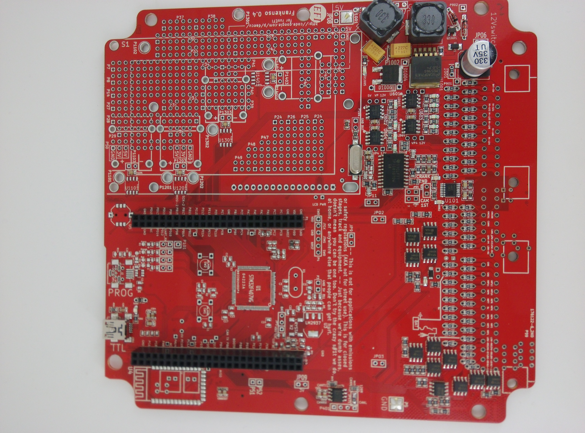
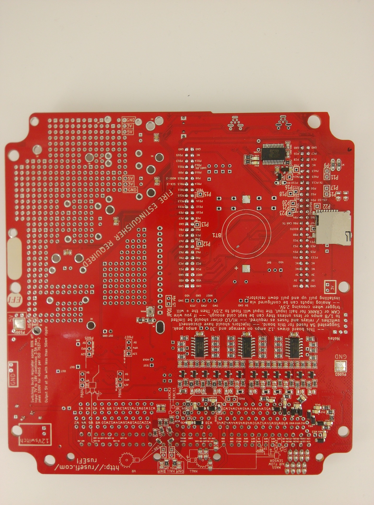
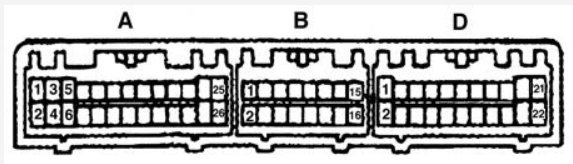
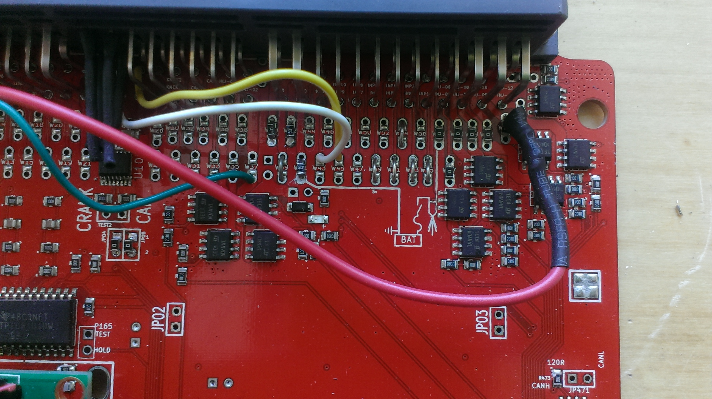

# 1991 Honda CRX B16A Swap Standalone Tuning & Troubleshooting

## Overview

Swapping a first-generation B16A VTEC engine into a 1988–1991 EF chassis Honda CRX requires converting the factory chassis wiring to support electronic fuel injection and standalone engine management. This build guide synthesizes real-world tuning and diagnostic data from extensive EF B16A project tests.

---

## 1. Engine & Chassis Specifications

- **Chassis:** 1991 Honda CRX (EF chassis)
- **Engine:** JDM B16A 1.6L DOHC VTEC (10.4:1 Compression)
- **Fuel System:** 240cc stock injectors, 3-bar fuel pressure regulator, Walbro 255 LPH pump
- **Management:** rusEFI / Standalone ECU via OBD0-to-OBD1 conversion harness

---

## 2. Key Tuning Milestones & Calibration

### Base Map & Fuel Table

- **Fuel Strategy:** Speed-Density (MAP vs RPM).
- **Idle Target:** 850 RPM at 14.7 AFR.
- **WOT Target:** 12.8–13.0 AFR in low-cam, transitioning to 12.5 AFR post-VTEC crossover.

### VTEC Crossover Calibration

- **Crossover Point:** Set to 5,200 RPM under load (&gt;60 kPa manifold pressure).
- Smooth torque transition verified by aligning low-cam and high-cam volumetric efficiency curves.

---

## 3. EF Chassis Electrical Troubleshooting

### Tachometer Signal Driver

EF CRX factory gauge cluster tachometers require a high-voltage pulse originally produced by the distributor coil. Modern standalone ECUs output a 0-12V square wave that fails to drive the cluster.

> \[!TIP\] Wire a simple 1k-ohm pull-up resistor or tachometer adapter module between +12V switched power and the Blue cluster tachometer wire to restore cluster tachometer sweep.

---

## 4. Standalone ECU Board & Harness Photos

```carousel

*Assembled standalone ECU board front view for EF B16A swap.*
<!-- slide -->

*Assembled standalone ECU board rear view showing solder points.*
```

### Harness Pinout Diagram

*EF chassis B16A swap ECU harness pinout and trigger input wiring.*

---

## 4. Standalone ECU Board & Harness Photos

```carousel

*Assembled standalone ECU board front view for EF B16A swap.*
<!-- slide -->

*Assembled standalone ECU board rear view showing solder points.*
<!-- slide -->

*Early prototype Frankenso 0.2 board layout comparison.*
```

### Harness Pinout Diagram

*EF chassis B16A swap ECU harness pinout and trigger input wiring.*
