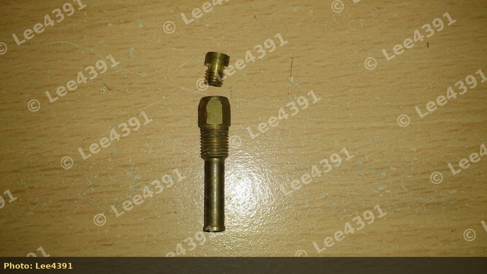
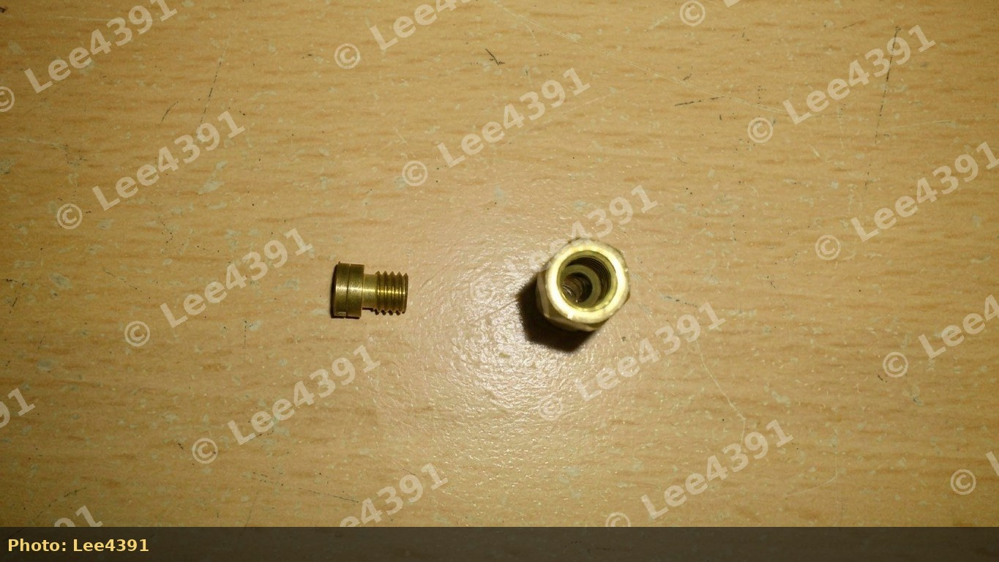
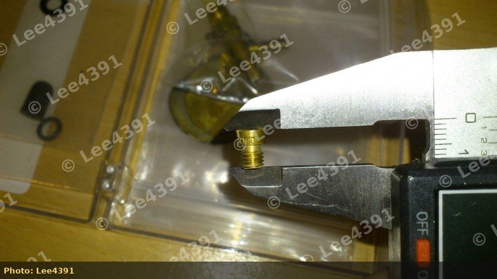

# Street Tuning Dual-Carburetor Honda D-Series Engines

This guide covers practical, still-carbureted street tuning for Honda dual-carb (twin Keihin CV) D-series engines, especially the **D14A1** 1.4 used in fourth-generation Civic GL and related CRX / Concerto applications. The same principles apply to dual-carb **D15** and **D16** variants.

> \[!IMPORTANT\] Across roughly ten dual-carb cars logged in community testing, stock setups commonly ran about **11:1 AFR at WOT** and **12:1 cruising** — far richer than needed. That hurts economy and masks real power. Use a **wideband** (or CO meter at idle) before chasing hard parts.

## Prerequisites

Work only on a healthy engine:

- Fresh service: plugs, oil, filters, valve clearances in specification (community claims a neglected service can leave **double-digit horsepower** on the table versus a well-serviced stock dual-carb car)
- Carburetors cleaned or rebuilt; no vacuum leaks; choke working
- Ignition timing at the service-manual baseline before you advance it
- No exhaust leaks that corrupt AFR readings

**CRX dual-carb note:** some 1.5 dual-carb CRX cars use a bulkhead **vacuum control box** tied into an ECU-style control path. Do not randomly unplug vacuum lines on those cars without understanding the circuit.

## Air / fuel targets

| Condition | Typical target | Notes |
| --- | --- | --- |
| Stoichiometric (cruise compromise) | \~14.7:1 | Economy baseline |
| Safe NA peak power (street) | \~12.8–13.8:1 | Avoid “dark side” lean WOT on a road car |
| Common stock dual-carb WOT | \~11:1 | Excessively rich |
| Boosted (if ever supercharged/turbo on carbs) | \~12:1 | Separate project; listed only as reference |

**Cold air is denser** and supports more power for a given throttle opening. Carbs will run on hot bay air, but colder air is better. Removing the exhaust-heat feed into the airbox after warm-up is a common first step.

## Stage 1 — free and low-cost mods

### Stock airbox improvements (preferred street path)

Many stronger street dual-carb D-series cars stay on a **drilled stock box + panel filter**, not open stacks.

1. Remove the airbox lid (**four clips** + centre **wing nut** toward the bulkhead on typical layouts).
2. Unhook vacuum lines and the **exhaust heat transfer pipe** that feeds warm air into the box.
3. Remove the airbox base (**3–4 × 10 mm nuts**).
4. Delete the heat pipe path and the **restrictive internal flap**.
5. Fit a high-flow **panel filter** (K&N-style or equivalent; one commonly cited dual-carb panel is in the K&N E-series range — confirm fitment for your box).
6. Optionally **drill extra inlet holes** in the box once flap/heat are sorted.

> \[!WARNING\] A cone filter only on the end of the factory snorkel is widely considered **pointless or restrictive**. Fix the box internals first.

**Cold start:** these airbox mods do not change the choke circuit; winter starting behaviour stays the same if the choke is healthy.

### Full exhaust and header

- Free-flow system helps a dual-carb D14 more than open filters alone.
- **4-2-1** headers for street low/mid torque and clearance; **4-1** for higher rpm (often hangs lower).
- See the published companion article: [D14 Dual-Carb Exhaust Manifold Selection](/cars/tuning/d14-dual-carb-exhaust-manifold).

### Ignition timing

After breathing and mixture are sensible:

1. Loosen the distributor clamp (often **10–12 mm** bolts — use what fits your dizzy).
2. Advance carefully (commonly rotating the body toward the firewall / anti-clockwise from the driver’s side — **confirm on your chassis**).
3. Road-test; **retard immediately** if detonation (ping/knock) appears.
4. Higher-octane fuel increases safe advance margin.

Example community baseline: a **stock dual-carb GL** on a dyno day made about **97 bhp** with only careful timing advance — before deeper head/intake work.

### Idle speed

Reset tick-over with the throttle-stop / idle screw on the carb linkage after any mixture or spring work. See the companion draft on mixture and balance.

## Stage 2 — carburetor internal work

### Accessing the slides

1. Undo the **two screws** on each carb top.
2. Lift carefully — a spring under the top will push upward.
3. Note orientation of the **black slide restrictor cap**, needle, and spring.

### Slide springs

Common modification: cut about **four coils**, stretch back to **stock free length**, reinstall **cut end down**.

**Intent:** less resistance so the vacuum piston rises sooner → sharper response.

**Counter-evidence (measure, do not assume):**

- Owner force testing: a stock spring needed about **13.7 N·m** to a set height; the same spring cut and stretched needed about **19.4 N·m** to the same height — i.e. **stiffer at full compression**, which can lean WOT if fuel is not increased.
- Some cars run poorly **below \~3,000 rpm** after a spring cut, then pull hard above — often mixture/transition, not “free power.”
- One approach for open stacks that go rich at WOT is a **stiffer** spring (or stacked springs) so the slide does not jump fully open too early — opposite of the cut-and-stretch folklore.
- Straight advice from “fasten up a 1400 dual carb” threads: **do not cut the springs** as a first move; use panel filter, drilled box, full exhaust, and a service.

> \[!WARNING\] Treat spring cutting as optional and **AFR-verified**. Real power still needs jets, needles, cam, and timing — not springs alone.

### Slide restrictor cap

Leave the **black restrictor** in place for mild street work. Removing it lets the needle lift higher at WOT and often dumps excess fuel (economy loss, long-term bore wash risk). Only revisit with full exhaust, open filters, and wideband jetting.

### Idle mixture screws

Mild-tune starting point from dual-carb road logging: seat lightly, then open about **1 turn** (not the older “3 turns out,” which many found too rich low down). Finalise with CO or wideband.

On D14A1 dual carbs, screws often sit under **white plastic blanking plugs** on each body. Adjust **both sides equally**.

### Needles

- D15 CRX dual-carb main needles often use a **more aggressive taper** than many 1.4 GL needles — a common mild swap onto a D14.
- **D15B needles** are also used with stacks to add fuel at certain throttle openings.
- Always verify cruise and WOT AFR after a needle change.

### Jets (main vs slow)

| Item | Location / notes | Community sizes |
| --- | --- | --- |
| **Main jet** | Screws into the **emulsion tube** (\~1 in long) in the bowl; under the needle circuit | Often marked **180** (\~1.80 mm) on some dual-carb sets |
| **Slow / pilot jet** | Separate small jet (do not confuse with mains when shopping) | Varies — measure what you have |
| **D15B example** | Mains pulled from some D15B dual carbs reported as **160** | Different calibrations exist — never assume |

Parts diagrams commonly label main jet, emulsion tube, and slow jet as distinct items (e.g. positions 26 / 18 / 27 on some Honda dual-carb breakdowns — verify against your carb family).

*Main jet screwed into emulsion tube (Lee4391).*

*Jet and emulsion tube body separated (Lee4391).*

*Example main jet marked 180 (\~1.80 mm) (Lee4391).*

## Stage 3 — intake philosophy (still carbed)

| Approach | Pros | Cons |
| --- | --- | --- |
| Drilled stock airbox + panel filter | Filtration, easier cold air, used on many strong street cars | Less induction noise |
| Velocity stacks + foam / ram socks | Sound; can help if jetted; stack **length** moves the torque band | Heat soak, dirt, often lean without fuel work |
| Cone on snorkel only | Easy | Little or no benefit |

**Dyno-backed illustration (built dual-carb D15 CRX, controlled fan, 7600 rpm limit — not a stock D14):**

| Intake on that build | Peak (approx.) |
| --- | --- |
| Modified stock airbox + panel | \~129 bhp / \~123 lb·ft |
| Bike-style filters on the carbs | \~137 bhp / \~126 lb·ft |
| Large oval foam filter | \~138 bhp / \~127 lb·ft |

On that car, open filters won peak power with a bonnet-up cold fan; a stock-box-style path held **more low-down torque** but less peak. A stock dual-carb GL on the same day made \~**97 bhp** with timing work only. **Do not expect stock D14A1 numbers in that 130+ range** without head, manifold, and fuel work — the table shows *relative* intake behaviour on a sorted dual-carb engine.

**Venturi vs harmonics:** short stacks help low-speed air speed; at higher rpm, runner length and wave tuning matter more than “more hole.”

## Stage 4 — further NA power (still carbed)

Only after Stages 1–3 and solid AFR logs:

- Mild **cam** (OEM dual-carb swaps, regrinds; Bisimoto-type grinds are often suggested when chasing high-rpm pull — match springs and fueling). See companion draft `cars/tuning/dual-carb-d14-d15-camshaft-upgrades`.
- Head skim / port match / manifold port match (as on the high-power dual-carb CRX example)
- Proper main-jet and needle kit with wideband
- Optional bike carbs or dual-carb VTEC mini-me — separate fabrication projects

## Recommended build order (still carbureted)

1. Service + carb rebuild/balance
2. Airbox flap + heat delete + panel filter (skip spring cuts for now)
3. Exhaust + 4-2-1 header
4. Idle mixture, balance, careful timing advance
5. Wideband log (idle / cruise / WOT)
6. Only then: springs, needles, jets, or open stacks
7. Cam / head work if still hungry

## What not to expect

- A stock D14A1 will not become a race engine on free filters alone; think **response, midrange, economy, and clean AFR**.
- Open stacks without fuel work frequently **lose** dyno power (example dual-carb 1.4: \~75 bhp lean, \~86 bhp when enrichment was added).
- Head swaps (D16Z6 still on carbs) and bike-carb conversions are not Stage 1.

## Safety

> \[!CAUTION\] Lean WOT under load can destroy pistons. Detonation from over-advanced timing does the same. Road cars should not be tuned on the “lean for max power” edge without rebuild budget.
