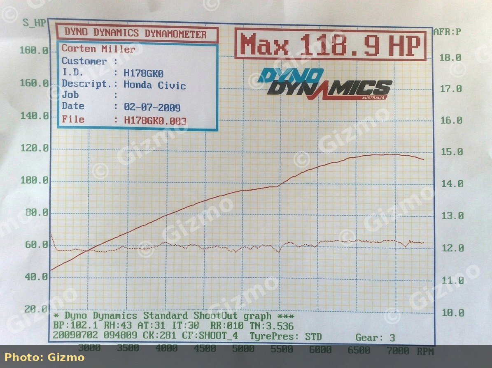

# Camshaft Upgrades for Dual-Carb Honda D14A1 and D15 Engines

Cam work is the usual **next step** after airbox, exhaust/header, mixture, and balance on a dual Keihin D-series that will **stay carbureted**. A freer cam only helps if the engine can fill the cylinders and the carbs still supply the fuel - otherwise the car just goes lean or peaky.

> [!IMPORTANT]
> Fit breathing and fueling first (service, airbox or properly jetted stacks, free-flow exhaust, mixture/balance, wideband). A cam on a dirty dual-carb D14 is an expensive way to learn that lesson.

## Why cam the dual-carb D14 / D15?

| Goal | Realistic outcome on dual carbs |
| --- | --- |
| Mild street response | OEM **D15** dual-carb cam in a **D14** is the common junkyard step |
| Stronger mid/high rpm | Aftermarket **regrind** (Bisimoto-type profiles are repeatedly cited on dual-carb GLs) |
| High-rpm pull toward 7-8k | Aggressive regrind + springs, careful timing, and jetting - not a first mod |
| Maximum power | Head work, manifold match, fuel (jets/needles or conversion) usually matter more than the cam alone |

Stock dual-carb **D14A1** cars are economy-oriented. Community dual-carb street builds that advertise serious wheel figures almost always list a cam package with the rest of the bolt-ons. Documented dual-carb GL / D14 packages include roughly **116 bhp** (Bisimoto stage-1 style cam, stock airbox, ~1.75 in exhaust), **~122 whp**, and signature notes around **~127 whp @ ~6200 rpm** on fuller builds (not cam-only).

## OEM lobe sizes (community caliper measurements)

Forum non-VTEC SOHC lobe **base diameter and lift** notes (measure your own cam; treat as comparative, not factory print):

| Cam | Intake base (lift) | Exhaust base (lift) | Notes |
| --- | --- | --- | --- |
| **D14** | 36.50 mm (4.5 mm lift) | 36.30 mm (4.3 mm lift) | Stock dual-carb GL |
| **D15B** | 37.00 mm (5.0 mm lift) | 36.80 mm (4.8 mm lift) | Common mild upgrade into D14 |
| **D16Z1** | 37.50 mm (5.5 mm lift) | 37.00 mm (5.0 mm lift) | Often pulled from Concerto; less often fitted than D15B |

That is why a **D15B** cam is the usual first step: a real but modest lift increase without a full regrind.

## Option 1: OEM D15 dual-carb cam in a D14 (mild)

### What people report

- A **D15B** cam is a straightforward lift bump over stock D14 (see table above).
- The **rocker assembly is the same family** as the D14 dual-carb head; some owners fit the complete rocker assembly with the cam.
- At least one dual-carb GL diary notes fitting a D15 cam by careful **timing-belt** work without a full strip.
- **D15B / D15A1** cams show up in EG Civics, Concertos, and related scrapyard SOHC non-VTEC heads.
- For dual-carb engines that still use a **mechanical fuel pump**, use a cam that retains the **fuel-pump lobe** - community consensus is **D15B non-VTEC** and **D16Z1** are the usual safe donors; many other SOHC cams omit that lobe.
- Idle and cold-start problems after a D15B swap are **not automatic**. Several dual-carb GLs report no idle/startup issues when clearances and timing are set; the biggest seat-of-pants change is often a **sharper exhaust note**, with power gains muted if the exhaust is still restrictive.
- Gains show up more after free-flow exhaust and mixture work - the cam alone on a stock cast manifold is easy to under-appreciate.

> [!TIP]
> “Even a D15 cam in a D14 helps” is a recurring community summary when discussing still-carbureted bottom ends, including when comparing mini-me / head options.

### Checklist

1. Confirm cam and rockers are for the correct **SOHC dual-carb** head family (do not mix random VTEC rockers without a full plan).
2. Set **valve clearances** cold after install (FSM procedure and values for the head you have).
3. Align **timing belt** marks carefully; dual-carb SOHC is less forgiving of a tooth out than it feels.
4. Re-set base **ignition timing**, then mixture/balance. More cam usually wants more fuel at higher rpm.
5. Road-test for valve noise, ping, and flat spots; log AFR if possible.

### When it is enough

Use the D15 OEM cam when you want a cheap, reversible step after exhaust and airbox, without paying for a regrind. Expect **response and midrange**, not a night-and-day top-end on a stock D14 bottom end.

## Option 2: OEM D16Z1 cam (next step after D15B)

- **D16Z1** lobes measure larger again than D15B (table above).
- Often found in **Concerto** engines in UK scrapyards.
- Fewer dual-carb GLs actually run one than talk about it; owners who do usually keep dual carbs and add breathing + exhaust.
- An **adjustable cam pulley** is sometimes discussed when swapping across D-series SOHC cams so you can re-time after the change.

## Option 3: Aftermarket regrind (e.g. Bisimoto / Newman-type)

### What the dual-carb community uses them for

- **Bisimoto** and UK regrind shops (e.g. **Newman** quoted around **£200** on a stock D14 blank in one thread) are the usual answer when someone wants a dual-carb D14 that **pulls harder high in the rev range** (including “toward 8k” wish-list posts).
- Some Bisimoto stage-1 profiles are described as **relatively mild**; still enough, with a free exhaust and sorted airbox, to land around **115+ bhp** on a dual-carb GL in community reports.
- One dual-carb D14 Bisimoto diary discusses power moving **up the rev range**, with peak torque around **~5300 rpm** on that package (trade some low-end plumpness for higher-rpm work).
- Owners often send a **D15B** core to the regrinder rather than a worn D14 blank.
- Builds that publish **~122 whp** or **~127 whp @ ~6200** with dual carbs + Bisimoto also run the rest of the package (exhaust, induction, tune). Do not expect stock carbs and a cam alone to match those figures.

### Supporting work after a regrind

| System | Why |
| --- | --- |
| Valve springs / retainers | Aggressive lobes need stable control at the new rpm |
| Carb jets / needles | Higher airflow at peak rpm leans stock mains |
| Exhaust (often 4-2-1 or free 1.75 in system) | Cam without exit flow wastes the grind |
| Ignition advance | Re-optimise; listen for detonation |
| Wideband | Mandatory for street reliability |

> [!WARNING]
> Asking a dual-carb D14 to live at high rpm with stock springs, stock jets, and a hot grind is how you get valve float, lean holes, or melted pistons. Stage the supporting mods.

## Option 4: Other paths (context)

| Path | Dual-carb street notes |
| --- | --- |
| Stay stock D14 | Fine for reliability; combine with airbox/exhaust/tune first |
| D15B SOHC non-VTEC | Preferred mild OEM upgrade into D14 |
| D16Z1 SOHC non-VTEC | Next OEM step; Concerto is a common donor |
| Random FI SOHC cams | May share journals but lobe design and idle vacuum can fight CV carbs; verify case-by-case |
| VTEC head / mini-me | Not a drop-in dual-carb power mod; separate project |

*Dual-carb **VTEC mini-me** package dyno near **119 hp** - cam/head work class, not a mild OEM cam alone (Gizmo).*

Always measure a used cam (base diameter and lift) and confirm against the grind card or FSM rather than trusting casting marks alone.

## What a cam will not fix

- Dirty or unbalanced dual carbs
- Heat-soaked open stacks with no jetting
- Stock cast manifold into a crushed exhaust
- Detonation from too much advance on low octane
- Expectation of B-series power from 1.4 dual carbs

Community dual-carb tuning guides put **cams in the same “real power” list as jets, needles, and timing**: after the free breathing work.

## Suggested order (still carbureted)

1. Service + carb rebuild, mixture, balance
2. Airbox flap/heat delete + panel filter (or stacks **with** fuel work)
3. Free-flow exhaust + 4-2-1 header
4. Mild timing advance under load
5. **D15 OEM cam** *or* mild regrind
6. Re-jet / needle as AFR demands
7. Only then: more aggressive grind, head work, or dual-carb VTEC mini-me

## Related articles

- [Street Tuning Dual-Carburetor Honda D-Series Engines](/cars/tuning/dual-carb-d-series-street-tuning)
- [Setting Idle Mixture and Balancing Dual Carbs on a D14A1](/cars/fueling/d14a1-dual-carb-mixture-balance)
- [Dual-Carb Intake Options: Stock Airbox versus Velocity Stacks](/cars/fueling/dual-carb-intake-airbox-vs-stacks)
- [D14 Dual-Carb Exhaust Manifold Selection](/cars/tuning/d14-dual-carb-exhaust-manifold)

## Safety and reliability

> [!CAUTION]
> Always confirm TDC and belt marks. A jumped belt or wrong cam gear index can bend valves on interference D-series engines.

> [!NOTE]
> Verify any grind card and clearances against the cam supplier and the Honda factory service manual before assembly.
