# H23 Block and H22 VTEC Cylinder Head Hybrid Conversion

This conversion pairs an **H23** non-VTEC block with an **H22** VTEC cylinder head and matching valvetrain parts. The goal is VTEC operation on a longer-stroke bottom end. It is a full top-end and oiling-path job - not a gasket swap.

```carousel
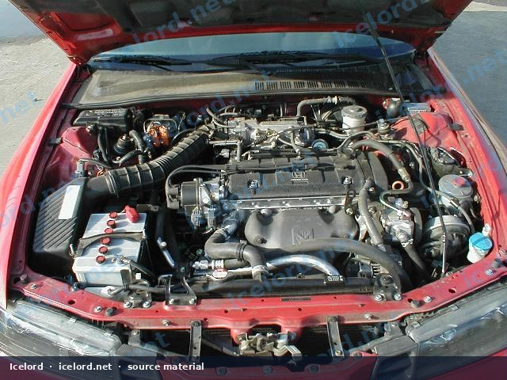
<!-- slide -->
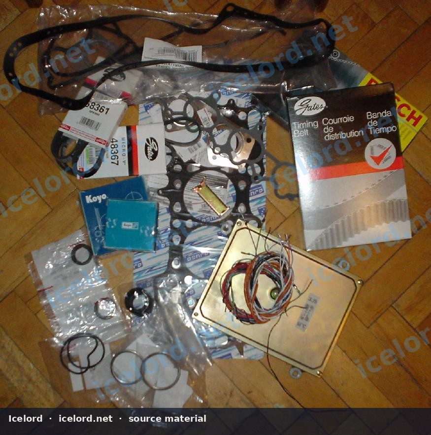
<!-- slide -->
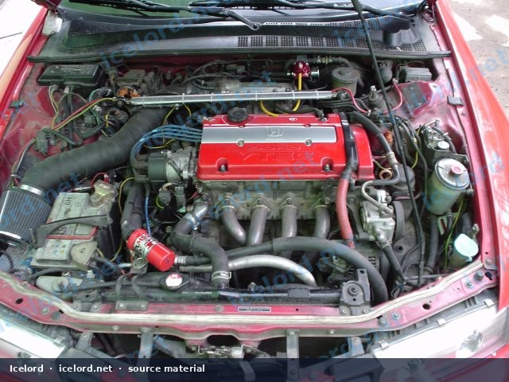
<!-- slide -->
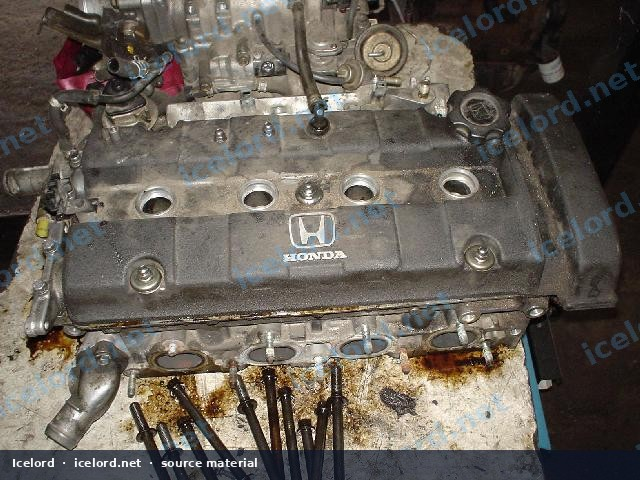
<!-- slide -->
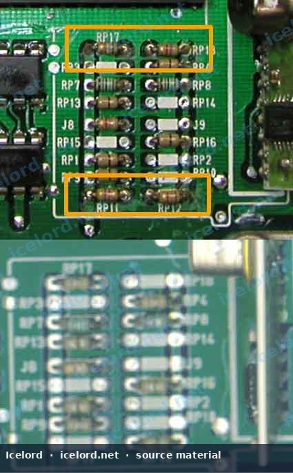
<!-- slide -->
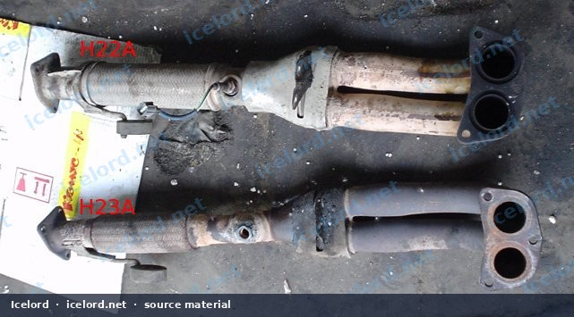
<!-- slide -->
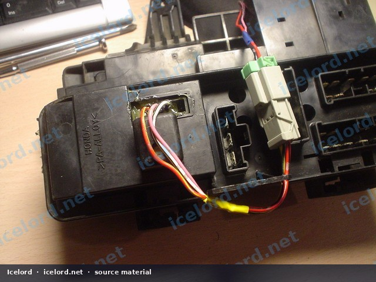
<!-- slide -->
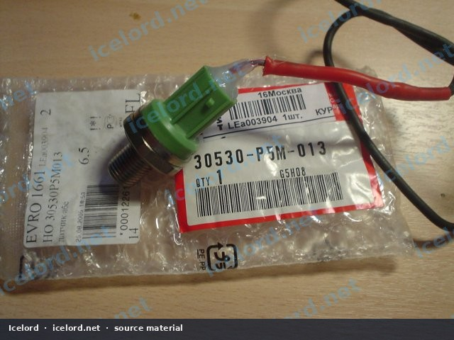

```

```carousel
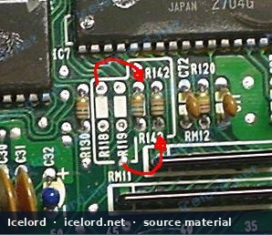
<!-- slide -->
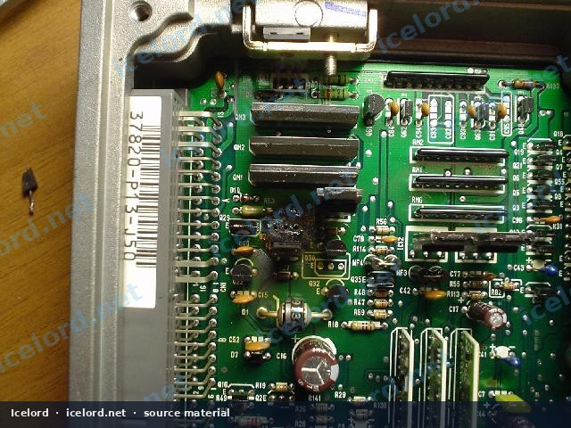
<!-- slide -->
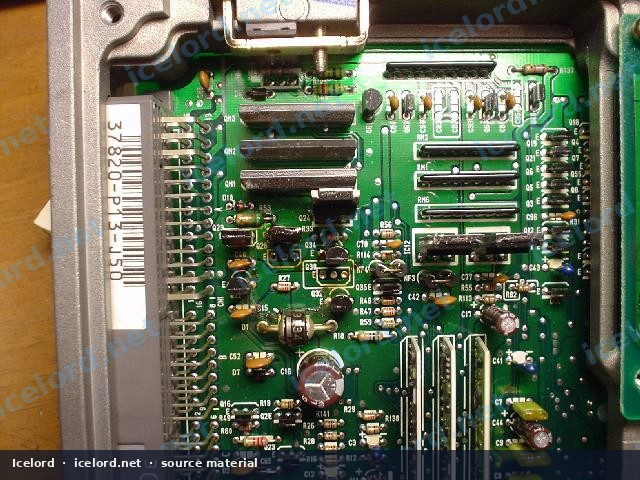

```

## Goal and Applicability

- Donor block: H23A family non-VTEC
- Donor head: H22A VTEC complete with cams, followers, and cover
- Typical host chassis: Prelude BB and other H-series engine bays
- Requires VTEC-capable ECU calibration and oil plumbing

## Critical Oiling Change

Between cylinders 2 and 3 on the block, H23 engines use an **oil control orifice** that limits flow for non-VTEC heads. For VTEC:

1. Locate the orifice assembly in the oil passage (firewall side of the valley area as equipped).
2. Extract it (often with a temporary M6 puller bolt threaded into the orifice).
3. If left in place, VTEC often will not engage reliably.

> [!IMPORTANT]
> Verify the exact orifice location and service method against the FSM and your block casting. Do not enlarge random oil holes.

## Parts (typical)

**From H22 donor / new:**

- Complete VTEC head, cams, sprockets, timing covers as needed
- Intake manifold **with injectors** matched to the ECU strategy
- Exhaust manifold/header compatible with the head
- Water pump, pump-to-thermostat tube
- Timing belt, balancer belt (if used), tensioner, idlers
- Head gasket, valve cover gasket, intake/exhaust gaskets, cam seals
- Auto tensioner stopper tool/procedure as required

**From H23 / vehicle:**

- Distributor (often retained and timed after assembly - confirm compatibility)
- Accessory brackets (power-steering bracket modifications are common)

**Control:**

- ECU such as **37820-P13-J00 / N00 / J50** (verify against market and immobilizer)
- Harness pins/wires for VTEC solenoid and VTEC pressure switch
- Knock sensor installation if required by the head/ECU combination

## Procedure Outline

1. Disconnect battery; drain coolant and oil.
2. Remove intake/exhaust, accessories, and the H23 head per FSM.
3. Remove water pump and lower timing sprocket as needed for access.
4. Remove the oil control orifice.
5. Install knock sensor if applicable.
6. Service the oil pan if rear main / mount access is required.
7. Fit new head gasket; install H22 head; torque head bolts to FSM sequence.
8. Install H22 water pump and thermostat tube.
9. Install H22 inner timing cover; reassemble cams per FSM.
10. Install timing belt using **H22** sprockets/covers for anything the belt touches.
11. Reassemble manifolds, accessories, and grounds.
12. Wire VTEC solenoid and pressure switch; confirm ECU compatibility.
13. Refill fluids; set base timing; verify VTEC engagement with oil pressure and logging if available.

## Validation

- [ ] No oil or coolant leaks
- [ ] Stable oil pressure hot and cold
- [ ] VTEC engages at expected conditions
- [ ] No knock under load after tuning
- [ ] Cooling system bled

## Reliability Notes

Budget 15–30 hours depending on rust, mounts, and wiring. Replace timing components as a set. A hybrid changes volumetric efficiency - fuel and ignition maps must match the build.
