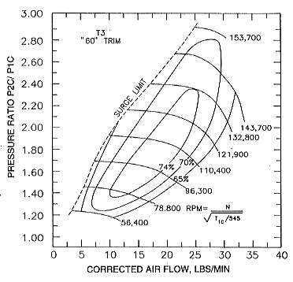

# Turbo Compressor Map

A turbocharger compressor map illustrates the operational characteristics of a compressor housing and wheel combination. Reading a compressor map allows you to determine efficiency, airflow limits, and pressure limits to correctly match a turbocharger to your specific Honda engine setup and power goals.

*Example Garrett T3 Super 60 Compressor Map*

## Key Parameters of a Compressor Map

### 1. Pressure Ratio (Y-Axis)

The vertical axis (Y-axis) represents the compressor **Pressure Ratio (PR)**. This is the ratio of absolute discharge pressure to absolute inlet pressure:

$$\text{Pressure Ratio} = \frac{\text{Target Boost (PSI)} + \text{Atmospheric Pressure (14.7 PSI)}}{14.7\text{ PSI}}$$

**Example Calculation (15 PSI Target Boost):**
1. Add atmospheric pressure: $15\text{ PSI} + 14.7\text{ PSI} = 29.7\text{ PSI absolute}$
2. Divide by ambient pressure: $29.7 / 14.7 = 2.02$

A target boost of 15 PSI corresponds to a Pressure Ratio of **2.02** on the Y-axis.

### 2. Airflow (X-Axis)

The horizontal axis (X-axis) represents mass airflow through the compressor, typically measured in **pounds per minute (lb/min)** or **cubic feet per minute (CFM)**.

- **Power Estimation:** As a general rule, **1 lb/min of air mass flow $\approx$ 10 flywheel horsepower (hp)**. Always account for drivetrain losses when estimating wheel horsepower.
- **CFM to lb/min Conversion:** Multiply CFM by 0.075 to convert to lb/min:
  $$\text{lb/min} = \text{CFM} \times 0.075$$
- **Distinguishing Graphs:** CFM maps feature numbers in the hundreds on the X-axis (e.g., 400 CFM), whereas lb/min maps feature numbers in the tens (e.g., 30 lb/min).

### 3. Efficiency Islands

The concentric enclosed rings on the graph represent compressor adiabatic efficiency (e.g., 75%, 72%, 70%, 65%). The innermost ring is the **peak efficiency island**.

> [!TIP]
> Always target turbo sizing where your engine's primary operating RPM range and target boost level fall directly within the highest efficiency island (70%+).

### 4. Outer Efficiency Rings

As operating points move away from the center island into outer rings, compressor efficiency drops. Lower efficiency means more heat is transferred into the intake air charge for a given boost pressure, reducing oxygen density and increasing knock risk.

### 5. Surge Line (Surge Limit)

The steep left-hand boundary line of the map represents the **surge limit**.

> [!WARNING]
> Operating to the left of the surge line occurs when compressor output exceeds the engine's volumetric capacity at that boost level. Air flow breaks down dynamically over the compressor blades, causing violent pressure oscillations, compressor surge, severe bearing stress, and thermal spikes.

### 6. Choke Line (Overspin Choke)

The far right boundary line of the map represents **choke**.

Operating to the right of this limit means the compressor wheel is undersized for the target airflow. The air velocity through the compressor inlet reaches speed-of-sound limits, causing efficiency to collapse, outlet air temperatures to skyrocket, and power output to flatten regardless of increased RPM.

### 7. Compressor Speed Lines

The curved lines running horizontally across the map indicate shaft rotation speed in **RPM** (e.g., 100,000 to 150,000+ RPM). Higher compressor shaft speeds generate significantly higher discharge temperatures.

> [!NOTE]
> Higher charge temperatures reduce intake air density. Installing an efficient front-mount intercooler (FMIC) is essential to cool the compressed air charge before it reaches the throttle body.

## Additional Resources

For manufacturer compressor performance databases and technical data sheets:
- [BorgWarner Turbochargers](https://www.borgwarner.com)

