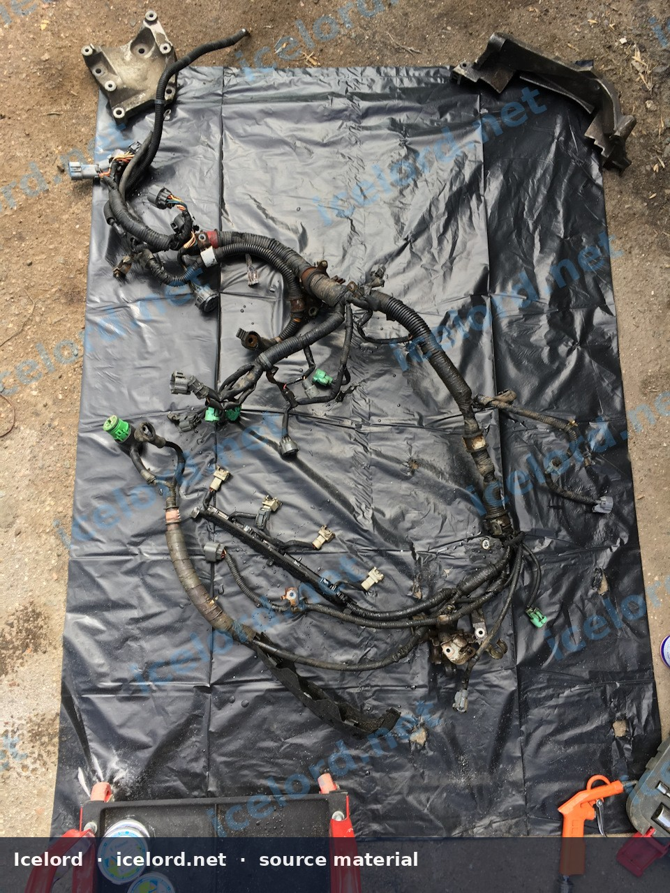
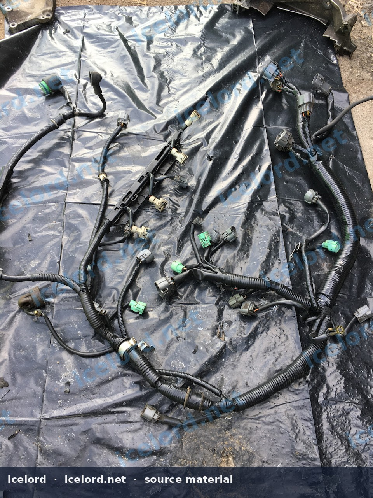

# Aged Honda Engine Harness Restoration

Over time, engine wiring harnesses in older Honda and Acura vehicles, particularly those subjected to wide temperature fluctuations and engine bay contaminants, can suffer significant degradation. The original electrical tape hardens, cracks, and becomes saturated with oil and grime, compromising the integrity of the wiring beneath. This article outlines a procedure for cleaning, inspecting, and rewrapping an aged engine harness to restore its protective qualities and ensure long-term electrical reliability.

```carousel

<!-- slide -->


```

## Why Restore Your Engine Harness?

Exposure to extreme temperatures (e.g., -30°C to 100°C), oil, and general engine bay contaminants causes the original PVC electrical tape to become brittle and lose its adhesive properties. This exposes the underlying wires to abrasion, moisture, and further chemical degradation, potentially leading to intermittent electrical issues, short circuits, or complete system failures. A thorough restoration improves both the aesthetic and functional integrity of the harness.

## Tools and Materials

Gather the following items before beginning the restoration process:

*   **Cleaning Agents:**
    *   White spirit (mineral spirits)
    *   Water
    *   Mild detergent or washing powder
*   **Cleaning Tools:**
    *   Stiff brushes (e.g., parts cleaning brush, toothbrush)
    *   Clean rags or microfiber cloths
    *   Gloves (chemical-resistant)
    *   Safety glasses
*   **Rewrapping Material:**
    *   High-quality PVC electrical tape (e.g., 19mm width x 20m length, black). Two rolls are typically sufficient for a full engine harness.
*   **Inspection Tools:**
    *   Bright light source
    *   Magnifying glass
    *   Multimeter (for continuity and resistance checks)
    *   Heat gun (optional, for heat shrink tubing)
*   **Repair Materials (as needed):**
    *   Wire strippers/crimpers
    *   Assorted automotive-grade wire (matching gauge and color)
    *   Heat shrink tubing
    *   Replacement terminals and connector housings

> [!CAUTION]
> Always work in a well-ventilated area when using solvents like white spirit. Wear appropriate personal protective equipment, including gloves and safety glasses, to prevent skin and eye irritation.

## Procedure

### Step 1: Harness Removal

1.  **Disconnect Battery:** Begin by disconnecting the negative battery terminal to prevent accidental electrical shorts.
2.  **Document Connections:** Carefully photograph and label all connectors and routing paths before disconnection. This aids in correct reinstallation.
3.  **Disconnect Components:** Disconnect the engine harness from all sensors, injectors, ignition components, and the Engine Control Unit (ECU).
4.  **Remove Harness:** Carefully unclip and remove the entire engine harness from the vehicle. Note any specific clips or mounting points.

### Step 2: Initial Cleaning

1.  **Remove Old Tape:** Carefully unwrap and remove all the old, hardened electrical tape from the harness. Take care not to damage the underlying wires.
2.  **Pre-soak (Optional):** For heavily soiled harnesses, a pre-soak in a solution of warm water and mild detergent can help loosen stubborn grime.
3.  **Solvent Cleaning:** Apply white spirit to a rag or brush and thoroughly clean the entire harness. Focus on areas with heavy oil and grease buildup. The white spirit will dissolve the oil and residue.
4.  **Detergent Wash:** After solvent cleaning, wash the harness with a solution of water and washing powder or mild detergent. Use brushes to scrub away any remaining dirt and solvent residue. Rinse thoroughly with clean water.
5.  **Drying:** Allow the harness to air dry completely. Ensure no moisture remains trapped within connectors or under any remaining insulation. A compressed air gun can assist in drying hard-to-reach areas.

### Step 3: Detailed Inspection and Repair

Once the harness is clean and dry, perform a meticulous inspection:

1.  **Wire Insulation:** Examine every wire for cracks, abrasions, cuts, or signs of melting. Pay close attention to areas where the harness bends or passes through grommets.
2.  **Connector Housings:** Inspect plastic connector housings for cracks, broken tabs, or missing seals.
3.  **Terminals:** Check all metal terminals within the connectors for corrosion, bending, or looseness. Corroded terminals can lead to high resistance and poor electrical contact.
4.  **Splices and Junctions:** Look for any factory or aftermarket splices that appear compromised or poorly insulated.

> [!IMPORTANT]
> Any damaged wires, corroded terminals, or compromised connector housings must be repaired or replaced. Refer to the factory service manual for specific wire repair procedures, appropriate wire gauges, and terminal crimping techniques.

### Step 4: Rewrapping

Rewrapping is crucial for protecting the harness. Use high-quality PVC electrical tape designed for automotive applications.

1.  **Start Point:** Begin rewrapping from one end of the harness, typically starting from a main branch or connector.
2.  **Overlap:** Apply the tape with a consistent 50% overlap. This ensures full coverage and creates a durable, moisture-resistant seal.
3.  **Tension:** Maintain firm, consistent tension on the tape as you wrap. This helps the tape conform to the harness shape and prevents it from unraveling over time.
4.  **Branching:** When encountering harness branches, wrap the main trunk past the branch point, then wrap the branch, and finally continue wrapping the main trunk, ensuring a smooth transition and full coverage at the junction.
5.  **Connector Ends:** Wrap the tape up to the base of each connector housing, ensuring no bare wires are exposed.

> [!TIP]
> For a professional finish and added protection in high-abrasion areas, consider using corrugated loom tubing or fabric tape over the newly rewrapped sections, especially where the harness passes through tight spaces or near moving parts.

### Step 5: Final Checks and Reinstallation

1.  **Continuity Check:** Before reinstallation, use a multimeter to perform continuity checks on critical circuits to confirm all repairs were successful and no new breaks were introduced.
2.  **Visual Inspection:** Perform a final visual inspection of the entire rewrapped harness to ensure all areas are properly covered and secured.
3.  **Reinstallation:** Carefully reinstall the harness into the vehicle, following your documented routing. Ensure all clips and mounting points are utilized.
4.  **Reconnect Components:** Reconnect all sensors, injectors, and the ECU. Double-check every connection.
5.  **Reconnect Battery:** Reconnect the negative battery terminal.
6.  **Test System:** Start the vehicle and check for any diagnostic trouble codes (DTCs) or unusual behavior. Verify the functionality of all systems connected to the engine harness.

Restoring your engine harness is a time-consuming but rewarding process that significantly contributes to the reliability and longevity of your Honda or Acura vehicle.
